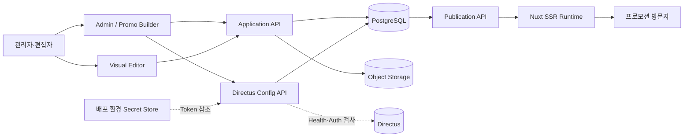
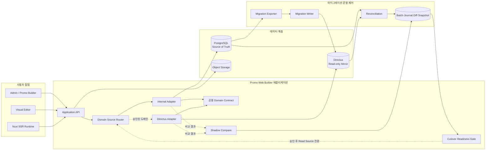
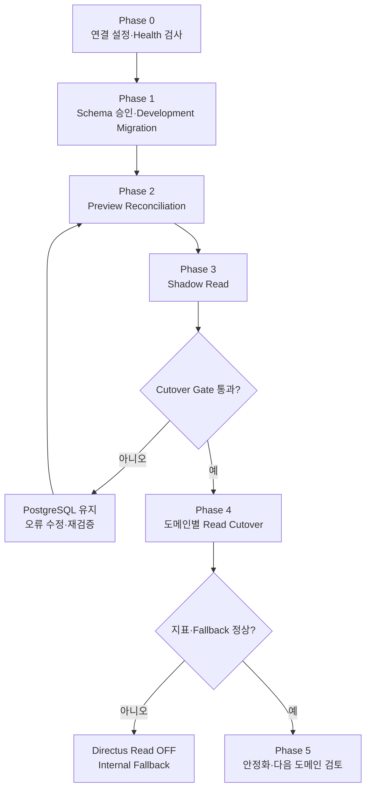
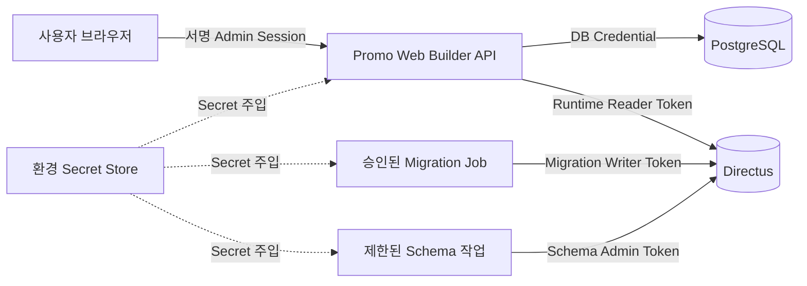

# Directus 연동 기본 구성도

```yaml
status: Review
owner: Promo Web Builder 개발팀
reviewers: [Backend, Directus, Infra, DevOps, Security, DBA, QA]
source_commit: d942d6b
baseline_date: 2026-10-12
target_environments: [development, preview, production]
execution_allowed: false
```

## 1. 목적과 범위

이 문서는 Promo Web Builder와 Directus의 기본 연결 구조, 데이터 소유권, 보안 경계 및 단계별 전환 방식을 한눈에 검토하기 위한 구성도다.

현재 PostgreSQL이 운영 Source of Truth이며 Directus는 Component와 Design Token의 Read-only Mirror 후보이다. 아래 목표 구성은 승인된 Schema, Migration, Reconciliation, Shadow Read 및 Cutover Gate를 통과하기 전에는 활성화하지 않는다.

## 2. 현재 운영 구성



현재 Directus 연결은 설정 저장과 Health·인증 검사까지만 수행한다. Directus 응답은 편집 화면이나 공개 Runtime의 콘텐츠 원본으로 사용하지 않는다.

## 3. 목표 연동 구성



핵심 경계는 다음과 같다.

- 애플리케이션은 Directus 고유 응답을 직접 사용하지 않고 공용 Domain Contract로 정규화한다.
- Shadow Read에서는 PostgreSQL 결과만 사용자에게 반환하고 Directus 결과는 비교에만 사용한다.
- Directus 장애 또는 Schema 불일치가 발생하면 Internal Adapter로 복귀한다.
- Migration Writer와 Runtime Reader Credential을 분리한다.
- Runtime Write는 별도 승인 전까지 비활성화한다.

## 4. 단계별 데이터 흐름



첫 번째 Cutover 후보는 `components`, 이후 `designTokens` 순서로 검토한다. Publication, Resource, Asset Binary, Builder Revision과 AI 실행 데이터는 1차 범위에서 제외한다.

## 5. 네트워크와 보안 경계



| 자격 증명 | 허용 범위 | 금지 사항 |
|---|---|---|
| Connection Reader | `/server/health`, `/users/me` 검사 | 콘텐츠 Write |
| Runtime Reader | 승인된 Collection Read | Schema 변경·Write |
| Migration Writer | 승인 Batch의 멱등 Upsert | Runtime API 사용 |
| Schema Admin | 승인된 Schema 적용 | 애플리케이션 상시 사용 |

Token 원문은 문서, 데이터베이스, API 응답 및 로그에 저장하지 않는다. 애플리케이션 설정에는 `env:DIRECTUS_SECRET_*` 형식의 Secret Reference만 저장한다.

## 6. 환경별 기본 상태

| 환경 | Config·연결 검사 | Migration | Shadow Read | Runtime Read | Runtime Write |
|---|---:|---:|---:|---:|---:|
| Development | 필요 시 ON | 승인 작업 시에만 ON | 검증 시 ON | Cutover 시험 시 ON | OFF |
| Preview | 승인 후 ON | Change Window에서만 ON | 대사 통과 후 ON | 최종 검증 시 ON | OFF |
| Production | 승인 후 ON | 기본 OFF | 별도 승인 | Gate 통과 도메인만 ON | OFF |

모든 환경에서 `DIRECTUS_MIGRATION_ENABLED`, `DIRECTUS_SHADOW_READ_ENABLED`, `DIRECTUS_RUNTIME_READ_ENABLED`, `DIRECTUS_RUNTIME_WRITE_ENABLED`의 기본값은 `false`다.

## 7. 구성요소 구현 상태

| 구성요소 | 현재 상태 | 다음 조치 |
|---|---|---|
| Integration Config·Connection Test | 구현 | 실제 환경 URL·Role로 검증 |
| Reference Schema Manifest | 구현 | Backend·DBA·Directus 승인 |
| Migration Plan·Reconciliation 기반 | 구현 | Exporter·Writer 및 실제 Snapshot 연결 |
| Domain Source Router | 기반 구현 | Internal·Directus Adapter 연결 |
| Cutover Readiness Gate | 구현 | Preview Evidence와 승인 기록 연결 |
| Directus Collection | 미생성 | 승인 Schema를 Development부터 적용 |
| Directus Domain Adapter | 미구현 | 공용 Domain Contract 기준 구현 |
| Runtime Read Cutover | 미실행 | Preview Shadow Read 통과 후 검토 |
| Runtime Write | 비활성 | 별도 정책 결정 전 개발하지 않음 |

## 8. 리뷰 시 확정할 항목

- Directus Development·Preview·Production 프로젝트와 네트워크 경로
- `components`, `designTokens`의 Owner와 Source of Truth
- Directus Collection·Field·Relation 최종 이름
- Connection Reader·Runtime Reader·Migration Writer·Schema Admin Role
- Secret 발급·Rotation·폐기 담당자
- Migration Window, Backup·Restore와 Rollback 담당자
- Shadow Diff, P95 Latency, 오류율 및 Fallback 합격 기준
- Cutover 승인자와 변경 관리 기록 위치

이 항목이 승인되기 전에는 실제 Schema 적용, 데이터 Write 또는 Runtime Source 전환을 수행하지 않는다.
