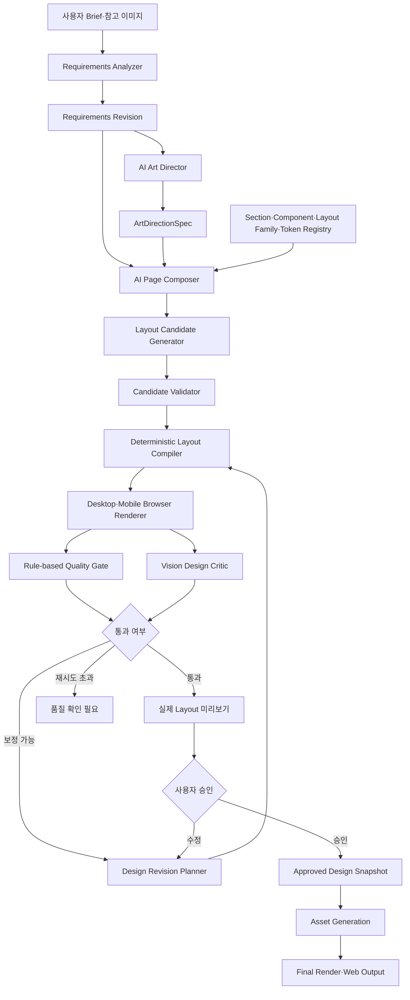

# LLM 기반 고품질 프로모션 웹디자인 생성 개발계획서

## 0. 문서 정보

- 작성일: 2026-11-06
- 대상 프로젝트: Promo Web Builder
- 대상 화면: `/prototype/create-promo?mode=ai`
- 문서 상태: 개발 검토안
- 목표 릴리스: AI Design Generation v1
- 기준 브랜치: `codex/ai-builder-chat-workspace`
- 기준 계약: Composition Contract v3, Builder Document Revision, Wireframe Revision
- 관련 문서:
  - `docs/계획/ai-builder-chat-workspace-and-wireframe-approval-development-plan-2026-11-04.md`
  - `docs/계획/ai-live-preview-design-quality-gate-development-plan-2026-08-20.md`
  - `docs/기획/ai-promotion-web-output-design-quality-strategy-2026-10-11.md`
  - `docs/설계/ai-promotion-builder-composition-engine-technical-design-2026-07-29.md`

## 1. 목적과 결론

이 개발의 목표는 자연어 요구사항을 입력하면 LLM이 단순히 콘텐츠를 채우거나 기존 Layout Preset 하나를 선택하는 수준을 넘어, 실제 브라우저에서 완성도가 높은 프로모션 웹페이지를 설계하고 검증하며 개선하도록 만드는 것이다.

현재 시스템은 승인된 Section, Component, Layout Preset과 Design Token을 사용하므로 안전성과 재현성이 높다. 반면 레이아웃 표현력이 등록된 프리셋에 제한되고, 페이지 구성 미리보기가 실제 Layout Snapshot을 렌더링하지 않으며, LLM이 자신이 만든 결과를 화면으로 보고 평가하는 단계가 없다.

핵심 결론은 다음과 같다.

> LLM은 Art Direction, 페이지 구조, Layout Family, 콘텐츠 위계와 반응형 전략을 결정한다. 결정론적 Compiler는 이를 승인된 Component·Token·Layout Primitive로 변환한다. 실제 Desktop·Mobile 렌더 결과는 규칙 기반 품질 게이트와 Vision LLM이 평가하고, 허용된 수정 명령으로 제한된 횟수만큼 자동 보정한다. 사용자에게는 최종 출력과 동일한 Layout Snapshot을 미리보기로 제공한다.

이 계획은 LLM이 임의 HTML, CSS 또는 JavaScript를 직접 실행하는 구조를 목표로 하지 않는다. 생성 자유도는 확대하되 결과는 선언형 계약, 허용 목록, Compiler와 품질 게이트 안에서만 실행한다.

## 2. 현행 구조 분석

### 2.1 현재 동작

현재 AI 모드의 페이지 구성 흐름은 다음과 같다.

```text
사용자 요구사항
  → promo_overview_parser
  → 요구사항 Tree
  → promo_page_composer
  → 활성 Composition Shell 조회
  → Registry Section·Component·Layout Preset 후보 조회
  → Layout Fit 점수 계산
  → LLM이 Section과 Layout Preset 선택
  → Contract v3 검증 및 보정
  → B/W 페이지 구성 미리보기
  → 사용자 승인
  → 선택된 Layout Preset을 실제 Snapshot으로 Compile
  → 이미지 생성 및 최종 디자인
```

### 2.2 현재 강점

- 승인된 Section과 Component만 사용한다.
- Layout Preset, Design Token과 정책을 서버에서 검증한다.
- Composition Proposal과 Builder Document Revision을 저장한다.
- Wireframe 승인 fingerprint로 승인 이후의 구조 변경을 차단한다.
- Desktop·Mobile Layout Snapshot을 최종 Compiler에서 해석할 수 있다.
- 프롬프트와 모델 설정을 Admin Control Plane에서 관리할 수 있다.
- 이미지 Asset Job과 최종 Composition을 분리해 재시도할 수 있다.

### 2.3 핵심 문제

| ID | 문제 | 현행 원인 | 영향 |
|---|---|---|---|
| QD-01 | 페이지 구성 미리보기가 실제 레이아웃을 보여주지 않음 | Wireframe이 공통 CSS Grid로 렌더됨 | 승인 화면과 최종 디자인 불일치 |
| QD-02 | 레이아웃 결과가 반복적임 | 저장된 Layout Preset 중 하나만 선택 | 생성 다양성과 차별화 제한 |
| QD-03 | 페이지 전체 Art Direction이 약함 | Section별 선택과 이미지 요청이 분리됨 | 색감·타이포·이미지 톤 불일치 |
| QD-04 | LLM이 렌더 결과를 보지 못함 | 구조화 JSON 생성 후 바로 적용 | 여백·줄바꿈·균형 문제를 발견하지 못함 |
| QD-05 | 단일 Composer 책임이 과도함 | 구조·카피·레이아웃을 한 프롬프트가 처리 | 오류 원인과 품질 개선 지점이 불명확 |
| QD-06 | 디자인 품질의 합격 기준이 불명확함 | 구조 검증 중심 | 정상 렌더와 좋은 디자인을 구분하지 못함 |
| QD-07 | 모바일 품질이 후행 확인됨 | Desktop 중심 구성 후 Mobile 보정 | 모바일 겹침·과밀·잘림 가능성 |
| QD-08 | 사용자의 수정 신호가 학습 데이터로 남지 않음 | 수정량과 승인 이유 미수집 | 품질 개선 우선순위 산정 어려움 |

### 2.4 사실과 판단의 구분

확인된 사실:

- `promo_page_composer`는 허용된 Section과 Layout Preset 후보에서 Composition을 생성한다.
- 서버 제약은 Raw HTML, CSS, JavaScript와 Raw Coordinate 생성을 허용하지 않는다.
- 현재 B/W Wireframe은 선택된 Layout Preset의 실제 geometry를 적용하지 않는다.
- 최종 Compiler는 선택된 Layout Preset의 Desktop·Mobile Snapshot을 해석한다.

설계 판단:

- 프롬프트만 강화해도 품질 상한은 충분히 높아지지 않는다.
- 실제 렌더 결과를 다시 평가하는 Visual Feedback Loop가 가장 큰 품질 개선 요소다.
- 자유 코드 생성보다 Layout Family와 제한된 Primitive 조합이 평균 품질과 운영 안정성에 유리하다.

검증이 필요한 가설:

- 후보를 6~12개 생성하고 상위 3개를 렌더 평가하면 단일 후보보다 첫 결과 채택률이 높아진다.
- Vision LLM 자동 보정 2회가 사용자 수정량을 유의미하게 낮춘다.
- Art Direction을 페이지 단위로 먼저 고정하면 이미지와 섹션 스타일의 일관성이 높아진다.

## 3. 목표 사용자 경험

```text
1. 사용자가 자연어 요구사항과 참고 이미지를 입력한다.
2. AI가 누락된 콘텐츠를 질문하고 요구사항을 구조화한다.
3. AI Art Director가 페이지 전체 디자인 방향을 제안한다.
4. AI가 실제 Layout Snapshot 기반 페이지 구성 후보를 생성한다.
5. 시스템이 Desktop·Mobile 후보를 실제 브라우저에 렌더링한다.
6. 품질 게이트와 Vision LLM이 후보를 평가하고 필요한 부분을 자동 보정한다.
7. 사용자는 실제 최종 결과와 같은 구조의 미리보기를 확인한다.
8. 사용자는 채팅으로 문구, 배치, 강조, 이미지 방향을 수정한다.
9. 사용자가 페이지 구성을 승인하면 동일 Snapshot을 잠근다.
10. 이미지 생성과 세부 스타일링을 완료한 뒤 Web Output을 제공한다.
```

사용자가 승인하는 미리보기에는 다음 항목이 실제 결과와 동일하게 표시되어야 한다.

- Section 순서와 높이
- Component 위치, 폭, 높이와 정렬
- Grid 열 수와 비율
- 제목·본문·혜택·CTA의 실제 문구와 위계
- 이미지 영역과 텍스트 Safe Area
- Desktop·Mobile 재배치
- 반복 카드 수와 카드별 문구
- 숨김·고정 콘텐츠와 법적 고지 위치

미리보기에서 단순화할 수 있는 항목은 실제 생성 이미지, 미세한 Shadow, Motion과 최종 Texture뿐이다.

## 4. 목표 아키텍처



### 4.1 책임 분리

| 계층 | 책임 | 금지 사항 |
|---|---|---|
| Requirements Analyzer | 사실, 조건, 콘텐츠와 누락 정보 구조화 | 디자인 geometry 생성 |
| Art Director | 페이지 콘셉트, 밀도, 타이포, 색상 역할, 이미지 방향 | 개별 좌표 생성 |
| Page Composer | Section 순서, Component 구성, 콘텐츠 위계 결정 | 임의 Component 생성 |
| Layout Designer | Layout Family와 제한된 파라미터 결정 | Raw CSS·HTML·JavaScript 생성 |
| Layout Compiler | 실제 Desktop·Mobile geometry 계산 | LLM 추측값을 검증 없이 적용 |
| Quality Gate | 겹침, 잘림, 대비, 콘텐츠와 자산 상태 검사 | 미적 취향을 단독 합격 기준으로 사용 |
| Vision Critic | 시각적 위계, 균형, 리듬과 일관성 평가 | 직접 DOM 변경 |
| Revision Planner | 허용된 Operation으로 수정안 생성 | 승인된 구조를 암묵적으로 변경 |

## 5. 핵심 설계 원칙

### 5.1 단일 Source of Truth

Wireframe 전용 구조와 최종 디자인 전용 구조를 별도로 만들지 않는다. Composition Contract v3를 호환 확장한 `Design Snapshot`을 페이지 구성 미리보기, 최종 디자인, Visual Editor와 Web Output이 공유한다.

권장 버전 전략:

- 외부 계약 이름은 Composition Contract v3 유지
- 신규 필드는 optional로 추가
- Snapshot 내부 `designContractVersion`을 도입
- 기존 v3 Snapshot은 기본값을 주입해 그대로 렌더링
- 별도의 경쟁 Contract v4는 기존 마이그레이션 비용을 검증한 뒤 결정

### 5.2 LLM 자유도와 안전성의 경계

LLM이 생성할 수 있는 항목:

- Layout Family
- Grid column 비율
- Component order와 emphasis
- 콘텐츠 폭 등급
- 이미지 위치와 visual weight
- CTA prominence와 placement
- Section density와 rhythm
- Desktop·Mobile layout strategy
- 승인된 Token role 선택

LLM이 직접 생성하지 않는 항목:

- 실행 가능한 HTML 문자열
- 임의 CSS 문자열
- JavaScript
- 검증되지 않은 URL과 외부 스크립트
- 무제한 absolute coordinate
- Registry에 없는 Component ID
- 접근성 기준을 우회하는 스타일

### 5.3 실제 렌더 기반 승인

페이지 구성 미리보기는 공통 Wireframe Grid를 사용하지 않는다. 최종 Renderer와 같은 geometry resolver를 사용하고, `wireframeTheme=true` 옵션으로 색상·이미지·Motion만 단순화한다.

### 5.4 Desktop·Mobile 동등 품질

Desktop 통과만으로 페이지를 승인하지 않는다. 두 viewport 모두 Blocking 진단 0건이어야 하며, Mobile은 별도 layout strategy와 screenshot 평가를 수행한다.

### 5.5 제한된 자동 보정

자동 보정은 최대 2회로 제한한다. 같은 진단이 반복되거나 구조 변경이 필요한 경우 `quality_review_required` 상태로 중단하고 사용자에게 원인을 표시한다.

## 6. 데이터 계약

### 6.1 ArtDirectionSpec

```json
{
  "version": 1,
  "concept": "Premium Editorial Event",
  "mood": ["exclusive", "dramatic", "modern"],
  "visualDensity": "low",
  "hierarchy": {
    "primary": "campaign-title",
    "secondary": "main-offer",
    "conversion": "primary-cta"
  },
  "paletteRoles": {
    "background": "surface-dark",
    "foreground": "text-on-dark",
    "accent": "campaign-accent"
  },
  "typographyRoles": {
    "display": "display-strong",
    "body": "body-readable",
    "legal": "caption-compact"
  },
  "imagery": {
    "style": "cinematic-product-key-visual",
    "subjectPosition": "right",
    "textSafeArea": "left",
    "mobileCropStrategy": "subject-center-copy-first"
  },
  "pageRhythm": {
    "hero": "immersive",
    "content": "alternating",
    "conversion": "focused"
  }
}
```

### 6.2 LayoutIntent

```json
{
  "sectionVersionId": "section-version-id",
  "sectionKey": "hero",
  "layoutFamily": "split",
  "layoutKey": "hero-split-right",
  "intent": {
    "contentAlignment": "left",
    "mediaPosition": "right",
    "columnRatio": "5:7",
    "contentWidth": "balanced",
    "visualEmphasis": "high",
    "ctaPlacement": "below-copy",
    "density": "spacious"
  },
  "responsive": {
    "mobileStrategy": "copy-first-media-after",
    "columns": 1,
    "hideDecorativeMedia": false
  }
}
```

### 6.3 CompiledDesignSnapshot

기존 `compositionSpec`, `content`, `designSpec`, `assets`, `motionSpec`을 유지하고 다음 메타데이터를 추가한다.

```json
{
  "designContractVersion": 1,
  "artDirection": {},
  "compositionSpec": {},
  "compiledLayout": {
    "compilerVersion": 1,
    "viewports": {
      "desktop": {},
      "mobile": {}
    }
  },
  "qualityState": {
    "status": "pending",
    "attempt": 0,
    "reportId": null
  },
  "generationMeta": {
    "candidateId": "candidate-id",
    "promptSnapshotIds": [],
    "modelSnapshotIds": []
  }
}
```

### 6.4 DesignRevisionOperation

허용 Operation 초기 목록:

- `select-layout-family`
- `select-layout-preset`
- `set-column-ratio`
- `set-content-width`
- `set-component-alignment`
- `set-component-order`
- `set-component-emphasis`
- `set-section-density`
- `set-section-min-height`
- `set-mobile-strategy`
- `replace-token-role`
- `adjust-copy-length`
- `change-image-safe-area`

각 Operation은 대상 ID, base revision, before/after, reason, source와 idempotency key를 포함한다.

### 6.5 QualityReport

```json
{
  "version": 1,
  "documentId": "document-id",
  "documentRevision": 12,
  "candidateId": "candidate-id",
  "viewports": {
    "desktop": {
      "blocking": [],
      "warnings": [],
      "visualScores": {
        "hierarchy": 86,
        "balance": 82,
        "rhythm": 78,
        "consistency": 90,
        "conversionFocus": 84
      }
    },
    "mobile": {
      "blocking": [],
      "warnings": [],
      "visualScores": {}
    }
  },
  "status": "passed",
  "repairAttempt": 1
}
```

Vision 점수는 후보 비교와 보정 우선순위에 사용한다. Blocking 여부는 DOM 측정과 정책 검증 결과가 Source of Truth다.

## 7. LLM 역할 및 프롬프트 구성

### 7.1 신규·분리 Prompt Type

| Prompt Type | 역할 | 입력 | 출력 |
|---|---|---|---|
| `promo_art_director` | 페이지 전체 디자인 방향 결정 | Overview, Brand Token, 참고자료 | ArtDirectionSpec |
| `promo_page_composer` | Section·Component·콘텐츠 구성 | Overview, 후보, Art Direction | CompositionSpec |
| `promo_layout_designer` | Layout Family·파라미터 설계 | Composition, Layout Family 후보 | LayoutIntent[] |
| `promo_visual_critic` | 실제 렌더 시각 평가 | Desktop·Mobile screenshot, DOM diagnostics | VisualReview |
| `promo_design_reviser` | 평가를 제한된 수정 명령으로 변환 | Snapshot, QualityReport, 허용 Operation | DesignRevisionOperation[] |
| `promo_mobile_optimizer` | 모바일 정보 위계·재배치 보완 | Mobile screenshot, Desktop intent | Mobile operations |

### 7.2 Prompt 운영 원칙

- 모든 실행은 Prompt Execution Snapshot을 저장한다.
- Admin Prompt 관리에서 버전, 모델, Provider와 Rollback을 지원한다.
- System 규칙과 Schema 계약은 코드 또는 필수 Layer로 고정한다.
- 캠페인별 문구나 임시 정책을 코드에 하드코딩하지 않는다.
- Vision Critic의 자연어 평가는 직접 저장하지 않고 구조화된 진단으로 정규화한다.
- 모델 응답이 비어 있거나 JSON 계약을 위반하면 1회 Repair 후 실패 처리한다.

### 7.3 모델 라우팅

초기 권장:

- 요구사항 분석: 빠른 구조화 모델
- Art Direction과 Layout Design: 고품질 reasoning 모델
- Visual Critic: 이미지 입력을 지원하는 multimodal 모델
- Revision Planner: 구조화 출력 정확도가 높은 모델
- 이미지 생성: 기존 Section·Component Asset Provider 유지

Provider와 모델명은 코드에 고정하지 않고 기존 LLM Model Registry와 Routing 정책으로 관리한다.

## 8. Layout Family와 Compiler

### 8.1 초기 Layout Family

| Section Role | Layout Family |
|---|---|
| Hero | Split, Centered Statement, Full Bleed, Editorial Asymmetric, Product Showcase, Offer Focused |
| Feature | Card Grid, Alternating Rows, Bento, Icon List, Sticky Visual |
| Offer | Price Split, Benefit Summary, Bundle Comparison, Conversion Band |
| Steps | Timeline, Numbered Cards, Alternating Guide |
| Social Proof | Quote Focus, Review Grid, Metric Band, Logo Wall |
| FAQ | Accordion, Topic Columns, Highlighted Question |
| Community | Profile Orbit, Member Cards, Editorial Collage |
| CTA | Centered CTA, Visual CTA, Floating Card, Compact Band |
| Terms | Compact Legal, Accordion Legal, Two-column Legal |

### 8.2 Layout Primitive

Compiler가 지원할 제한된 Primitive:

- `stack`
- `grid`
- `split`
- `overlay-safe`
- `bento`
- `repeat-grid`
- `sticky-media`
- `full-bleed`
- `conversion-band`

각 Primitive는 다음 범위만 허용한다.

- 승인된 Grid column 수와 ratio
- Token 기반 gap과 padding
- 제한된 alignment와 ordering
- min/max width와 height
- Desktop·Mobile breakpoint별 재배치
- 제한된 overlay와 safe area

### 8.3 Compiler 불변식

- Component가 Section 경계를 벗어나지 않는다.
- 필수 Component는 숨길 수 없다.
- CTA touch target은 최소 기준을 만족한다.
- 텍스트는 최소 글자 크기와 대비 기준을 만족한다.
- 이미지 위 텍스트는 지정된 Safe Area에만 배치한다.
- 모바일에서 수평 스크롤을 만들지 않는다.
- Collection repeat는 허용된 min/max 범위 안에 있다.
- 법적 고지 Section의 위치와 내용 잠금을 유지한다.
- 같은 Snapshot과 Compiler version은 같은 geometry를 생성한다.

## 9. 실제 레이아웃 미리보기

### 9.1 변경 목표

현재 `ai-wireframe-components` 공통 Grid 표현을 검토용 카드 목록으로만 사용하고, 기본 미리보기는 실제 `compiledLayout`을 공통 Renderer로 출력한다.

```text
현재
Composition Snapshot → wireframe-display 변환 → 공통 Grid

변경
Composition Snapshot → Layout Compiler → PromoPageRenderer
                                     ├─ wireframeTheme
                                     └─ finalTheme
```

### 9.2 Wireframe Theme

Wireframe Theme은 geometry를 변경하지 않는다.

- 배경과 텍스트는 grayscale token 사용
- 실제 이미지 대신 동일 aspect ratio placeholder 사용
- Font family는 기본 서체를 사용하되 실제 font size·weight·line height 유지
- Shadow와 Texture는 단순화
- Motion 비활성화
- Section과 Component 경계를 선택적으로 표시
- 실제 콘텐츠와 CTA 문구는 유지

### 9.3 편집 범위

페이지 구성 미리보기에서 허용:

- 문구 수정
- Layout Family 또는 Preset 변경
- 좌·중·우 정렬
- 이미지와 텍스트 위치 교환
- 열 비율 변경
- 카드 열 수 변경
- Section 밀도 변경
- Desktop·Mobile 전략 변경

색상, 실제 이미지 생성과 Motion은 Art Direction 검토 또는 최종 디자인 단계에서 수정한다.

## 10. Visual Quality Feedback Loop

### 10.1 렌더 절차

1. Candidate Snapshot을 격리된 Preview URL로 렌더링한다.
2. Font와 이미지 placeholder가 안정화될 때까지 대기한다.
3. Desktop 기준 viewport를 캡처한다.
4. Mobile 기준 viewport를 캡처한다.
5. DOM geometry와 computed style 진단을 수집한다.
6. 규칙 기반 품질 게이트를 실행한다.
7. screenshot과 진단을 Vision Critic에 전달한다.
8. Revision Planner가 허용 Operation을 생성한다.
9. 수정 Snapshot을 다시 Compile하고 최대 2회 반복한다.

### 10.2 규칙 기반 Blocking 진단

- Component overlap
- Section boundary overflow
- text clipping
- horizontal overflow
- 최소 글자 크기 미달
- 대비 기준 미달
- CTA touch target 미달
- 필수 콘텐츠 누락
- placeholder 또는 내부 ID 노출
- 이미지 aspect ratio 불일치
- 지나치게 큰 빈 영역
- 모바일 reading order 오류
- 승인된 Wireframe fingerprint 불일치

### 10.3 Vision 평가 기준

- 정보 위계
- 시각적 균형
- 페이지 리듬
- 타이포그래피 완성도
- 이미지와 콘텐츠 관계
- 브랜드 일관성
- CTA 집중도
- 섹션 간 다양성과 일관성의 균형
- 모바일 밀도와 가독성

Vision 평가만으로 결과를 차단하지 않는다. 초기에는 후보 랭킹과 수정 제안에 사용하고, 운영 데이터가 축적된 이후 최소 점수 정책을 검토한다.

## 11. 후보 생성과 선택

### 11.1 후보 전략

- 전체 조합을 무작위로 생성하지 않는다.
- Art Direction과 Section 역할을 기준으로 Layout Family 후보를 제한한다.
- 기본 6개, 최대 12개의 경량 후보를 생성한다.
- 구조 검증 후 상위 3개만 실제 렌더한다.
- Desktop·Mobile 통합 점수가 가장 높은 후보를 기본안으로 제시한다.
- 필요 시 사용자에게 최대 3개의 레이아웃 방향을 비교 제공한다.

### 11.2 초기 후보 점수

```text
totalScore =
  structuralValidity * requiredWeight
  + contentFit
  + layoutDiversity
  + responsiveQuality
  + visualHierarchy
  + brandConsistency
  + conversionFocus
  - blockingPenalty
  - repeatedLayoutPenalty
  - repairCostPenalty
```

운영 전에는 점수 가중치를 고정 사실로 간주하지 않는다. Shadow Mode에서 사람 평가와 상관관계를 측정한 뒤 조정한다.

## 12. API 계획

### 12.1 신규 API

| Method | Endpoint | 기능 |
|---|---|---|
| POST | `/api/promo-design-directions` | ArtDirectionSpec 생성 |
| GET | `/api/promo-design-directions?documentId=` | 현재 Art Direction 조회 |
| POST | `/api/promo-layout-candidates` | Layout 후보 생성 작업 시작 |
| GET | `/api/promo-layout-candidates?proposalId=` | 후보와 상태 조회 |
| POST | `/api/promo-layout-candidates/:id/render` | Desktop·Mobile 렌더 작업 요청 |
| POST | `/api/promo-design-quality-evaluations` | 품질 평가 시작 |
| GET | `/api/promo-design-quality-evaluations?candidateId=` | 품질 보고서 조회 |
| POST | `/api/promo-design-revisions` | 제한된 보정 Operation 적용 |
| POST | `/api/promo-design-approvals` | 최종 Design Snapshot 승인 |

### 12.2 기존 API 변경

| API | 변경 |
|---|---|
| `promo-page-composition-proposals` | Art Direction ID와 Layout Intent 포함 |
| `promo-builder-wireframes` | 실제 compiledLayout과 quality state 저장 |
| `promo-builder-wireframes-confirm` | Design Snapshot fingerprint 검증 추가 |
| `promo-builder-wireframe-edits` | Layout Operation 편집 지원 |
| `promo-page-composition-apply` | 승인된 Design Snapshot과 quality pass 요구 |
| `promo-builder-export` | 승인 및 quality state 검증 |

API 이름은 구현 전에 현재 Vercel Function route 규칙과 중복 여부를 확인해 확정한다.

## 13. 저장 구조

### 13.1 재사용

- `promo_builder_documents`
- `promo_builder_composition_proposals`
- `promo_builder_document_versions`
- `promo_builder_document_operations`
- `promo_builder_wireframe_revisions`
- `promo_builder_chat_sessions`
- `promo_builder_events`
- Prompt·Model Registry 테이블
- Section Layout Preset과 Design Token 테이블

### 13.2 신규 저장 후보

#### `promo_builder_art_directions`

- `id`
- `document_id`
- `base_document_revision`
- `spec_json`
- `prompt_execution_snapshot`
- `status`
- `created_at`

#### `promo_builder_design_candidates`

- `id`
- `proposal_id`
- `candidate_index`
- `snapshot_json`
- `compiler_version`
- `structural_score`
- `selected`
- `created_at`

#### `promo_builder_quality_reports`

- `id`
- `candidate_id`
- `document_revision`
- `report_json`
- `status`
- `repair_attempt`
- `desktop_artifact_url`
- `mobile_artifact_url`
- `created_at`

신규 테이블을 확정하기 전에 기존 Proposal Snapshot과 Event JSON으로 충분한지 검토한다. 조회, 보존 기간, 비교 평가가 필요한 데이터만 별도 테이블로 분리한다.

## 14. 상태 모델

```text
requirements_review
  → art_direction_generating
  → art_direction_review
  → layout_candidates_generating
  → layout_compiling
  → render_evaluating
  → auto_repairing
  → design_review
  → design_approved
  → asset_generating
  → finalizing
  → completed
```

오류·중단 상태:

- `quality_review_required`
- `candidate_generation_failed`
- `render_evaluation_failed`
- `repair_exhausted`
- `stale_revision`
- `cancelled`

장기 실행 상태는 브라우저 메모리가 아니라 서버에 저장한다. 새로고침 후 동일 operation 상태를 복원한다.

## 15. 개발 단계

### Phase 0 — 기준선과 품질 평가 세트

목표:

- 품질 개선 전후를 비교할 고정 Brief와 사람 평가 기준을 만든다.

개발 항목:

1. 프로모션 유형별 Benchmark Brief 10~20개 선정
2. Desktop·Mobile 현재 결과 캡처
3. 디자이너 평가 Rubric 확정
4. 첫 생성 채택률, 수정량, 생성 시간 기준선 측정
5. Layout Family별 대표 Fixture 작성

완료 조건:

- 같은 Brief로 변경 전후 결과를 재현할 수 있다.
- 최소 2명의 평가자가 동일 Rubric으로 평가할 수 있다.

### Phase 1 — 실제 Layout Snapshot 기반 미리보기

우선순위: P0

목표:

- 사용자 승인 화면과 최종 디자인의 geometry를 일치시킨다.

개발 항목:

1. `wireframe-display.mjs`의 공통 Grid 의존 제거
2. `resolveSectionLayoutPreset()`과 Compiler geometry 재사용
3. `PromoPageRenderer`에 `wireframeTheme` 모드 추가
4. Desktop·Mobile 실제 Layout 렌더
5. Wireframe fingerprint에 layout version과 geometry 포함
6. 기존 인라인 콘텐츠·정렬 편집을 Layout Operation으로 전환
7. 기존 Wireframe revision 호환 처리

완료 조건:

- 같은 Snapshot의 Wireframe과 Final Render component geometry가 허용 오차 내에서 일치한다.
- Desktop·Mobile Layout Preset 차이가 미리보기에서 보인다.
- 승인 후 최종 생성에서 Section·Component·Layout Key가 변경되지 않는다.

### Phase 2 — 페이지 단위 Art Direction

우선순위: P0

목표:

- Section과 이미지가 하나의 시각 방향을 공유하게 한다.

개발 항목:

1. ArtDirectionSpec Schema·Validator 추가
2. `promo_art_director` Prompt Type 추가
3. Admin Prompt·Model Registry 연결
4. Brand Token·Foundation Token·참고 이미지 Context 구성
5. Art Direction Revision 저장
6. 이미지 Prompt와 Composer에 Art Direction 전달
7. 사용자 검토 UI와 자연어 수정 지원

완료 조건:

- 모든 Section과 이미지 요청이 같은 Art Direction ID를 참조한다.
- 금지 Token과 브랜드 정책 위반 시 생성이 차단된다.
- Art Direction 수정 시 종속 후보가 stale 상태가 된다.

### Phase 3 — Layout Family와 다중 후보 생성

우선순위: P1

목표:

- 프리셋 단일 선택을 넘어 제한된 디자인 공간에서 다양한 고품질 후보를 만든다.

개발 항목:

1. LayoutIntent Schema와 Validator 추가
2. 초기 Layout Family·Primitive 구현
3. `promo_layout_designer` Prompt 추가
4. 후보 생성기와 중복 제거 fingerprint 구현
5. 상위 후보 구조 점수 계산
6. Compiler에 Layout Family 파라미터 해석 추가
7. Admin Layout Preset에 selection metadata 보강
8. 후보 비교 UI 추가

완료 조건:

- 같은 Brief에서 구조적으로 유효하고 시각적으로 구분되는 후보를 최소 3개 생성한다.
- 모든 후보가 Registry Component와 Token만 사용한다.
- 같은 후보와 Compiler version은 동일 Snapshot을 생성한다.

### Phase 4 — Browser Render Quality Gate

우선순위: P0/P1

목표:

- 깨진 결과가 사용자 승인 단계로 진행되지 않게 한다.

개발 항목:

1. 격리된 Desktop·Mobile Render Runner 구현
2. Font·Image·Layout 안정화 대기 조건 구현
3. DOM geometry·computed style 수집
4. Blocking 진단 구현
5. QualityReport 저장
6. Candidate ranking에 규칙 기반 점수 반영
7. 실패 원인 UI와 재시도 정책 구현

완료 조건:

- 겹침, 잘림, 수평 overflow와 필수 콘텐츠 누락 Fixture를 모두 차단한다.
- Desktop·Mobile Blocking 0건인 결과만 승인 가능하다.
- 품질 보고서가 document revision과 연결된다.

### Phase 5 — Vision Critic과 자동 보정

우선순위: P1

목표:

- 구조적으로 정상이나 시각적으로 부족한 결과를 자동 개선한다.

개발 항목:

1. Screenshot artifact 저장과 보존 정책 구현
2. `promo_visual_critic` Prompt·Schema 추가
3. VisualReview 정규화와 신뢰도 기록
4. `promo_design_reviser` Prompt·Operation 추가
5. 최대 2회 Repair Loop 구현
6. 같은 오류 반복 감지
7. Before·After 비교와 Repair 감사 로그 저장
8. Mobile Optimizer 단계 추가

완료 조건:

- 자동 보정이 승인된 Operation만 사용한다.
- 구조 fingerprint를 변경하는 수정은 사용자 재승인을 요구한다.
- 재시도 초과 시 결과를 성공으로 표시하지 않는다.

### Phase 6 — 사용자 수정·승인 UX

우선순위: P1

목표:

- 사용자가 디자인 용어를 몰라도 채팅으로 결과를 수정할 수 있게 한다.

개발 항목:

1. 실제 Layout Preview에서 대상 Section·Component 선택
2. 선택 Context를 채팅에 전달
3. 자연어 수정 요청을 DesignRevisionOperation으로 변환
4. 수정 영향 범위와 Before·After 표시
5. Desktop·Mobile 개별 수정과 공통 수정 구분
6. 승인 Snapshot과 이후 수정의 stale 처리
7. 후보 비교·선택·되돌리기 지원

완료 조건:

- “CTA를 가운데로”, “이미지를 오른쪽으로”, “카드를 3열로” 요청이 대상 범위에만 적용된다.
- 모든 수정이 revision과 audit event로 남는다.
- 승인된 Snapshot과 Web Output이 동일하다.

### Phase 7 — 운영 Rollout과 최적화

우선순위: P1/P2

개발 항목:

1. 기능 플래그와 Shadow Mode 추가
2. 모델별 품질·비용·지연 비교
3. Prompt·Compiler·Quality Gate 버전별 지표 수집
4. Screenshot과 후보 Snapshot 보존 기간 설정
5. 실패율과 비용 Budget Alert 설정
6. Preview → 내부 사용자 → 제한 Production → 전체 Production 전환
7. Rollback Runbook 작성

## 16. 소스코드 변경 예상 범위

### Frontend

- `visual-editor/src/builder/AiBuilderApp.vue`
- `visual-editor/src/builder/services/wireframe-display.mjs`
- `visual-editor/src/builder/services/composition-client.mjs`
- `visual-editor/src/builder/CompositionReview.vue`
- `visual-editor/src/PromoPageRenderer.vue`
- `visual-editor/src/platform/editor-core/*`
- `visual-editor/src/shared/composition/*`

### API·Domain

- `api/promo-page-composition-proposals.js`
- `api/_promo-page-composition-service.js`
- `api/_promo-registry-composition-contract.js`
- `api/_promo-registry-composition-compiler.js`
- `api/_promo-layout-fit.js`
- `api/_section-layout-preset-resolver.js`
- `api/_promo-builder-wireframe-edits.js`
- 신규 Art Direction, Layout Candidate, Quality Evaluation API

### Admin

- `admin-app/src/services/prompt-template-group-service.mjs`
- Prompt·Model 관리 화면
- Section Layout Preset Manager
- Design Token과 Composition Shell 관리 화면

### DB

- 기존 Migration 이후 충돌 없는 신규 Migration 번호 배정
- Art Direction, Candidate와 Quality Report 저장 구조
- Revision·Event index와 보존 정책

### Test

- Composition Contract 및 Compiler 계약 테스트
- Layout Family Fixture 테스트
- Wireframe·Final geometry parity 테스트
- Desktop·Mobile Browser Quality Gate 테스트
- Vision 응답 Schema·Repair Loop 테스트
- 승인 fingerprint·revision race 테스트
- Production smoke test

## 17. 테스트 전략

### 17.1 계약 테스트

- 허용되지 않은 Layout Family 거부
- Registry에 없는 Component 거부
- Raw HTML·CSS·JavaScript 필드 거부
- 잘못된 Token reference 거부
- Desktop·Mobile 전략 누락 시 기본값 주입
- Revision mismatch와 stale candidate 거부

### 17.2 Compiler 테스트

- 같은 입력의 결정론적 결과
- Grid·Split·Bento·Overlay Primitive geometry
- Collection repeat와 카드 열 수
- 이미지 Safe Area
- 필수 Section 고정 위치
- Mobile reflow와 reading order

### 17.3 Browser 테스트

- 실제 Layout Wireframe과 Final geometry 비교
- Desktop 1440px·Mobile 390px 렌더
- 긴 한글 제목과 다국어 줄바꿈
- 이미지 로딩 실패와 Placeholder
- 폰트 로딩 전후 Layout Shift
- CTA 위치·크기·키보드 접근성
- 겹침·잘림·수평 overflow 차단

### 17.4 LLM 평가 테스트

- 고정 Fixture에 대한 Schema 준수율
- Prompt version별 후보 다양성
- Vision Critic 진단 재현성
- Repair가 Blocking 진단을 실제로 감소시키는지 확인
- 동일 오류 반복 시 중단 확인
- 모델 장애와 timeout fallback

### 17.5 사람 평가

Blind Review 항목:

- 첫 화면 이해도
- 디자인 완성도
- 정보 위계
- 브랜드 적합성
- Desktop·Mobile 품질
- 게시 전 예상 수정량

기존 방식, 신규 단일 후보, 신규 다중 후보+Repair 세 그룹을 같은 Brief로 비교한다.

## 18. 성공 지표

### 제품 지표

- 첫 생성 결과 채택률
- 승인 전 사용자 수정 Operation 수
- Section 재생성률
- 생성부터 Web Output까지 걸린 시간
- 후보 비교 후 기본 후보 유지율
- Desktop·Mobile 개별 수정률

### 품질 지표

- Blocking 진단 발생률
- 자동 Repair 성공률
- Repair 후 재발률
- Wireframe·Final geometry 불일치율
- 사람 평가 평균과 하위 10% 점수
- 내부 ID·Placeholder 노출률

### 운영 지표

- 단계별 P50·P95 지연
- 모델 호출 비용
- 후보 1개당 렌더 비용
- Vision 호출 실패율
- Prompt·Model·Compiler version별 실패율
- Rollback 발생률

수치 목표는 Phase 0 기준선 측정 후 확정한다. 근거 없는 목표값을 사전에 고정하지 않는다.

## 19. 기능 플래그

- `PROMO_AI_ART_DIRECTION_V1_ENABLED`
- `PROMO_AI_LAYOUT_FAMILY_V1_ENABLED`
- `PROMO_REAL_LAYOUT_PREVIEW_V1_ENABLED`
- `PROMO_DESIGN_QUALITY_GATE_V1_ENABLED`
- `PROMO_VISION_CRITIC_V1_ENABLED`
- `PROMO_DESIGN_AUTO_REPAIR_V1_ENABLED`

플래그는 Production과 Preview를 분리하고, Preview 전용 DB와 Prompt version을 먼저 검증한다.

## 20. 보안·저작권·운영 정책

- 외부 참고 이미지는 디자인 패턴과 분위기 분석에만 사용한다.
- 로고, 캐릭터, 문구와 이미지를 명시적 권한 없이 복제하지 않는다.
- 참고자료의 브랜드명과 상표를 생성 결과에 자동 전이하지 않는다.
- Screenshot artifact는 비공개 저장소에 보관하고 만료 정책을 둔다.
- 사용자 입력과 생성 결과를 모델 학습에 사용하는 정책은 별도 동의를 요구한다.
- LLM 출력은 실행 가능한 코드로 직접 취급하지 않는다.
- 모든 외부 URL, asset URL과 content binding을 서버에서 검증한다.
- Prompt와 Model 변경은 Admin audit log와 Rollback을 지원한다.

## 21. 위험과 대응

| 위험 | 영향 | 대응 |
|---|---|---|
| LLM 자유도 증가로 실패 편차 확대 | 깨진 결과 증가 | Primitive·Schema·Compiler·Gate로 제한 |
| Vision 평가의 주관성 | 결과 변동 | Blocking은 DOM Gate가 판정, Vision은 랭킹·제안 중심 |
| 후보 생성과 렌더로 지연 증가 | UX 저하 | 경량 후보 선별 후 상위 3개만 렌더, 병렬 처리와 캐시 |
| 모델 비용 증가 | 운영 비용 증가 | 품질 모드 등급, Budget 제한, Snapshot 재사용 |
| Wireframe·Final 불일치 | 승인 신뢰 하락 | 동일 Renderer와 compiledLayout 사용 |
| 자동 Repair 무한 반복 | 지연·비용 증가 | 최대 2회, 동일 진단 반복 시 중단 |
| 기존 Snapshot 호환 실패 | 과거 문서 열람 장애 | optional 필드·기본값·fixture 회귀 테스트 |
| Layout Family가 형식적으로만 다양함 | 비슷한 결과 반복 | geometry fingerprint·시각 유사도·최근 선택 회피 |
| 모바일 품질 후퇴 | 게시 품질 저하 | Mobile Blocking 0건 필수, Mobile Optimizer 분리 |
| Prompt만 계속 비대해짐 | 유지보수 악화 | 역할별 Prompt와 JSON 계약 분리 |

## 22. 예상 일정과 투입

아래는 상세 설계와 기준선 측정 전의 추정치이며 확정 일정이 아니다.

| 단계 | 예상 기간 |
|---|---:|
| Phase 0 기준선 | 3~5일 |
| Phase 1 실제 Layout Preview | 5~8일 |
| Phase 2 Art Direction | 5~8일 |
| Phase 3 Layout Family·후보 | 10~15일 |
| Phase 4 Browser Quality Gate | 8~12일 |
| Phase 5 Vision·Auto Repair | 8~12일 |
| Phase 6 수정·승인 UX | 6~10일 |
| Phase 7 Rollout | 4~7일 |

병렬 개발이 가능한 최소 역할:

- Composition·API 개발
- Layout Compiler·Renderer 개발
- AI Prompt·Evaluation 개발
- Frontend UX 개발
- QA·Design Evaluation

1인 순차 개발보다 2~3개 트랙 병렬 개발을 권장한다. 실제 일정은 Phase 1 기술 검증 후 다시 산정한다.

## 23. 우선순위

### P0 — 반드시 먼저

1. 실제 Layout Snapshot 기반 미리보기
2. Wireframe·Final geometry 단일화
3. ArtDirectionSpec
4. Desktop·Mobile 규칙 기반 품질 게이트
5. 승인·Revision·fingerprint 강화

### P1 — 고품질 생성 핵심

1. Layout Family와 다중 후보 생성
2. Vision Critic
3. 제한된 자동 Repair
4. 자연어 Layout 수정
5. 후보 비교 UI

### P2 — 운영 최적화

1. 비용·지연 최적화
2. 성과 기반 Candidate ranking
3. 브랜드별 품질 프로파일
4. A/B Variant와 전환 데이터 연결
5. Layout Family 자동 확장 제안

## 24. 구현 착수 전 결정 사항

1. 실제 Layout Preview를 기존 Wireframe 탭에 대체할지, 구조 목록과 함께 이중 제공할지 결정
2. 후보를 자동 1개 선택할지, 최대 3개 비교를 기본으로 할지 결정
3. Art Direction을 사용자 승인 단계로 둘지 자동 확정할지 결정
4. Vision Critic 모델과 데이터 보존 정책 결정
5. Browser Render Runner를 Vercel Function, 별도 Worker 또는 기존 품질 게이트 서비스 중 어디에 둘지 결정
6. 신규 테이블 범위와 Screenshot artifact 보존 기간 결정
7. Layout Family 초기 목록과 디자인팀 검수 책임자 결정
8. 품질 모드별 시간·비용 Budget 결정

## 25. 권장 착수 순서

첫 번째 개발 묶음은 다음으로 제한한다.

```text
Phase 1 실제 Layout Preview
  + Wireframe·Final geometry parity test
  + Desktop·Mobile 규칙 기반 Blocking Gate 최소 기능
```

이 단계가 완료되지 않은 상태에서 Vision LLM이나 다중 후보 생성을 먼저 추가하면, LLM이 개선한 레이아웃이 사용자 미리보기와 최종 결과에서 다르게 보일 수 있다.

두 번째 개발 묶음은 다음으로 진행한다.

```text
ArtDirectionSpec
  + LayoutIntent
  + 초기 Layout Family 3종
  + 실제 후보 3개 비교
```

세 번째 개발 묶음에서 Vision Critic과 자동 Repair를 연결한다.

## 26. 최종 완료 기준

다음 조건을 모두 만족하면 AI Design Generation v1을 완료한 것으로 판단한다.

1. 페이지 구성 미리보기와 최종 출력이 동일한 Layout Snapshot을 사용한다.
2. Desktop·Mobile에서 선택된 Layout Family와 실제 component geometry가 보인다.
3. LLM이 Art Direction, Section 구성과 LayoutIntent를 구조화 계약으로 생성한다.
4. Raw HTML·CSS·JavaScript 없이 승인된 Component·Token·Primitive만 사용한다.
5. 실제 브라우저 렌더 결과가 규칙 기반 품질 게이트를 통과한다.
6. Vision Critic과 자동 Repair가 허용 Operation 안에서 최대 2회 동작한다.
7. 품질 실패 결과는 완료 또는 승인 가능 상태로 표시되지 않는다.
8. 사용자의 자연어 Layout 수정이 대상 Section·Component에만 적용된다.
9. 승인된 Design Snapshot과 Web Output이 구조적으로 동일하다.
10. Prompt, Model, Compiler, Candidate, Quality Report와 Revision 이력을 추적할 수 있다.
11. 기존 Composition Contract v3 문서와 Template Mode 회귀 테스트가 통과한다.
12. 사람 평가에서 기존 방식보다 디자인 품질과 예상 수정량이 개선됨을 확인한다.

## 27. 최종 제안

이 프로젝트의 고품질 생성 목표는 LLM 모델 하나를 교체하거나 프롬프트를 길게 만드는 것으로 달성하기 어렵다. 품질은 다음 결합 구조에서 나온다.

```text
좋은 디자인 재료
  × 구조화된 LLM 설계
  × 결정론적 Compiler
  × 실제 브라우저 렌더
  × Desktop·Mobile 품질 게이트
  × Vision Feedback Loop
  × 사용자 승인과 Revision
```

가장 먼저 해결해야 할 항목은 실제 Layout Snapshot 기반 페이지 구성 미리보기다. 그 위에 Art Direction, Layout Family, 다중 후보와 Visual Feedback Loop를 단계적으로 추가해야 품질 향상이 안정적으로 누적된다.
