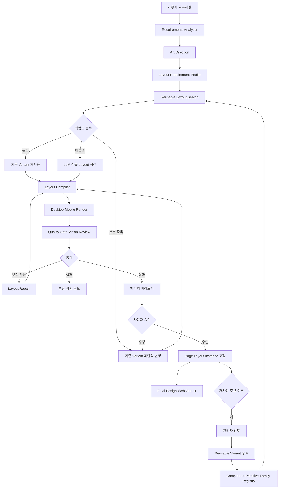

# LLM 재사용형 Generative Layout System 개발계획서

## 0. 문서 정보

- 작성일: 2026-11-06
- 대상 프로젝트: Promo Web Builder
- 문서 상태: 구현 검토안
- 목표 릴리스: Reusable Generative Layout v1
- 대상 흐름: AI 요구사항 분석 → Layout 생성·재사용 → 실제 미리보기 → 품질검사 → 승인 → Web Output
- 기준 계약: Composition Contract v3, Builder Document Revision, Wireframe Revision
- 선행 문서:
  - `docs/계획/llm-high-quality-web-design-generation-development-plan-2026-11-06.md`
  - `docs/계획/ai-builder-chat-workspace-and-wireframe-approval-development-plan-2026-11-04.md`
  - `docs/계획/ai-live-preview-design-quality-gate-development-plan-2026-08-20.md`
  - `docs/기획/ai-promotion-web-output-design-quality-strategy-2026-10-11.md`

## 1. 목적

이 개발의 목적은 LLM이 매 요청마다 HTML, CSS와 Component를 처음부터 새로 생성하는 시스템을 만드는 것이 아니다. 승인된 Component, Design Token과 Layout Primitive를 재사용하면서 캠페인 요구사항에 맞는 Layout 조합을 생성하고, 검증된 우수 결과를 다시 재사용 가능한 자산으로 축적하는 시스템을 구축하는 것이다.

목표 구조는 다음과 같다.

```text
재사용 Component·Token·Layout Primitive
  + 사용자 요구사항·Art Direction
  + 기존 검증 Layout 검색
          ↓
적합한 기존 Layout 존재
  ├─ 예: 재사용 또는 제한적 변형
  └─ 아니오: LLM 신규 Layout 생성
          ↓
Compiler·Desktop/Mobile 품질검사·사용자 승인
          ↓
페이지 전용 Layout Instance 저장
          ↓
반복 사용 가치가 있는 우수 결과만
Reusable Layout Variant로 승격
```

핵심 결론:

> Component와 Layout 문법은 재사용하고, 캠페인별 조합과 파라미터는 생성한다. 생성 결과는 기본적으로 페이지 전용이며, 자동 품질검사와 관리자 검토를 통과한 결과만 브랜드 또는 공용 재사용 자산으로 승격한다.

## 2. 핵심 질문에 대한 확정 답변

### 2.1 생성 레이아웃은 Component 기준인가

그렇다. LLM은 Registry에 등록된 Component Version과 Component Instance를 참조해 배치한다. 임의 Component ID, 임의 DOM 문자열 또는 실행 코드를 생성하지 않는다.

디자인 단위는 다음 계층으로 관리한다.

```text
Page Composition
  └─ Section Instance
       └─ Component Instance
            └─ Component Field
```

- Page: Section 순서, 전체 리듬과 Art Direction
- Section: Component 배치, 크기, Grid와 반응형 전략
- Component: 내부 Field 순서, 정렬, 이미지 비율과 CTA 위치
- Field: 콘텐츠 값과 허용된 스타일 역할

### 2.2 매번 새로운 것을 생성하는가

아니다. 요청 처리 순서는 기존 자산 재사용 가능성 평가가 먼저다.

1. 동일하거나 유사한 요구조건의 활성 Layout Variant 검색
2. 콘텐츠 길이, Component 집합, 이미지 조건과 반응형 조건 비교
3. 충분히 적합하면 그대로 재사용
4. 일부 조건만 다르면 제한된 파라미터 변형
5. 기존 자산으로 표현할 수 없을 때만 신규 Layout 생성

### 2.3 생성 결과는 자동으로 공용 자산이 되는가

아니다. 생성 결과는 먼저 페이지 전용 Instance로 저장한다. 품질검사, 실제 사용과 관리자 승인을 통과한 결과만 브랜드 또는 공용 Variant로 승격한다.

## 3. As-Is와 To-Be

| 영역 | As-Is | To-Be |
|---|---|---|
| Layout 선택 | 저장된 Preset 중 하나 선택 | 기존 자산 검색 → 재사용·변형 → 필요 시 생성 |
| 생성 단위 | Section Layout Preset | Page·Section·Component 계층 Layout Spec |
| 재사용 | 사전에 수동 등록한 Preset | 수동 등록 + 검증된 AI 결과 승격 |
| Preview | 공통 B/W Grid | 실제 compiled geometry 기반 Preview |
| 다양성 | Preset 개수에 제한 | Primitive와 파라미터 조합으로 확장 |
| 안전성 | Preset과 Validator 중심 | Registry 참조 + Schema + Compiler + Quality Gate |
| 모바일 | 저장된 Snapshot에 의존 | 생성 시 Desktop·Mobile 전략 동시 설계 |
| 품질 개선 | 사람의 사후 수정 | 실제 렌더 평가와 제한된 자동 Repair |
| 자산 범위 | 전역 중심 | 페이지·프로젝트·브랜드·공용 Scope |
| 이력 | Layout Version | 생성 근거·변형·승격·사용 이력까지 추적 |

## 4. 개발 범위

### 4.1 포함 범위

- 재사용형 Layout 자산 계층 정의
- Layout Primitive와 Layout Family 계약
- Page·Section·Component 기반 DesignLayoutSpec
- 기존 Layout 적합도 검색 및 랭킹
- LLM Layout 생성·변형
- 결정론적 Layout Compiler
- Desktop·Mobile 실제 미리보기
- 구조·렌더 품질검사
- 페이지 전용 Layout Instance 저장
- 검증된 결과의 Reusable Variant 승격
- 페이지·프로젝트·브랜드·공용 Scope 정책
- Admin 검토·승격·비활성화·Version 관리
- 생성·재사용·변형·승격 감사 이력
- 기능 플래그와 단계적 Rollout

### 4.2 비범위

- LLM이 생성한 임의 HTML·CSS·JavaScript 실행
- Registry에 없는 Component를 자동 활성화
- 사용자 승인 없이 페이지 전용 결과를 공용 자산으로 전환
- 브랜드 전용 Layout을 다른 브랜드에 자동 적용
- 콘텐츠·이미지·금액·기간·약관을 Layout 자산에 포함
- 품질검사 없이 생성 Layout 게시
- 기존 Template Mode 제거
- 외부 사이트 디자인의 직접 복제

## 5. 용어와 자산 계층

### 5.1 Component Definition

재사용 가능한 렌더링 단위다.

- Component Version
- RenderSpec
- Field Schema
- Content Binding 계약
- Style Slot
- 허용 Capability
- 내부 Layout Variant

### 5.2 Layout Primitive

Compiler가 해석할 수 있는 제한된 배치 문법이다.

- `stack`
- `grid`
- `split`
- `bento`
- `asymmetric-grid`
- `full-bleed`
- `overlay-safe`
- `repeat-grid`
- `sticky-media`
- `conversion-band`

### 5.3 Layout Family

Section 역할별 구조와 반응형 행동을 정의하는 재사용 가능한 설계 문법이다.

예:

```text
hero-split
  ├─ copy-left-media-right
  ├─ media-left-copy-right
  ├─ ratio-5-7
  ├─ ratio-6-6
  └─ mobile-copy-first
```

### 5.4 Reusable Layout Variant

Layout Family와 파라미터를 이용해 생성되고 검증·승인된 재사용 자산이다. 콘텐츠와 이미지는 포함하지 않는다.

### 5.5 Generated Layout Instance

특정 Builder Document Revision을 위해 생성된 페이지 전용 Layout이다. Component reference, geometry, Art Direction reference와 콘텐츠 binding을 포함한다.

### 5.6 Composition Snapshot

Page, Section, Component, Content, Layout, Token, Asset와 Motion 정보를 포함하는 실행 가능한 문서 Snapshot이다. Preview와 Web Output의 단일 Source of Truth다.

## 6. 재사용 Scope

| Scope | 설명 | 사용 예 |
|---|---|---|
| `page` | 현재 Builder Document에서만 사용 | 특정 이벤트 전용 실험 Layout |
| `project` | 동일 프로젝트·캠페인 그룹에서 재사용 | 시즌별 Variant |
| `brand` | 동일 브랜드에서 재사용 | 브랜드 고유 Hero·CTA |
| `global` | 모든 브랜드에서 사용 가능한 공용 구조 | 범용 Benefit Grid |

Scope 적용 원칙:

1. 좁은 Scope가 넓은 Scope보다 우선한다.
2. 브랜드 자산은 다른 브랜드의 후보에 포함하지 않는다.
3. 공용 Layout은 브랜드 Token을 저장하지 않고 Token role만 참조한다.
4. Scope 변경은 신규 Version과 관리자 승인을 요구한다.
5. 비활성 또는 Archived Variant는 신규 생성 후보에서 제외한다.

## 7. 목표 서비스 흐름



## 8. 재사용 우선 결정 정책

### 8.1 Layout Requirement Profile

요구사항과 Component 구조를 검색 가능한 Profile로 정규화한다.

```json
{
  "sectionRole": "hero",
  "componentCapabilities": ["title", "body", "cta", "image"],
  "contentProfile": {
    "headlineLength": "long",
    "bodyLength": "medium",
    "ctaCount": 1,
    "collectionCount": 0
  },
  "visualProfile": {
    "imageRequired": true,
    "visualEmphasis": "high",
    "textSafeArea": "left"
  },
  "responsiveProfile": {
    "mobileStrategy": "copy-first",
    "allowDecorativeHide": true
  },
  "artDirectionTags": ["premium", "editorial", "dramatic"]
}
```

### 8.2 재사용 점수

```text
reuseScore =
  componentCompatibility
  + contentCapacityFit
  + responsiveFit
  + artDirectionFit
  + brandScopeFit
  + historicalQuality
  + adoptionScore
  - repairCost
  - recentRepeatPenalty
```

초기 정책:

- 필수 Component 불일치: 후보 제외
- Scope 불일치: 후보 제외
- Mobile Snapshot 없음: 후보 제외
- Blocking 품질 이력 존재: 후보 제외
- 높은 점수: 그대로 재사용
- 중간 점수: 제한적 변형
- 낮은 점수 또는 후보 없음: 신규 생성

임계값은 Shadow Mode에서 실제 평가 데이터로 조정한다.

### 8.3 재사용과 신규 생성 판단 기록

모든 결정은 다음 정보를 저장한다.

- 후보 Layout ID와 Version
- 점수 항목
- 제외 이유
- 재사용·변형·신규 생성 결정
- 선택한 LLM·Prompt Snapshot
- 최종 Quality Report

## 9. DesignLayoutSpec

### 9.1 Page 계층

```json
{
  "designLayoutVersion": 1,
  "page": {
    "artDirectionId": "art-direction-id",
    "contentMaxWidthToken": "content-max-wide",
    "sectionRhythm": "alternating",
    "sections": []
  }
}
```

### 9.2 Section 계층

```json
{
  "sectionInstanceId": "hero:0",
  "sectionVersionId": "hero-section-version",
  "layoutSource": {
    "type": "generated",
    "familyKey": "hero-split",
    "baseVariantId": null
  },
  "primitive": "split",
  "parameters": {
    "columns": 12,
    "columnRatio": "5:7",
    "sectionPaddingToken": "space-12",
    "contentGapToken": "space-6",
    "visualBleed": "right",
    "density": "spacious"
  },
  "components": [],
  "responsive": {}
}
```

### 9.3 Component 계층

```json
{
  "componentInstanceId": "hero-copy",
  "componentVersionId": "component-version-id",
  "itemKey": "copy",
  "placement": {
    "columnStart": 1,
    "columnSpan": 5,
    "rowStart": 1,
    "rowSpan": 1,
    "horizontalAlign": "left",
    "verticalAlign": "center",
    "zLayer": 1
  },
  "fieldLayoutVariant": "title-body-cta-stack"
}
```

### 9.4 Mobile 계층

```json
{
  "responsive": {
    "mobile": {
      "primitive": "stack",
      "componentOrder": ["hero-copy", "hero-visual"],
      "overrides": {
        "hero-copy": {
          "widthMode": "fill",
          "horizontalAlign": "left"
        },
        "hero-visual": {
          "widthMode": "fill",
          "aspectRatio": "4:3"
        }
      }
    }
  }
}
```

## 10. 생성과 변형의 경계

### 10.1 재사용 시 변경하지 않는 항목

- Component Version reference
- 필수 Component 존재 여부
- Content Binding 대상 Field
- 법적 고지 Component
- 브랜드 금지 정책
- Primitive 불변식
- 접근성 최소 기준

### 10.2 제한적 변형 항목

- column ratio
- component order
- alignment
- width mode
- section density
- token 기반 gap과 padding
- 이미지 좌우 위치
- 카드 열 수
- mobile strategy
- 허용된 overlay와 zLayer

### 10.3 신규 생성 조건

- 호환 가능한 Component 집합의 기존 Variant가 없음
- 콘텐츠 길이를 수용하는 Variant가 없음
- Art Direction과 현저히 불일치
- Mobile 요구조건을 만족하는 Variant가 없음
- 동일 Layout 반복 회피 정책에 따라 새로운 방향 필요
- 사용자가 명시적으로 새로운 디자인 방향 요청

## 11. LLM 역할

### 11.1 `promo_layout_reuse_planner`

역할:

- 기존 후보의 재사용 가능성 설명
- 재사용·변형·신규 생성 중 하나를 제안
- 결정 근거를 구조화

코드 기반 점수가 우선하며 LLM 결정은 정책 범위를 넘을 수 없다.

### 11.2 `promo_layout_designer`

역할:

- 신규 DesignLayoutSpec 생성
- 허용된 Primitive와 Registry Component만 사용
- Desktop·Mobile 전략 동시 생성
- Art Direction과 콘텐츠 위계 반영

### 11.3 `promo_layout_reviser`

역할:

- 기존 Variant 또는 Generated Instance를 제한된 Operation으로 수정
- 전체 재생성이 아니라 문제 범위만 변경

### 11.4 `promo_visual_critic`

역할:

- 실제 Desktop·Mobile Screenshot 평가
- 시각적 위계, 균형, 리듬과 브랜드 일관성 진단
- 직접 Layout을 수정하지 않고 진단만 반환

### 11.5 프롬프트 관리

모든 Prompt Type은 기존 Admin LLM·Prompt Control Plane에 등록한다.

- Prompt Version
- Model·Provider Routing
- 변수 계약
- 실행 Snapshot
- 평가 결과
- Rollback

코드에는 모델명과 캠페인별 Prompt를 하드코딩하지 않는다.

## 12. Layout Compiler

### 12.1 책임

- DesignLayoutSpec Schema 검증
- Registry Component reference 확인
- Primitive와 파라미터 해석
- Desktop·Mobile geometry 생성
- Design Token reference 확인
- Component 내부 Field Layout 적용
- 기존 Composition Snapshot으로 Compile
- 결정론적 fingerprint 생성

### 12.2 Compiler 불변식

- Component가 Section 경계를 벗어나지 않는다.
- Component 간 금지된 overlap이 없다.
- 필수 Component와 Field가 유지된다.
- CTA와 interactive element가 최소 크기를 만족한다.
- Mobile horizontal overflow가 없다.
- 이미지 Safe Area와 텍스트가 충돌하지 않는다.
- 법적 고지 위치와 잠금이 유지된다.
- 같은 Spec·Registry Version·Compiler Version은 같은 결과를 생성한다.

### 12.3 캐시와 fingerprint

```text
layoutFingerprint = hash(
  DesignLayoutSpec
  + Component Version IDs
  + Token Set Version
  + Compiler Version
  + Viewport Contract
)
```

같은 fingerprint의 Compile 결과와 품질 보고서는 정책이 허용하는 범위에서 재사용한다. 콘텐츠 길이가 geometry에 영향을 주는 경우 Content Profile fingerprint를 포함한다.

## 13. 생성 결과 저장 정책

### 13.1 Page Layout Instance

모든 생성 결과의 기본 저장 형태다.

- Builder Document와 Revision에 연결
- 콘텐츠와 Asset reference 포함 가능
- 다른 프로젝트에서 자동 검색하지 않음
- 사용자 수정과 승인 이력 저장
- Web Output Source of Truth로 사용

### 13.2 Reusable Variant

승격 시 다음 정보만 저장한다.

- Layout Family
- Primitive와 파라미터
- Component role·capability 요구조건
- Desktop·Mobile geometry 전략
- Content capacity metadata
- Art Direction 적합 태그
- 품질 점수와 검증 Fixture
- Scope와 Brand ID
- Version과 상태

다음 정보는 제거한다.

- 실제 캠페인 문구
- 혜택 금액과 기간
- CTA 실제 문구
- 생성 이미지와 Logo
- 약관 본문
- 사용자 식별 정보
- 페이지 전용 Component binding 값

### 13.3 승격 전 정규화

1. 콘텐츠 값 제거
2. 이미지 reference 제거
3. Component ID를 role·version reference로 정규화
4. Token 값을 Token role로 변환
5. Page-specific ID 제거
6. Fixture 콘텐츠로 Desktop·Mobile 재검증
7. fingerprint 재계산

## 14. 승격 Lifecycle

```text
generated
  → quality_passed
  → user_approved
  → promotion_candidate
  → admin_review
  ├─ rejected
  └─ approved
       → draft_variant
       → fixture_validated
       → active
       → deprecated
       → archived
```

승격 조건 초기안:

- Desktop·Mobile Blocking 0건
- 사용자 승인 완료
- 최소 품질 점수 충족
- 기존 Variant와 geometry 중복 아님
- 콘텐츠 제거 후 Fixture 재검증 통과
- Scope와 브랜드 정책 확인
- 관리자 승인

자동 승격은 v1 범위에서 허용하지 않는다.

## 15. 중복 방지

고품질 자산 축적은 Variant 개수 증가가 아니라 유효한 다양성 증가를 목표로 한다.

중복 판정:

- geometry fingerprint
- Component role sequence
- Primitive와 주요 파라미터
- Desktop·Mobile strategy
- Screenshot perceptual similarity

중복에 가까운 경우:

- 신규 Variant 생성 대신 기존 Version 갱신 제안
- 품질 점수가 더 높은 쪽 유지
- 사용량·승인률·수정량 비교
- 브랜드 Scope 차이가 있으면 Token role 차이를 검토한 뒤 병합 여부 결정

## 16. 품질검사

### 16.1 구조 검증

- 허용된 Primitive
- Component Version 존재·활성 상태
- 필수 role 충족
- Field binding 소유권
- Collection min/max
- Scope와 브랜드 정책
- Token reference

### 16.2 실제 렌더 검증

- overlap
- clipping
- viewport overflow
- text overflow
- 빈 필수 콘텐츠
- 이미지 aspect ratio
- CTA touch target
- contrast
- 모바일 reading order
- 내부 ID와 placeholder 노출
- 과도한 Section 공백

### 16.3 Vision 검토

- 정보 위계
- 좌우 균형
- 여백과 리듬
- 타이포그래피 완성도
- 이미지와 텍스트 관계
- 브랜드 일관성
- CTA 집중도
- Section 간 반복성
- 모바일 밀도

Blocking 판정은 구조·DOM 검증이 담당한다. Vision 평가는 후보 랭킹, Repair 우선순위와 관리자 검토 정보로 사용한다.

## 17. 사용자 경험

### 17.1 생성 중

사용자에게 내부 재사용 여부를 기술 용어로 강요하지 않는다.

표시 예:

```text
요구사항에 맞는 검증된 레이아웃을 찾고 있습니다.
→ 적합한 레이아웃을 바탕으로 디자인을 구성하고 있습니다.
→ Desktop·Mobile 품질을 확인하고 있습니다.
```

### 17.2 페이지 구성 미리보기

- 실제 compiled geometry 렌더링
- Desktop·Mobile 전환
- 실제 문구 표시
- 이미지 placeholder의 실제 비율 유지
- Layout Source를 선택적으로 표시
- 자연어 수정
- 다른 후보 보기
- 재생성
- 승인

### 17.3 재사용 상태 표시

관리자 또는 기술 정보에서만 다음을 표시한다.

- 기존 Variant 재사용
- 기존 Variant 변형
- 신규 생성
- Base Variant와 Version
- Quality Report
- 승격 후보 여부

## 18. Admin 기능

### 18.1 Layout Asset 목록

필드:

- 이름
- Family
- Section Role
- Scope
- Brand
- Version
- 상태
- Desktop·Mobile Preview
- 사용 횟수
- 승인률
- 평균 수정 Operation 수
- 품질 점수
- 최근 사용일

### 18.2 Promotion Review

- 생성 원본과 정규화 결과 비교
- 콘텐츠·이미지 제거 확인
- 기존 Variant 유사도
- Desktop·Mobile Fixture 결과
- Quality Report
- Scope 선택
- 이름·설명·태그 편집
- 승인·반려

### 18.3 Version 관리

- Draft 생성
- Fixture 재검증
- Active 전환
- 이전 Version Rollback
- Deprecate
- Archive
- 사용 중인 Page Instance 영향도 표시

## 19. API 계획

### 19.1 조회·검색

| Method | Endpoint | 기능 |
|---|---|---|
| POST | `/api/promo-layout-search` | 요구 Profile에 맞는 재사용 후보 검색 |
| GET | `/api/promo-layout-families` | 활성 Family와 Primitive 조회 |
| GET | `/api/promo-layout-variants` | Scope·Role별 Variant 조회 |
| GET | `/api/promo-layout-variants/:id` | Variant Version 상세 조회 |

### 19.2 생성·변형

| Method | Endpoint | 기능 |
|---|---|---|
| POST | `/api/promo-layout-generations` | 신규 Layout 생성 작업 시작 |
| GET | `/api/promo-layout-generations/:id` | 생성·Compile·검사 상태 조회 |
| POST | `/api/promo-layout-revisions` | 제한된 Layout Operation 적용 |
| POST | `/api/promo-layout-candidates/:id/render` | Desktop·Mobile Preview 생성 |
| POST | `/api/promo-layout-candidates/:id/approve` | Page Layout Instance 승인 |

### 19.3 승격·관리

| Method | Endpoint | 기능 |
|---|---|---|
| POST | `/api/promo-layout-promotions` | 승격 후보 생성 |
| GET | `/api/promo-layout-promotions` | 관리자 검토 목록 |
| POST | `/api/promo-layout-promotions/:id/review` | 승인·반려 |
| POST | `/api/promo-layout-variants/:id/activate` | 검증된 Version 활성화 |
| POST | `/api/promo-layout-variants/:id/archive` | Variant Archive |

실제 Route 명칭은 기존 `wizard-content-section-layouts` API와 책임 중복을 검토한 후 확정한다.

## 20. 저장 구조 계획

기존 구조를 우선 재사용한다.

- `wizard_content_section_layouts`
- `promo_builder_documents`
- `promo_builder_composition_proposals`
- `promo_builder_document_versions`
- `promo_builder_document_operations`
- `promo_builder_wireframe_revisions`
- `promo_builder_events`
- Component·Token·Composition Shell Registry

신규 테이블 후보:

### 20.1 `promo_layout_families`

- `id`
- `family_key`
- `section_role`
- `primitive_contract`
- `parameter_schema`
- `status`
- `created_at`
- `updated_at`

### 20.2 `promo_layout_variants`

- `id`
- `family_id`
- `scope`
- `brand_id`
- `name`
- `description`
- `status`
- `current_version`
- `created_at`
- `updated_at`

### 20.3 `promo_layout_variant_versions`

- `id`
- `variant_id`
- `version`
- `layout_spec`
- `requirement_profile`
- `selection_metadata`
- `geometry_fingerprint`
- `quality_summary`
- `source_type`
- `source_document_id`
- `status`
- `created_at`

### 20.4 `promo_generated_layout_instances`

- `id`
- `document_id`
- `document_revision`
- `proposal_id`
- `source_variant_version_id`
- `generation_mode`
- `layout_spec`
- `compiled_snapshot`
- `layout_fingerprint`
- `quality_report_id`
- `approval_status`
- `created_at`

### 20.5 `promo_layout_promotion_reviews`

- `id`
- `layout_instance_id`
- `normalized_layout_spec`
- `requested_scope`
- `requested_brand_id`
- `similarity_report`
- `review_status`
- `reviewed_by`
- `reviewed_at`
- `created_at`

테이블 확정 전 기존 Section Layout Preset Version 구조로 통합 가능한지 검토한다. Page-level Layout과 Section-level Layout의 수명주기가 다르면 별도 테이블을 사용한다.

## 21. 캐시와 비용 최적화

- 동일 Layout Requirement Profile 검색 결과 캐시
- 동일 fingerprint Compile 결과 재사용
- 동일 Snapshot·Viewport Screenshot 재사용
- 변경된 Section만 재렌더
- Vision 평가는 상위 후보에만 실행
- 기존 Variant가 품질 기준을 충족하면 신규 LLM 생성 생략
- 사용자 수정 시 전체 페이지가 아닌 대상 Section만 Revision
- 실패한 모델 호출은 동일 idempotency key로 중복 과금 방지

## 22. 개발 단계

### Phase 0 — 현행 Layout Inventory와 기준선

목표:

- 현재 Layout 자산과 실제 재사용 가능성을 파악한다.

작업:

1. 활성 Section·Component·Layout Preset 목록 추출
2. Desktop·Mobile Snapshot 완전성 검사
3. Component capability와 content capacity 분석
4. 중복 geometry 탐지
5. 사용 횟수와 실패 이력 조사
6. 핵심 Section Role별 자산 공백 정의
7. Benchmark Brief와 Fixture 구성

완료 기준:

- 유지·보완·중복·폐기·신규 생성 필요 자산이 분류된다.
- 재사용 점수 실험에 사용할 기준 데이터가 준비된다.

### Phase 1 — DesignLayoutSpec과 Compiler 기반

우선순위: P0

작업:

1. Page·Section·Component Layout Schema 작성
2. Primitive 계약 정의
3. Registry reference Validator 구현
4. Desktop·Mobile Compiler 구현
5. fingerprint와 cache key 구현
6. 기존 Layout Preset Adapter 구현
7. 기존 Composition Contract v3 호환 처리

완료 기준:

- 기존 Layout Preset과 신규 Spec을 동일 Renderer에서 출력할 수 있다.
- 같은 입력은 동일 geometry를 생성한다.
- 잘못된 Component reference와 배치를 거부한다.

### Phase 2 — 실제 Layout Preview

우선순위: P0

작업:

1. 공통 B/W Grid를 실제 Renderer 기반 Preview로 대체
2. Wireframe Theme 구현
3. Desktop·Mobile 전환
4. Preview·Final geometry parity test
5. 승인 fingerprint 확장
6. 기존 Wireframe Revision Adapter 구현

완료 기준:

- 사용자가 승인한 Preview와 Final Output geometry가 일치한다.
- Layout Family 차이가 Preview에서 실제로 보인다.

### Phase 3 — Reusable Layout Search

우선순위: P0/P1

작업:

1. Layout Requirement Profile 생성기
2. Scope·Brand·Capability 필터
3. 적합도 Score와 제외 사유
4. 최근 반복 회피
5. 검색 API와 관측 Event
6. Shadow Mode에서 임계값 수집

완료 기준:

- 호환되지 않는 자산은 후보에서 제외된다.
- 검색 결과와 선택 근거를 재현할 수 있다.

### Phase 4 — LLM 신규 Layout 생성·변형

우선순위: P1

작업:

1. `promo_layout_reuse_planner` 추가
2. `promo_layout_designer` 추가
3. `promo_layout_reviser` 추가
4. 허용 Primitive·파라미터 Prompt Context 구성
5. 다중 후보 생성과 중복 제거
6. 제한된 Layout Operation 구현
7. 모델·Prompt Snapshot 저장

완료 기준:

- 기존 자산이 적합하면 불필요한 신규 생성을 하지 않는다.
- 신규 결과는 Registry Component와 허용 Primitive만 사용한다.
- Desktop·Mobile Spec을 함께 생성한다.

### Phase 5 — Render Quality Gate와 Auto Repair

우선순위: P0/P1

작업:

1. Desktop·Mobile Browser Render Runner
2. DOM Blocking 진단
3. Vision Critic
4. 제한된 Repair Operation
5. 최대 2회 Repair Loop
6. Quality Report 저장
7. 실패·중단 UX

완료 기준:

- Blocking 결과는 승인할 수 없다.
- Repair가 같은 오류를 반복하면 중단한다.
- Quality Report가 Layout Instance와 연결된다.

### Phase 6 — Layout Asset Promotion

우선순위: P1

작업:

1. 페이지 전용 결과 정규화
2. 콘텐츠·이미지·페이지 ID 제거
3. geometry·Screenshot 유사도 검사
4. Promotion Candidate 생성
5. Admin Review UI
6. Scope·Brand·Version 정책
7. Fixture 재검증과 Active 전환

완료 기준:

- 페이지 콘텐츠가 Reusable Variant에 남지 않는다.
- 관리자 승인 전에는 검색 후보로 노출되지 않는다.
- 승격된 Variant를 다른 문서에서 재사용할 수 있다.

### Phase 7 — 운영 지표와 Rollout

작업:

1. 재사용률·변형률·신규 생성률 수집
2. Layout별 승인률과 수정량 수집
3. 비용·지연·품질 Dashboard
4. Preview Shadow Mode
5. 내부 사용자 제한 적용
6. 브랜드별 제한 Production
7. 전체 Production과 Rollback Runbook

## 23. 기능 플래그

- `PROMO_GENERATIVE_LAYOUT_V1_ENABLED`
- `PROMO_LAYOUT_REUSE_SEARCH_V1_ENABLED`
- `PROMO_REAL_LAYOUT_PREVIEW_V1_ENABLED`
- `PROMO_LAYOUT_AUTO_REPAIR_V1_ENABLED`
- `PROMO_LAYOUT_PROMOTION_V1_ENABLED`
- `PROMO_LAYOUT_VISION_REVIEW_V1_ENABLED`

각 플래그는 Preview와 Production을 분리한다. 신규 생성보다 실제 Preview와 검색 Shadow Mode를 먼저 활성화한다.

## 24. 소스코드 변경 예상 범위

### Visual Editor

- `visual-editor/src/builder/AiBuilderApp.vue`
- `visual-editor/src/builder/services/wireframe-display.mjs`
- `visual-editor/src/builder/services/composition-client.mjs`
- `visual-editor/src/PromoPageRenderer.vue`
- `visual-editor/src/platform/editor-core/*`
- `visual-editor/src/shared/composition/*`

### API·Domain

- `api/promo-page-composition-proposals.js`
- `api/_promo-page-composition-service.js`
- `api/_promo-registry-composition-contract.js`
- `api/_promo-registry-composition-compiler.js`
- `api/_promo-layout-fit.js`
- `api/_section-layout-preset-resolver.js`
- `api/_promo-builder-wireframe-edits.js`
- 신규 Layout Search·Generation·Promotion Domain

### Admin

- `admin-app/src/components/SectionLayoutPresetManager.vue`
- `admin-app/src/components/SectionLayoutDomWorkbench.vue`
- `admin-app/src/services/section-layout-preset-service.mjs`
- Prompt·Model 관리
- 신규 Layout Asset·Promotion Review 화면

### DB·Migration

- 기존 Migration 번호 충돌 확인 후 신규 번호 배정
- Family·Variant·Instance·Promotion Review 저장 구조
- Scope·Brand·Status index
- 기존 Layout Preset Adapter 또는 Backfill

## 25. 테스트 전략

### 25.1 계약 테스트

- Registry에 없는 Component 거부
- Scope·Brand 위반 후보 제외
- Raw HTML·CSS·JavaScript 거부
- 허용되지 않은 Primitive·파라미터 거부
- 필수 Component 누락 거부
- Field binding 소유권 위반 거부

### 25.2 Compiler 테스트

- 기존 Preset Adapter와 신규 Spec parity
- Desktop·Mobile 결정론
- Grid·Split·Bento·Overlay geometry
- Collection repeat
- Safe Area
- 긴 한글 제목
- Section boundary와 overlap

### 25.3 검색 테스트

- 정확히 호환되는 Variant 우선
- Scope 우선순위
- 브랜드 격리
- Content capacity 불일치 제외
- 최근 반복 회피
- 품질 실패 Variant 제외

### 25.4 승격 테스트

- 콘텐츠와 이미지 제거
- 페이지 ID 제거
- 중복 Variant 탐지
- 관리자 승인 전 검색 제외
- Active Version만 검색
- Rollback과 Archive

### 25.5 브라우저 테스트

- Preview·Final geometry 일치
- Desktop 1440px·Mobile 390px
- 겹침·잘림·수평 overflow
- 사용자 자연어 수정 범위
- 승인 이후 stale 처리
- 생성 중 새로고침 복원

## 26. 성공 지표

### 재사용 지표

- 기존 Variant 직접 재사용률
- 기존 Variant 변형률
- 신규 Layout 생성률
- 생성 결과 승격률
- 승격 Variant 재사용 횟수
- 중복 Variant 차단률

### 품질 지표

- 첫 결과 승인률
- 승인 전 평균 수정 Operation 수
- Desktop·Mobile Blocking 발생률
- 자동 Repair 성공률
- Preview·Final geometry 불일치율
- 사람 디자인 평가 점수

### 운영 지표

- 재사용 대비 신규 생성 비용
- Layout 검색 P95
- Compile·Render·Vision 단계별 P95
- Prompt·Model·Compiler Version별 실패율
- 브랜드별 Layout 채택 분포

수치 목표는 Phase 0과 Shadow Mode에서 기준선을 측정한 뒤 확정한다.

## 27. 위험과 대응

| 위험 | 영향 | 대응 |
|---|---|---|
| 생성 결과를 무분별하게 승격 | 자산 오염 | 페이지 전용 기본, 관리자 승인 필수 |
| Variant가 과도하게 증가 | 검색 품질 저하 | fingerprint·Screenshot 유사도·사용량 정리 |
| 기존 Layout만 반복 | 디자인 단조로움 | 최근 반복 Penalty와 명시적 신규 생성 조건 |
| 신규 생성 비율 과다 | 비용·지연 증가 | 재사용 검색 선행, cache와 Section 단위 수정 |
| 브랜드 Layout 누출 | 브랜드 정책 위반 | Scope·Brand 서버 필터와 계약 테스트 |
| 콘텐츠가 Preset에 저장 | 잘못된 정보 재사용 | 승격 정규화와 Fixture 재검증 |
| LLM이 Registry ID 조작 | 잘못된 binding | 후보 Snapshot 기반 enum Schema |
| Preview·Final 불일치 | 승인 신뢰 하락 | 동일 Compiler·Renderer·Snapshot 사용 |
| 모바일 품질 누락 | 게시 실패 | Mobile Spec과 Blocking 0건 필수 |
| Vision 평가 변동 | 선택 불안정 | DOM Gate 우선, Vision은 랭킹·제안 중심 |

## 28. 예상 일정

상세 설계 전 추정치이며 확정 일정이 아니다.

| 단계 | 예상 기간 |
|---|---:|
| Phase 0 Inventory | 3~5일 |
| Phase 1 Spec·Compiler | 8~12일 |
| Phase 2 실제 Preview | 5~8일 |
| Phase 3 Reuse Search | 5~8일 |
| Phase 4 LLM 생성·변형 | 8~12일 |
| Phase 5 Quality·Repair | 8~12일 |
| Phase 6 Asset Promotion | 6~10일 |
| Phase 7 Rollout | 4~7일 |

권장 병렬 트랙:

- Layout Contract·Compiler
- LLM Prompt·Evaluation
- Preview·Admin UX
- DB·API·Quality Runner
- Design Fixture·사람 평가

## 29. 구현 우선순위

### P0

1. DesignLayoutSpec
2. 기존 Layout Preset Adapter
3. 실제 Layout Preview
4. Preview·Final parity
5. Reusable Layout Search Shadow Mode
6. Desktop·Mobile Blocking Gate

### P1

1. LLM 신규 Layout 생성
2. 제한된 Layout 변형
3. Vision Critic과 Auto Repair
4. Promotion Candidate와 Admin Review
5. Scope·Brand Version 관리

### P2

1. 성과 기반 Layout Ranking
2. 자동 Archive 추천
3. 브랜드별 Layout Profile
4. A/B Variant 생성
5. 전환 성과와 Layout 선택 연결

## 30. 착수 전 결정 사항

1. Page-level Variant와 Section-level Variant를 하나의 자산 모델로 관리할지 분리할지
2. 기존 `wizard_content_section_layouts`를 확장할지 신규 Registry를 만들지
3. 재사용 점수 임계값의 초기 정책
4. 사용자에게 후보 비교를 기본 제공할지 자동 1개 선택할지
5. 승격 검토 권한과 책임자
6. Screenshot artifact 보존 기간
7. Brand Scope 식별 기준
8. Vision 모델과 호출 Budget
9. 우수 Variant의 Active 전환 전 최소 Fixture 수

## 31. 권장 1차 Vertical Slice

첫 구현은 Hero Section 하나로 제한한다.

범위:

- Component: title, body, CTA, image
- Primitive: split, full-bleed, centered, overlay-safe
- Reuse Scope: global, brand
- Desktop·Mobile Spec
- 기존 Variant 검색
- 적합 후보 없을 때 신규 후보 3개 생성
- 실제 Layout Preview
- DOM 품질검사
- 사용자 승인
- 관리자 수동 승격

완료 시나리오:

```text
긴 제목·이미지 강조 요구 입력
  → 기존 Hero Variant 검색
  → 적합 후보 없음
  → LLM이 Hero Layout 3개 생성
  → Compiler·Desktop/Mobile 검사
  → 상위 후보 미리보기
  → 사용자 수정·승인
  → Page Instance 저장
  → 관리자 검토
  → Brand Hero Variant로 승격
  → 다음 캠페인에서 재사용
```

Hero Vertical Slice에서 품질·비용·지연과 승격 모델을 검증한 뒤 Benefit, Offer, CTA, Community 순으로 확장한다.

## 32. 최종 완료 기준

1. AI Layout이 Registry Component를 기준으로 생성된다.
2. 기존 재사용 자산 검색이 신규 생성보다 먼저 실행된다.
3. 적합한 자산은 재사용하고 일부 차이는 제한된 Operation으로 변형한다.
4. 기존 자산으로 표현할 수 없을 때만 신규 Layout을 생성한다.
5. Desktop·Mobile 실제 Layout Preview와 Final Output이 동일한 Snapshot을 사용한다.
6. 생성 결과는 기본적으로 Page Scope에 저장된다.
7. 콘텐츠·이미지·페이지 ID를 제거한 결과만 승격할 수 있다.
8. 관리자 승인 전에는 재사용 검색 후보로 노출되지 않는다.
9. 브랜드·프로젝트·공용 Scope가 서버에서 격리된다.
10. 중복 Layout이 fingerprint와 시각 유사도로 차단된다.
11. 품질 실패 Layout은 승인·승격·게시할 수 없다.
12. Prompt, Model, Compiler, Layout Version, Quality Report와 사용 이력을 추적할 수 있다.
13. 기존 Composition Contract v3와 Template Mode 회귀 테스트가 통과한다.
14. 승격된 Variant를 다른 캠페인에서 재사용하고 필요하면 다시 변형할 수 있다.

## 33. 최종 제안

재사용형 Generative Layout System은 템플릿 시스템과 매번 새로 생성하는 시스템의 중간이 아니다. 두 방식의 장점을 결합하는 축적형 디자인 플랫폼이다.

```text
검증된 자산은 재사용하고
요구사항 차이는 안전하게 변형하며
기존 표현력으로 부족할 때만 새로 생성하고
좋은 생성 결과는 다시 검증된 자산으로 축적한다.
```

첫 번째 개발 목표는 Layout 자산을 많이 만드는 것이 아니라 Hero 하나에서 검색, 생성, 실제 Preview, 품질검사, 승인과 승격의 전체 순환을 완성하는 것이다. 이 순환이 검증된 이후 Section 범위를 확장해야 품질과 재사용성이 함께 누적된다.
