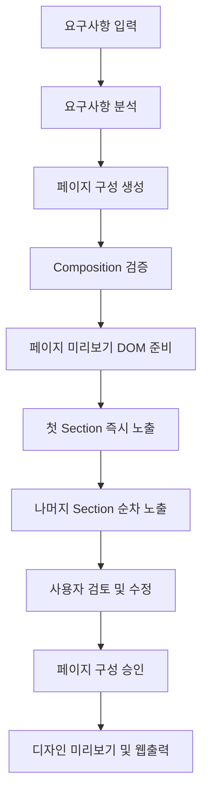
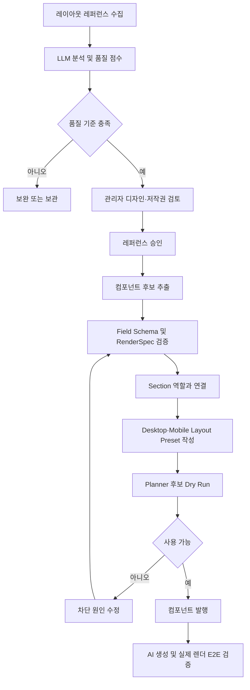

# 페이지 미리보기 순차 노출 및 레퍼런스 컴포넌트 사용 가능화 개발계획서

## 0. 문서 정보

- 작성일: 2026-11-08
- 대상 프로젝트: Promo Web Builder
- 대상 화면: `/prototype/create-promo?mode=ai`, Admin 레이아웃 레퍼런스 및 컴포넌트 관리
- 문서 상태: 로컬 구현 및 Neon Preview DB 검증 완료 · Vercel Preview E2E 대기
- 목표 릴리스: Progressive Preview and Reference Component Publishing v1
- 기준 브랜치: `codex/ai-builder-chat-workspace`
- 대상 요청:
  1. 페이지 구성 미리보기를 위에서 아래로 순차적으로 노출한다.
  2. 레이아웃 수집에서 파생된 컴포넌트를 실제 AI 페이지 생성에 사용할 수 있게 한다.
- 관련 문서:
  - `docs/계획/llm-reusable-generative-layout-system-development-plan-2026-11-06.md`
  - `docs/계획/llm-high-quality-web-design-generation-development-plan-2026-11-06.md`
  - `docs/계획/ai-builder-chat-workspace-and-wireframe-approval-development-plan-2026-11-04.md`
  - `docs/계획/component-dom-render-spec-and-image-generation-development-plan-2026-09-09.md`

### 구현 진행 기록 (2026-11-08)

완료된 항목:

- 페이지 구성 미리보기 Section 순차 노출과 reduced-motion·print 예외
- 레퍼런스 및 컴포넌트 Generation Readiness 계산과 차단 사유 표시
- 레퍼런스 승인 시 Layout Spec 필수 검증
- reference-derived 컴포넌트의 RenderSpec 없는 활성화 차단
- 6개 레퍼런스 패턴 컴포넌트의 검증 해시 포함 RenderSpec v2
- 6개 Registry Section과 Desktop·Mobile Layout Preset 마이그레이션
- 레퍼런스-컴포넌트 관계 및 발행 감사·Idempotency 테이블
- Publish Plan Dry Run API와 트랜잭션 Publish API
- Admin 컴포넌트 관리의 Section·Layout·레퍼런스 선택 및 Dry Run·발행 UI
- Planner 레퍼런스 후보의 Layout Spec·디자인 요약 필수화
- 전체 자동 테스트 204개 통과
- Visual Editor와 Admin production build 통과

남은 배포 전 검증:

- 기존 Neon Preview 브랜치는 2026-11-04 기준이라 선행 마이그레이션 080 데이터가 없었다.
- Production 최신 Snapshot에서 `preview-reference-components-081-20261108` 브랜치를 새로 생성했다.
- 신규 Preview 브랜치 ID는 `br-floral-butterfly-ao8f2h7k`이다.
- 최초 적용에서 운영 스키마의 Section 역할 제약 누락을 확인했고 트랜잭션 전체가 롤백됐다.
- 081에 `offer`, `trust` 역할 제약과 불변 Composition Shell 후속 버전 발행을 추가한 뒤 재적용에 성공했다.
- 6개 컴포넌트 모두 v1 `inactive`, v2 `active`, RenderSpec 검증 해시 정상 상태다.
- 6개 모두 활성 Registry Section, Layout Preset, Desktop·Mobile itemKey, Component 역할과 Shell 역할 검증을 통과했다.
- 081을 동일 Preview 브랜치에서 재실행해 Idempotency도 검증했다.
- Production Neon DB와 Vercel Production은 변경하지 않았다.
- 남은 단계는 Vercel Preview에서 실제 Planner 후보 조회, 생성 E2E 및 사용자 검토 후 Production 승인이다.

## 1. 목적과 핵심 결론

이번 개발은 두 가지 사용자 경험 문제를 함께 해결한다.

첫째, 페이지 구성 미리보기가 한 번에 나타나는 대신 페이지가 조립되는 흐름을 사용자가 이해할 수 있도록 위에서 아래로 짧고 부드럽게 노출한다. 이 효과는 실제 서버 스트리밍을 흉내 내는 장시간 애니메이션이 아니라, 완성된 Composition을 안정적으로 렌더한 다음 Section 단위로 보여주는 Progressive Reveal 방식으로 구현한다.

둘째, 레이아웃 레퍼런스를 수집하고 컴포넌트 초안을 생성하는 데서 끝난 현행 파이프라인을 `검토 → RenderSpec 검증 → Section 연결 → Layout Preset 연결 → Planner 후보 검증 → 발행`까지 완성한다. 컴포넌트의 `active` 상태와 실제 생성 가능 상태를 구분하고, 관리자 화면에서 사용 불가 원인을 명확히 표시한다.

핵심 결론은 다음과 같다.

> 수집된 레퍼런스는 디자인 판단 자료이고, 추출된 컴포넌트는 렌더링 자산이다. 두 자산 모두 검토와 품질 게이트를 통과한 뒤 활성 Section 및 Layout Preset에 연결되어야 AI 생성 후보가 된다. 페이지 미리보기는 이 동일한 Composition을 변경하지 않고 Section 단위로 순차 노출한다.

## 2. 현행 상태와 확인 결과

### 2.1 확인된 사실

2026-11-08 운영 Neon DB와 현재 소스코드를 기준으로 확인한 결과다.

| 영역 | 현재 상태 | 영향 |
|---|---:|---|
| 수집된 레이아웃 레퍼런스 | 55개 | 수집 자체는 완료됨 |
| 승인된 레퍼런스 | 0개 | Planner 참고자료에 포함되지 않음 |
| 저작권 검토 완료 | 0개 | Planner 후보 조건 미충족 |
| Planner 사용 가능 레퍼런스 | 0개 | 레퍼런스 기반 디자인 판단 불가 |
| 레퍼런스 품질 점수 | 0.00~2.60 | 현행 최소 기준 4.00 미충족 |
| 파생 컴포넌트 | 6개 | 컴포넌트 Registry에는 존재함 |
| 파생 컴포넌트 버전 상태 | 6개 모두 `active` | 활성화 자체는 완료됨 |
| RenderSpec 보유 | 0개 | 컴포넌트 고유 DOM 렌더 계약 없음 |
| Section Component Instance 연결 | 0건 | Planner가 컴포넌트를 조회할 경로 없음 |
| 사용 가능한 Section 연결 | 0건 | 생성 후보 포함 불가 |
| 연결된 Section Layout Preset | 0건 | Desktop·Mobile 배치 정보 없음 |

현재 파생 컴포넌트는 다음 6개다.

1. Offer Value Breakdown
2. Promotion Steps
3. Trust Proof Grid
4. Metric Strip
5. Feature Split
6. FAQ Accordion

### 2.2 소스코드에서 확인된 정책

- `promo_layout_references`는 `draft`, `review`, `approved`, `archived` 상태를 지원한다.
- Planner는 `approved`, `copyright_reviewed=true`, `research_only=true`, `quality_score>=4`를 모두 만족하는 레퍼런스만 조회한다.
- AI Composer는 전체 컴포넌트 Registry를 직접 조회하지 않는다.
- `active`이면서 Wizard에 노출되는 `registry/shared` Section을 먼저 조회한다.
- 해당 Section의 Component Instance 중 활성 컴포넌트 버전만 Planner 후보에 포함한다.
- 레퍼런스 파생 컴포넌트 마이그레이션은 관리자 검토와 RenderSpec 작성 후 활성화하도록 설계되었다.
- 운영 DB에서는 6개 버전이 RenderSpec 없이 활성화되어 있다.

### 2.3 강점

- 검토되지 않은 외부 레이아웃을 자동으로 페이지에 사용하는 것을 차단하고 있다.
- Planner가 Registry에 등록된 자산만 사용하므로 임의 DOM과 임의 컴포넌트 생성 위험이 낮다.
- Section, Component Version, Layout Preset의 책임이 분리되어 있다.
- 컴포넌트 RenderSpec 검증 API와 이미지 분석 기반 Draft 생성 흐름이 이미 존재한다.

### 2.4 약점

- 수집, 분석, 승인, 컴포넌트 생성과 실제 발행이 하나의 관리 흐름으로 연결되어 있지 않다.
- `active` 상태만 보면 사용 가능한 것처럼 보이지만 Section 연결이 없으면 Planner는 사용할 수 없다.
- 레퍼런스 55개의 분석 점수와 검토 상태가 Planner 기준에 도달하지 못했지만 일괄 원인 표시가 없다.
- RenderSpec 없는 레퍼런스 파생 컴포넌트도 활성화할 수 있어 의도한 검토 게이트가 약하다.
- 페이지 구성 미리보기는 Section DOM을 한 번에 생성하며 순차 노출 상태를 관리하지 않는다.

### 2.5 확인되지 않은 내용

- 6개 컴포넌트 버전을 누가 어떤 경로로 활성화했는지는 현재 조회한 데이터만으로 확정할 수 없다.
- 수집된 55개 레퍼런스의 품질 점수가 낮은 원인이 분석 미실행인지, 분석 결과 자체가 낮은 것인지는 개별 `analysis_meta`와 실행 로그를 추가 점검해야 한다.
- 6개 패턴과 55개 레퍼런스 사이의 직접적인 파생 관계는 별도 관계 테이블이 없어 자동 추적할 수 없다.

## 3. As-Is와 To-Be

| 영역 | As-Is | To-Be |
|---|---|---|
| 페이지 미리보기 | 모든 Section이 즉시 표시 | 완성된 Composition을 Section 단위로 위에서 아래로 순차 노출 |
| 재방문 동작 | 탭을 열 때마다 동일 렌더 | 새 생성·재생성 시에만 노출 효과, 단순 탭 이동은 즉시 표시 |
| 접근성 | 미리보기 전용 Motion 정책 없음 | `prefers-reduced-motion`에서는 즉시 표시 |
| 레퍼런스 상태 | 55개 모두 Draft | 분석·검토·저작권 확인·승인 상태를 명시적으로 관리 |
| 레퍼런스 사용 | Planner 후보 0개 | 기준을 통과한 승인 레퍼런스를 Planner 판단 자료로 제공 |
| 컴포넌트 활성 상태 | `active`이면 사용 가능한 것처럼 보임 | `active`와 `generationReady`를 분리해 표시 |
| RenderSpec | 6개 모두 없음 | 각 컴포넌트에 검증된 RenderSpec 보유 |
| Section 연결 | 0건 | 허용 역할의 활성 Section에 Component Instance로 연결 |
| Layout | 연결 없음 | Desktop·Mobile Layout Preset과 Component item key 연결 |
| 발행 | 수동 작업이 분산됨 | Readiness 점검과 Publish를 하나의 관리자 흐름으로 제공 |
| 추적성 | 레퍼런스와 컴포넌트 관계 불명확 | 파생 관계와 검토 이력을 저장 |

## 4. 목표 사용자 흐름

### 4.1 일반 사용자 흐름



### 4.2 관리자 레퍼런스 발행 흐름



## 5. 개발 범위

### 5.1 포함 범위

- 페이지 구성 미리보기 Section 순차 노출
- 새 Composition과 기존 Composition 재방문 구분
- Motion 감소 설정 및 테스트·내보내기 예외 처리
- 레이아웃 레퍼런스 Readiness 계산
- 컴포넌트 Generation Readiness 계산
- 레퍼런스와 파생 컴포넌트 관계 저장
- 레퍼런스 파생 컴포넌트 RenderSpec 필수화
- 컴포넌트와 활성 Section 연결
- Desktop·Mobile Layout Preset 연결
- Planner 후보 Dry Run 및 차단 사유 표시
- 관리자 Publish 흐름과 감사 이력
- 6개 기존 컴포넌트의 정상 발행
- Preview와 Production 단계별 검증

### 5.2 비범위

- 외부 사이트의 HTML·CSS 직접 복사
- 저작권 확인 자동 승인
- 품질 점수 미달 레퍼런스의 강제 사용
- LLM이 임의 HTML, CSS 또는 JavaScript를 생성해 실행하는 기능
- Registry에 없는 컴포넌트의 자동 활성화
- 사용자 승인 없는 Production 자동 발행
- 페이지 미리보기를 실제 토큰 스트리밍이나 Section별 API 스트리밍으로 변경
- 기존 3단계 사용자 흐름 제거

## 6. Track A 페이지 미리보기 순차 노출

### 6.1 구현 원칙

1. 서버 응답과 Composition 검증이 완료된 뒤 DOM 전체를 생성한다.
2. DOM 구조와 높이를 먼저 확보해 Layout Shift를 줄인다.
3. Section별 `revealIndex`를 부여하고 CSS Custom Property로 지연 시간을 전달한다.
4. 첫 Section은 즉시 또는 80ms 이내에 표시한다.
5. 이후 Section은 90~140ms 간격으로 표시한다.
6. 최초 화면의 전체 노출 시간은 최대 1.2초를 넘기지 않는다.
7. 8개를 초과하는 긴 페이지는 첫 8개까지만 순차 노출하고 나머지는 viewport 진입 시 표시한다.
8. 단순 탭 이동, viewport 전환과 편집 모드 진입에서는 전체 애니메이션을 반복하지 않는다.
9. Composition Revision이 바뀌면 새 미리보기로 판단하고 다시 실행한다.
10. `prefers-reduced-motion: reduce`, 인쇄, 스크린샷 및 자동화 테스트에서는 즉시 표시한다.

### 6.2 상태 모델

```text
idle
  → prepared
  → revealing
  → complete

오류 또는 사용자 탭 이동
  → complete
```

필요 상태:

- `previewRevealRevision`: 효과를 실행한 Composition Revision
- `previewRevealState`: `idle | prepared | revealing | complete`
- `revealedSectionCount`: 현재까지 표시된 Section 수
- `reducedMotion`: 사용자 OS 설정
- `isAutomationOrExport`: 테스트, 캡처 및 내보내기 여부

### 6.3 UI 구현 지점

주요 변경 대상:

- `visual-editor/src/builder/CompositionReview.vue`
  - Section별 reveal 속성 및 상태 적용
  - Composition Revision 변화 감지
  - 탭 재방문 시 애니메이션 반복 방지
- `visual-editor/src/builder/ai-builder.css`
  - opacity와 translateY 기반 진입 효과
  - reduced motion, print 및 capture 예외
- `prototype/visual-editor-assets/ai-builder.js`
  - Visual Editor 빌드 결과 반영
- `prototype/visual-editor-assets/ai-builder.css`
  - Visual Editor 빌드 결과 반영

권장 Motion 값:

```css
opacity: 0 → 1
transform: translateY(12px) → translateY(0)
duration: 320ms
easing: cubic-bezier(.2, .75, .25, 1)
stagger: 110ms
```

### 6.4 예외 처리

- Section key가 바뀌거나 Section 수가 달라지면 Revision 기준으로 전체를 새로 노출한다.
- 문구나 정렬만 수정한 경우 변경된 Section만 짧게 강조하는 기능은 P1 후속 범위로 둔다.
- 사용자가 미리보기 탭을 빠르게 벗어나면 모든 Section을 즉시 표시하고 Timer를 정리한다.
- 브라우저 백그라운드 탭에서는 지연 Timer에 의존하지 않고 복귀 시 최종 상태로 전환한다.
- DOM을 `display:none`으로 제거하지 않고 visibility, opacity와 transform만 사용해 높이 변동을 방지한다.

### 6.5 완료 기준

- 새 미리보기 생성 시 Section이 위에서 아래로 한 번만 나타난다.
- 첫 Section은 Composition 준비 후 250ms 이내 표시된다.
- 8개 이하 Section은 1.2초 이내 모두 표시된다.
- 탭 재방문과 Desktop·Mobile 전환 시 불필요하게 반복되지 않는다.
- reduced motion 설정에서는 애니메이션 없이 즉시 표시된다.
- 편집, 승인, 디자인 생성과 웹출력 데이터에는 영향이 없다.

## 7. Track B 레퍼런스 컴포넌트 사용 가능화

### 7.1 상태를 두 축으로 분리

컴포넌트 상태는 다음 두 축으로 표시한다.

```text
Lifecycle Status
  draft | active | inactive | archived

Generation Readiness
  blocked | ready | verified
```

`active`는 최신 활성 버전이라는 의미만 가진다. AI 생성 사용 가능 여부는 `Generation Readiness`로 판단한다.

### 7.2 Readiness 조건

레퍼런스는 다음 조건을 모두 만족해야 Planner 참고 후보가 된다.

- 상태가 `approved`
- `copyright_reviewed=true`
- `research_only=true`
- `quality_score>=4`
- 필수 분석 결과와 `layout_spec` 존재

컴포넌트는 다음 조건을 모두 만족해야 생성 후보가 된다.

- 컴포넌트 상태 `active`
- 컴포넌트 버전 상태 `active`
- RenderSpec 존재
- RenderSpec Validation `ok=true`
- 활성 `registry/shared` Section에 Component Instance로 연결
- Section과 Component 모두 Wizard 노출 가능
- Section 역할이 Component Placement Policy와 일치
- Section에 최소 1개 Layout Preset 존재
- Layout Snapshot에 연결된 `item_key` 존재
- Desktop·Mobile geometry 검증 통과
- Composition Shell에서 해당 Section 역할 허용
- Planner Candidate Dry Run에 포함

### 7.3 차단 코드

관리자 화면과 API는 사람이 이해할 수 있는 설명과 함께 다음 코드 중 하나 이상을 반환한다.

| 코드 | 의미 |
|---|---|
| `REFERENCE_NOT_APPROVED` | 레퍼런스가 승인되지 않음 |
| `COPYRIGHT_REVIEW_REQUIRED` | 저작권 검토가 완료되지 않음 |
| `REFERENCE_QUALITY_BELOW_THRESHOLD` | 품질 점수 4 미만 |
| `REFERENCE_LAYOUT_SPEC_REQUIRED` | 분석된 Layout Spec 없음 |
| `RENDER_SPEC_REQUIRED` | 컴포넌트 RenderSpec 없음 |
| `RENDER_SPEC_INVALID` | RenderSpec 검증 실패 |
| `ACTIVE_VERSION_REQUIRED` | 활성 Component Version 없음 |
| `SECTION_INSTANCE_REQUIRED` | 활성 Section 연결 없음 |
| `SECTION_ROLE_NOT_ALLOWED` | Placement Policy와 역할 불일치 |
| `LAYOUT_PRESET_REQUIRED` | Section Layout Preset 없음 |
| `LAYOUT_ITEM_BINDING_INVALID` | Layout item key와 Component Instance 불일치 |
| `RESPONSIVE_LAYOUT_INVALID` | Desktop 또는 Mobile geometry 실패 |
| `COMPOSITION_SHELL_ROLE_NOT_ALLOWED` | Shell 정책에서 Section 역할 차단 |
| `PLANNER_CANDIDATE_EXCLUDED` | 최종 Planner 후보에서 제외됨 |

### 7.4 데이터 모델 변경

신규 관계 테이블을 추가한다.

```sql
promo_layout_reference_component_links
  id uuid primary key
  layout_reference_id uuid not null
  component_id uuid not null
  component_version_id uuid
  relationship text not null
  evidence jsonb not null default '{}'
  created_by text not null
  created_at timestamptz not null
```

`relationship` 허용값:

- `derived`: 해당 레퍼런스 분석을 기반으로 추출
- `inspired`: 여러 레퍼런스에서 공통 패턴을 정리
- `validated`: 기존 컴포넌트를 레퍼런스로 검증

제약:

- 관계 생성은 관리자 권한이 필요하다.
- `derived`는 최소 하나의 레퍼런스 근거를 요구한다.
- 저작권 검토 전에는 컴포넌트 발행 근거로 사용할 수 없다.
- 원본 이미지나 외부 사이트 코드는 관계 테이블에 저장하지 않는다.

Readiness는 중복 상태 컬럼으로 저장하지 않고 기존 데이터로 계산한다. 성능 문제가 확인될 때만 Materialized View 또는 Cache를 도입한다.

### 7.5 API 변경

#### 기존 API 강화

- `GET /api/layout-references`
  - 레퍼런스별 `plannerReadiness`, `blockerCodes` 추가
- `PATCH /api/layout-references`
  - 승인 시 저작권 검토, 품질 점수와 분석 결과 동시 검증
- `POST /api/item-component-render-spec-validate`
  - 레퍼런스 파생 컴포넌트에 Field Binding과 Responsive 검증 강화
- `POST /api/item-component-activate`
  - `referenceDerived=true`이면 유효한 RenderSpec 없이는 활성화 거부
- `GET /api/item-component-usage`
  - Section 연결뿐 아니라 `generationReadiness`, `blockerCodes` 반환
- `GET /api/promo-registry-composition-candidates`
  - 관리자 Dry Run에서 포함·제외 이유를 반환

#### 신규 API

`POST /api/reference-component-publish-plan`

- 입력: `componentVersionId`, `sectionId`, `layoutPresetIds`, `referenceIds`
- 동작: DB를 변경하지 않고 모든 Readiness 조건 검사
- 출력: 적용 예정 변경, 차단 코드, 경고, Planner 후보 예상 결과

`POST /api/reference-component-publish`

- 입력: 승인된 Publish Plan, 관리자 변경 사유, Idempotency Key
- 동작: 관계 저장, Section Instance 연결, Layout 검증, 버전 활성화를 트랜잭션으로 처리
- 출력: 발행 결과와 최종 Readiness Snapshot

운영 원칙:

- Dry Run 성공 없이 Publish할 수 없다.
- Publish 도중 하나라도 실패하면 전체를 Rollback한다.
- 기존 활성 컴포넌트가 있으면 영향 범위를 사전 표시한다.
- 외부 공개 페이지 발행과 컴포넌트 Registry 발행은 별도 권한으로 유지한다.

### 7.6 관리자 UI

레이아웃 레퍼런스 목록에 다음 정보를 표시한다.

- 분석 완료 여부
- 품질 점수와 기준 충족 여부
- 저작권 검토 여부
- Planner 사용 가능 여부
- 연결된 컴포넌트 수
- 차단 사유

컴포넌트 목록은 상태를 다음처럼 구분한다.

```text
활성 · 사용 가능
활성 · 설정 미완료
초안 · 검토 필요
비활성
보관됨
```

`사용 준비` 버튼을 누르면 다음 순서의 Wizard를 제공한다.

1. 레퍼런스 근거와 승인 상태 확인
2. Field Schema와 RenderSpec 확인
3. Section 역할 및 Instance 연결
4. Desktop·Mobile Layout Preset 확인
5. Planner Dry Run
6. 관리자 발행

활성 상태지만 사용 불가능한 현재 6개 컴포넌트에는 `설정 미완료` 배지와 차단 사유를 표시한다.

### 7.7 6개 컴포넌트 연결 전략

| 컴포넌트 | 권장 Section 역할 | 기본 Layout Family | 우선순위 |
|---|---|---|---|
| Offer Value Breakdown | `offer`, `cta` | offer summary, centered conversion | P0 |
| Promotion Steps | `content`, `offer` | numbered grid, vertical steps | P0 |
| Trust Proof Grid | `trust`, `benefit` | proof grid, badge band | P0 |
| Metric Strip | `trust`, `benefit` | metric band, metric grid | P0 |
| Feature Split | `content`, `benefit`, `hero` | media left, media right | P0 |
| FAQ Accordion | `notice`, `content` | accordion stack | P1 |

각 컴포넌트는 최소 다음 Layout을 가져야 한다.

- Desktop 기본형 1개
- Desktop 대안형 1개
- Mobile stack 또는 reflow 전략 1개
- 긴 제목·본문 대응 규칙
- 이미지 없는 경우의 fallback
- 반복 Collection의 최소·최대 항목 대응

### 7.8 기존 데이터 보정

현재 운영 DB의 6개 활성 버전은 바로 삭제하거나 비활성화하지 않는다.

1. 운영 데이터 Snapshot을 조회해 대상 ID를 확정한다.
2. 신규 RenderSpec을 Draft 버전 2로 생성한다.
3. 버전 2를 Preview DB Branch에서 검증한다.
4. Section과 Layout Preset을 버전 2에 연결한다.
5. Planner Dry Run과 실제 생성 E2E를 통과시킨다.
6. 버전 2를 활성화하고 기존 버전 1을 `inactive`로 전환한다.
7. 문제가 발생하면 버전 1을 재활성화하되 Planner 연결은 신규 버전과 함께 Rollback한다.

이 방식은 현재 활성 버전을 직접 수정하는 것보다 이력과 복구 가능성이 높다.

## 8. 구현 단계

### Phase 0 기준선 고정 및 테스트 준비

- 운영 DB Readiness 조회 SQL을 테스트 Fixture로 고정
- 55개 레퍼런스와 6개 컴포넌트의 현재 Snapshot 기록
- Feature Flag 추가
  - `progressive_preview_reveal_v1`
  - `reference_component_publishing_v1`
- Preview Neon Branch 및 Vercel Preview 환경 확인

완료 조건:

- 변경 전 Planner 후보 목록과 Preview 동작을 재현할 수 있다.
- Production 변경 없이 Preview Branch에서 마이그레이션을 검증할 수 있다.

### Phase 1 페이지 미리보기 순차 노출

- Reveal 상태와 Revision 추적 구현
- Section별 CSS delay 적용
- 탭 재방문·viewport 전환 예외 처리
- reduced motion, print, screenshot 예외 처리
- Component 및 브라우저 테스트 추가

완료 조건:

- Track A 완료 기준 전체 통과

### Phase 2 Readiness 진단 기반 구축

- 레퍼런스 Readiness 계산기 구현
- 컴포넌트 Readiness 계산기 구현
- 차단 코드와 한국어 설명 정의
- 기존 목록·사용처 API에 Readiness 추가
- Admin 목록에 상태와 차단 사유 표시

완료 조건:

- 현재 55개와 6개가 왜 차단되는지 UI와 API에서 동일하게 확인된다.

### Phase 3 RenderSpec과 Section·Layout 통합

- 관계 테이블 마이그레이션
- 6개 컴포넌트 버전 2 및 RenderSpec 작성
- RenderSpec Validation 통과
- 역할별 Section Component Instance 연결
- Desktop·Mobile Layout Preset 작성
- Composition Shell 역할 정책 검증

완료 조건:

- 6개 컴포넌트 모두 `generationReady=true`
- Planner Candidate Snapshot에 포함

### Phase 4 관리자 Publish 흐름

- Publish Plan Dry Run API
- Transactional Publish API
- Admin `사용 준비` Wizard
- 감사 이력과 Idempotency 적용
- 활성화 API의 reference-derived RenderSpec 필수화

완료 조건:

- 부분 활성 상태를 만들지 않고 하나의 Publish 작업으로 발행 또는 전체 Rollback된다.

### Phase 5 E2E 검증 및 단계적 배포

- 레퍼런스 승인 후보를 수동 검토
- 우선 2개 컴포넌트로 Preview Pilot
- 6개 전체 생성 시나리오 검증
- Desktop·Mobile Preview와 Web Output 비교
- Vercel Preview 배포 및 사용자 승인
- Production 배포 후 로그와 사용률 모니터링

완료 조건:

- 생성 요청에서 신규 컴포넌트가 실제 선택되고 렌더된다.
- 페이지 구성 미리보기와 Web Output의 구조가 일치한다.
- Blocking 오류가 없고 Rollback 절차가 검증된다.

## 9. 테스트 계획

### 9.1 단위 테스트

- Reveal delay 계산
- Revision 변경과 재방문 판정
- reduced motion 판정
- 레퍼런스 Readiness 조건별 차단 코드
- 컴포넌트 Readiness 조건별 차단 코드
- Placement Policy와 Section Role 일치 판정
- Layout item key와 Component Instance 일치 판정

### 9.2 계약 테스트

- Planner가 승인·저작권·품질 조건을 유지하는지 확인
- reference-derived 컴포넌트는 RenderSpec 없이 활성화할 수 없는지 확인
- 활성 Section Instance가 없는 컴포넌트는 후보에서 제외되는지 확인
- Dry Run 실패 시 Publish가 실행되지 않는지 확인
- Publish 실패 시 Section, Layout과 버전 상태가 모두 Rollback되는지 확인

### 9.3 브라우저 E2E

시나리오 A: 순차 노출

1. 자연어 요구사항 입력
2. 페이지 미리보기 생성
3. Section 노출 순서와 총 시간 확인
4. 탭 왕복 시 반복되지 않는지 확인
5. Desktop·Mobile 전환 후 전체 내용 유지 확인
6. reduced motion에서 즉시 표시 확인

시나리오 B: 신규 컴포넌트 사용

1. 혜택 요약, 참여 단계, 신뢰 지표와 FAQ가 필요한 프로모션 요청
2. Planner Candidate Snapshot에 대상 컴포넌트 포함 확인
3. 최소 2개 파생 컴포넌트 선택 확인
4. 페이지 구성 미리보기 문구와 배치 확인
5. 디자인 미리보기 생성
6. Web Output에서 동일한 Section·Component와 콘텐츠 확인
7. Mobile 겹침·잘림·과밀 여부 확인

### 9.4 회귀 테스트

- 기존 Registry Hero, Card Grid, Brand Story와 Social Proof 생성
- 요구사항 수정과 미리보기 수정 저장
- 디자인 미리보기 생성
- 사용자 승인 Fingerprint
- Web Output 및 Vercel Preview
- Admin 컴포넌트 보관·비활성화·버전 전환

## 10. 품질 지표

### 10.1 기능 지표

- Planner 사용 가능 레퍼런스: 초기 승인 목표 최소 10개
- 사용 가능한 레퍼런스 파생 컴포넌트: 6개
- Readiness 차단 원인 미표시: 0건
- Planner Candidate 포함 실패: 0건
- Preview와 Web Output Section 불일치: 0건
- Publish 부분 적용: 0건

### 10.2 사용자 경험 지표

- 첫 Section 표시: Composition 준비 후 250ms 이내
- 8개 Section 전체 노출: 1.2초 이내
- Reveal 중 Layout Shift: CLS 0.1 미만
- reduced motion 준수율: 100%
- 순차 노출로 인한 승인·편집 버튼 차단: 0건

### 10.3 품질 개선 관찰 지표

- 신규 컴포넌트별 Planner 선택 횟수
- 신규 컴포넌트가 포함된 결과의 첫 승인율
- 사용자 수정 요청 횟수
- Preview와 Web Output 차이 신고 수
- RenderSpec Validation 실패 유형
- Section Role 및 Layout Fit 제외 빈도

선택률 자체를 성공 기준으로 강제하지 않는다. 요구사항에 적합하지 않은 컴포넌트를 억지로 선택하면 디자인 품질이 낮아질 수 있기 때문이다.

## 11. 위험과 대응

| 위험 | 영향 | 대응 |
|---|---|---|
| 낮은 품질의 레퍼런스를 수치만 올려 승인 | Planner 디자인 판단 오염 | 재분석과 사람 검토를 분리하고 승인 사유 저장 |
| 외부 사이트 디자인 복제 | 저작권 및 브랜드 위험 | 구조 패턴만 추출하고 원본 코드·문구·이미지 미사용 |
| `active`와 사용 가능 상태 혼동 | 운영자가 미완성 자산 발행 | Generation Readiness와 차단 사유 별도 표시 |
| RenderSpec 없이 활성화 | 렌더 불일치와 fallback 의존 | reference-derived 활성화에 RenderSpec 필수화 |
| Section 연결은 있으나 Layout이 없음 | Composer 후보 오류 | Publish Dry Run에서 필수 Layout 검사 |
| Layout item key 불일치 | 빈 콘텐츠 또는 잘못된 Binding | Publish 전 Snapshot Binding 정적 검증 |
| 순차 노출이 느리게 느껴짐 | 미리보기 확인 지연 | 최대 1.2초, 재방문 미반복, reduced motion 지원 |
| 애니메이션으로 자동화 테스트 불안정 | 간헐적 테스트 실패 | automation/capture 모드 즉시 표시 |
| 운영 DB 직접 보정 | 복구와 감사 이력 부족 | 신규 버전, Preview Branch와 관리 API 사용 |

## 12. 배포와 Rollback

### 12.1 배포 순서

1. 코드와 DB Migration을 Preview Branch에 적용
2. Readiness API는 읽기 전용 상태로 먼저 배포
3. Progressive Preview Feature Flag를 Preview에서 활성화
4. 2개 컴포넌트만 Publish Pilot
5. 브라우저 E2E와 사용자 검토
6. 나머지 4개 컴포넌트 발행
7. Production 코드 배포
8. Production DB Publish 실행
9. 24시간 오류·후보 선택·렌더 결과 확인

### 12.2 Rollback

- 순차 노출 문제: `progressive_preview_reveal_v1=false`
- 후보 품질 문제: `reference_component_publishing_v1=false`
- 특정 컴포넌트 문제: 신규 버전 2를 `inactive`, 이전 버전 재활성화
- Section 문제: 신규 Component Instance와 Layout Preset 비활성 또는 연결 해제
- 레퍼런스 문제: `approved`에서 `review`로 되돌리고 Planner 후보 제외

Rollback 시 생성 완료된 기존 페이지 Snapshot은 변경하지 않는다. 신규 생성 후보만 차단한다.

## 13. 예상 일정과 작업량

아래 일정은 1명 기준의 추정치이며, 55개 레퍼런스의 수동 저작권·품질 검토 시간은 별도다.

| 단계 | 예상 기간 |
|---|---:|
| Phase 0 기준선과 Feature Flag | 0.5일 |
| Phase 1 순차 노출 | 1.0일 |
| Phase 2 Readiness 진단 | 1.5일 |
| Phase 3 RenderSpec·Section·Layout 통합 | 3.0일 |
| Phase 4 관리자 Publish 흐름 | 2.0일 |
| Phase 5 E2E·배포 | 1.5일 |
| 합계 | 약 9.5 개발일 |

레퍼런스 55개 전체를 검토하기 전에 품질 상위 후보 10개와 핵심 컴포넌트 2개로 Pilot을 진행하면 기술 검증과 콘텐츠 검토를 병렬로 진행할 수 있다.

## 14. 최종 완료 조건

다음 항목을 모두 충족하면 이번 개발을 완료로 판단한다.

- 페이지 구성 미리보기가 새 생성 시 위에서 아래로 부드럽게 한 번만 노출된다.
- 접근성, 테스트, 내보내기와 탭 재방문에서 불필요한 Motion이 발생하지 않는다.
- 레퍼런스별 Planner 사용 가능 여부와 차단 사유가 표시된다.
- 컴포넌트별 `active`와 `generationReady`가 구분된다.
- 6개 레퍼런스 파생 컴포넌트에 검증된 RenderSpec이 존재한다.
- 6개 컴포넌트가 활성 Section과 Desktop·Mobile Layout Preset에 연결된다.
- Planner Candidate Snapshot에 6개 컴포넌트가 조건에 맞게 포함된다.
- 실제 생성 요청에서 신규 컴포넌트가 선택되고 Preview와 Web Output에 동일하게 렌더된다.
- Publish 작업이 Dry Run, 감사 이력, Idempotency와 Transaction Rollback을 지원한다.
- Preview 배포와 Production 배포 후 Blocking 회귀 오류가 없다.

## 15. 착수 우선순위

즉시 착수 순서는 다음과 같다.

1. 페이지 미리보기 순차 노출을 독립 Feature Flag로 구현한다.
2. Readiness 계산기를 먼저 만들어 현재 차단 상태를 UI에 표시한다.
3. Offer Value Breakdown과 Feature Split 두 개를 Pilot 대상으로 선정한다.
4. 두 컴포넌트의 RenderSpec, Section과 Layout Preset을 완성한다.
5. Planner Dry Run과 실제 Preview·Web Output을 검증한다.
6. 동일한 절차를 나머지 네 컴포넌트로 확장한다.
7. 품질 상위 레퍼런스 10개를 검토·승인하고 Planner 참고 후보로 개방한다.

이 순서는 사용자에게 보이는 개선을 빠르게 제공하면서, 미완성 컴포넌트를 한꺼번에 Production 후보로 노출하는 위험을 줄인다.
