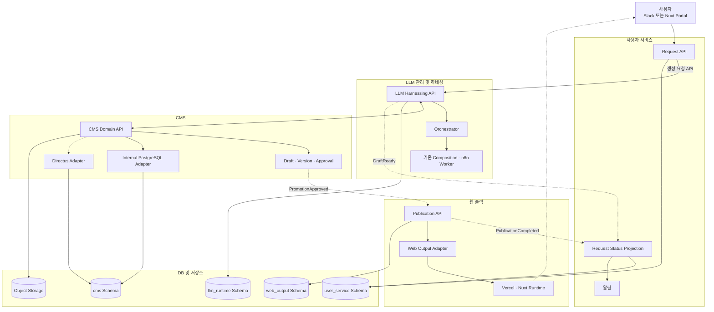
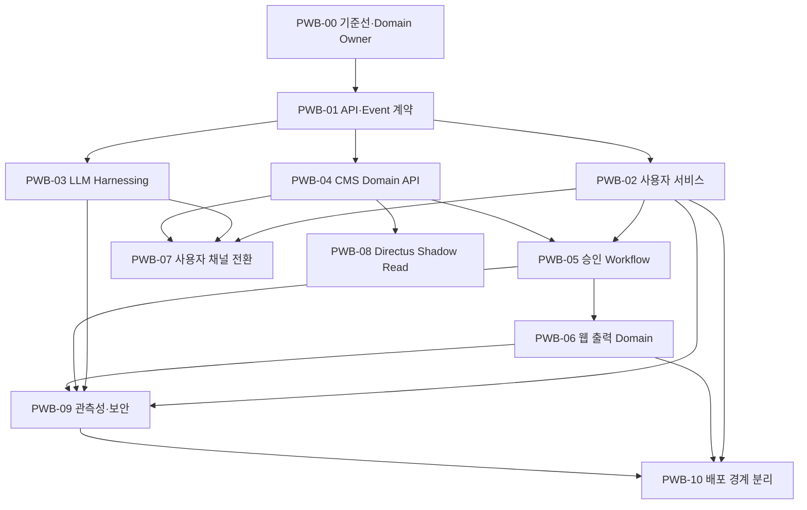

# Promo Web Builder 서비스 계약 V3 개발 계획서

## 0. 문서 정보

- 작성일: 2026-11-03
- 대상 프로젝트: `promo_web_builder`
- 기준 Commit: `5fe5731`
- 문서 상태: V3 소스 구현·커밋 완료 · Preview DB 인증 복구 대기
- 권장 실행 기간: 8주
- 현재 Source of Truth: PostgreSQL
- 목표: 기존 Builder와 PublishedPromotion v1 계약을 유지하면서 사용자 서비스, LLM 관리 및 하네싱, CMS, 웹 출력의 네 Domain을 Promo Service Contract V3 API로 구축한다.
- 전제: 이번 계획의 승인 전에는 기존 API 삭제, Domain별 물리 DB 분리, Directus Runtime Write 활성화를 수행하지 않는다.

### 0.1 V3 구현 현황

2026-11-03 기준 다음 기반 소스가 구현되었다.

| 구분 | 구현 내용 | 상태 |
|---|---|---|
| 공용 계약 | PromoRequest, GenerationJob, GenerationContext, DomainEvent V3 Validator | 완료 |
| 사용자 서비스 | `POST/GET /api/v3/promo-requests` | 완료 |
| LLM 하네싱 | `POST/GET /api/internal/v3/generation-jobs`, 기존 n8n Worker Adapter | 완료 |
| CMS Context | `GET /api/internal/v3/generation-context` | 완료 |
| 사용자 Action | Feedback, Regenerate, Cancel API | 완료 |
| 승인 | Quality Gate 기반 Review와 CMS Approval Event | 완료 |
| 웹 출력 | 승인 Snapshot 기반 Publication V3와 Nuxt Cache Invalidation | 완료 |
| 데이터 경계 | `user_service`, `llm_runtime`, `cms`, `web_output` Schema Migration | 작성 완료, Preview DB 인증 실패로 적용 전 |
| Event | Domain별 Outbox, Dispatcher와 Request Projection | 완료 |
| 보안 | 내부 API 전용 Bearer Token 검증 | 완료 |
| Rollout | `PROMO_SERVICE_CONTRACT_V3_ENABLED` Feature Flag | 완료, 기본 OFF |
| 사용자 UI | AI Builder Request V3와 승인·발행 UI | 완료 |
| 검증 | 전체 190개 Test와 Admin·Visual Editor·Nuxt Build | 완료 |

다음 항목은 외부 환경 Rollout 단계이다.

- Preview의 `PREVIEW_DATABASE_URL` 자격 증명 복구
- Preview DB Migration 적용
- Preview 환경의 `PROMO_SERVICE_V3_TOKEN` 설정 완료, Feature Flag는 DB 복구 전까지 OFF
- Preview 배포 완료, 실제 DB·n8n·Nuxt E2E는 DB 복구 후 재개
- Rollback Drill
- Preview Release Gate 통과 후 Production Migration과 단계적 활성화

V3 활성화 전 `070_promo_service_contract_v3_foundation.sql`을 적용하고 `PROMO_SERVICE_V3_TOKEN`을 32자 이상으로 설정해야 한다.

### 1.1 2026-11-03 Rollout 결과

- V3 Preview 소스 배포와 Build는 성공했다.
- V3 Capability는 Preview에서 활성 상태로 확인했다.
- `070` Migration 실행은 `PREVIEW_DATABASE_URL`의 `neondb_owner` 비밀번호 인증 실패(`28P01`)로 Transaction 시작 전에 중단됐다.
- Preview DB 스키마와 Production DB에는 변경이 발생하지 않았다.
- 임시 Migration UI/API는 제거했고 제거 경로의 `404`를 확인했다.
- Preview Feature Flag는 `false`로 복구했으며 Capability가 Contract Version 2를 반환하는 것을 확인했다.
- Production Migration과 Production 배포는 Preview Release Gate 미통과로 실행하지 않았다.

## 1. 개발 목표

사용자의 프로모션 요구사항 입력부터 웹 출력까지의 흐름을 다음 대표 API로 단순화한다.

```text
사용자 서비스
→ Request API V3
→ LLM Harnessing API V3
↔ CMS Domain API V3
→ CMS Draft · Version · Approval
→ Publication API V3와 Web Output Adapter
→ Vercel 또는 Nuxt Runtime
```

최종 목표 상태는 다음과 같다.

- 사용자 서비스는 요청, 피드백, 검토 화면, 상태 Projection과 알림을 소유한다.
- LLM 관리 및 하네싱은 Job, Attempt, 입력 Snapshot, 품질 결과와 사용량을 소유한다.
- CMS는 Component, Token, Content, Asset Metadata, Draft, Version과 Approval을 소유한다.
- 웹 출력은 승인 Snapshot, Publication, 배포 상태, 공개 URL과 Cache 무효화를 소유한다.
- 사용자 채널은 세부 Builder, Prompt, Component, Token API를 직접 조합하지 않는다.
- 하나의 Request ID로 Document, Generation Job, Draft, Approval, Publication을 추적할 수 있다.
- LLM 하네싱은 Composition과 Generation Pipeline의 내부 차이를 외부에 노출하지 않는다.
- LLM Worker는 CMS Table을 직접 조회하지 않고 CMS Domain API를 사용한다.
- CMS 구현은 Directus 또는 Web Builder Admin 중 무엇을 사용하더라도 동일한 Domain Contract를 반환한다.
- 사용자 승인과 기술적 Quality Gate, Publication 상태가 분리된다.
- 승인된 고정 Revision만 Vercel/Nuxt Runtime에 게시된다.
- 일반 프로모션 발행은 애플리케이션 재배포가 아니라 Snapshot 반영과 Cache Revalidation로 처리한다.
- Domain 간 상태 전파는 대표 API와 Versioned Domain Event를 사용한다.
- 초기에는 Monorepo와 단일 PostgreSQL을 유지하되 Domain별 Package, Schema Owner와 배포 경계를 분리한다.
- 기존 API와 UI는 단계적 전환이 완료될 때까지 Rollback 경로로 유지한다.

## 2. 현행 기준선

현재 저장소에는 다음 기반이 이미 존재한다.

- Vue 기반 AI Builder와 Visual Editor
- Builder Document와 Revision Snapshot
- Composition Proposal, Lease, Retry, Apply, Rollback
- Integrated Brief, LO-FI, Final Design Generation Run
- Prompt, Model, Design Token, Component, Content Resource 관리
- Quality Gate와 Browser Attestation
- PublishedPromotion v1 계약
- Publication API와 Preview Token
- Nuxt SSR Readonly Runtime
- Directus Config, Migration, Shadow Read, Cutover Gate 기반
- 전체 186개 테스트 파일

현재 주요 차이는 다음과 같다.

| 영역 | 현행 | 목표 |
|---|---|---|
| 사용자 요청 | AI Builder가 여러 API 직접 조합 | Request API Facade |
| LLM 실행 | Composition과 Generation Run에 분산 | 단일 Harnessing Job Contract |
| CMS 조회 | Component, Token, Content API 개별 호출 | CMS Generation Context API |
| 승인 | Quality Gate 통과 후 즉시 Publication 가능 | 사용자 승인과 Publication 분리 |
| DB | 공통 PostgreSQL에 다수 Domain 공존 | 논리 Schema와 Owner 분리 |
| 데이터 소유권 | 일부 Store와 UI가 다른 Domain 데이터에 직접 접근 | Domain API와 Event를 통한 접근 |
| 상태 동기화 | 동기 호출과 내부 상태에 결합 | Transactional Outbox와 Projection |
| Directus | 전환 기반만 구현 | Components와 Tokens부터 Read Cutover |
| 웹 출력 | Nuxt Runtime과 Cache Invalidation 구현 | Output Adapter와 배포 경계 확정 |

## 3. 개발 범위

### 3.1 포함

1. 공용 Request, Job, CMS Context, Approval, Publication 계약
2. Request API Facade
3. LLM Harnessing API Facade
4. CMS Domain API와 Internal Adapter
5. Directus Components, Design Tokens Read Adapter
6. 사용자 승인과 Publication 상태 분리
7. Web Output Adapter와 Vercel/Nuxt Runtime 연동
8. Slug와 Locale 단위 Cache Revalidation
9. Request ID 기반 Audit와 Trace 연결
10. 기존 UI의 단계적 Facade 전환
11. 전체 회귀 테스트와 단계적 Rollout
12. Domain별 Package와 PostgreSQL Schema Owner 정의
13. Domain Event Envelope, Transactional Outbox와 Consumer Idempotency
14. 사용자 서비스와 웹 출력의 독립 배포 가능성 검증

### 3.2 제외

- Visual Editor 전면 재작성
- 기존 Builder Document와 Revision 계약 교체
- 기존 PublishedPromotion 계약 교체
- 모든 Admin 기능을 Directus로 즉시 이전
- Promotion, Job, Prompt의 Directus Runtime Write
- PostgreSQL 물리 DB 즉시 분리
- 모든 Domain의 즉시 Microservice 전환
- CMS와 LLM 실행 Domain의 즉시 독립 배포
- AI Provider와 n8n Worker 전면 교체
- 프로모션마다 Vercel Application 전체 재배포
- RAG와 Vector Database 도입
- 기존 Prototype의 즉시 제거

## 4. 추진 원칙

### 4.1 Facade 우선

신규 API는 기존 기능을 다시 구현하지 않고 현재 Store와 Domain Service를 조합한다.

```text
신규 Facade API
→ 기존 Domain Service
→ 기존 Store
→ 기존 PostgreSQL
```

기존 API 삭제는 신규 Facade 전환과 회귀 검증이 완료된 후 별도 계획으로 수행한다.

### 4.2 계약 우선

코드를 변경하기 전에 Request와 Response Contract, 상태 전이, 오류 코드, Idempotency 규칙을 먼저 확정한다.

### 4.3 데이터 소유권 명시

- 사용자 서비스는 사용자 요청, 피드백, 상태 Projection과 알림을 소유한다.
- LLM Harnessing은 Job, Attempt, Snapshot, Log, Quality Result를 소유한다.
- CMS는 Component, Token, Content, Asset Metadata, Draft, Version과 Approval을 소유한다.
- 웹 출력은 승인 Version의 불변 Snapshot, Publication, 배포 상태와 Runtime URL을 소유한다.

다른 Domain의 Table을 직접 수정하는 코드는 허용하지 않는다. 초기 단일 PostgreSQL에서도 Cross-schema 쓰기는 금지하고, 읽기 역시 API 또는 명시적으로 승인된 Read Model로 제한한다.

### 4.4 점진적 전환

모든 신규 경로는 Feature Flag를 사용한다. 기존 API와 UI를 한 번에 교체하지 않는다.

### 4.5 Fail Closed

- Quality Gate가 통과하지 않은 Revision은 게시하지 않는다.
- 승인 기록이 없는 Version은 게시하지 않는다.
- Directus Read가 실패하면 Internal Adapter로 복귀한다.
- Runtime Write는 별도 승인 전까지 비활성화한다.

### 4.6 Domain 우선 분리

사용자 서비스, CMS, 웹 출력은 논리적으로 별도 Domain으로 구성한다. LLM 관리 및 하네싱은 세 Domain을 연결하는 Execution Domain으로 유지한다.

초기에는 Monorepo와 단일 PostgreSQL을 유지하고 다음 순서로 분리한다.

```text
Domain Package와 API 경계
→ PostgreSQL Schema Owner
→ 사용자 서비스와 웹 출력 배포 분리
→ 필요 시 Domain별 물리 DB 분리
```

사용자 승인 행위는 사용자 서비스가 접수하지만, 승인된 Promotion Version과 Approval 상태는 CMS가 소유한다. 웹 출력은 CMS Draft를 직접 수정하거나 공개 요청마다 CMS를 실시간 조회하지 않고 `PromotionApproved` Event와 승인 Snapshot만 사용한다.

### 4.7 API와 Event의 역할 구분

- 즉시 응답과 명령 검증이 필요한 요청은 동기 API를 사용한다.
- 완료 알림, 상태 Projection, 발행 시작처럼 여러 Domain에 전파되는 변경은 Domain Event를 사용한다.
- Event 발행은 원본 상태 변경과 같은 Transaction에 Outbox로 기록한다.
- Consumer는 `eventId`와 Aggregate Version을 기준으로 중복 처리와 역순 도착을 방어한다.

상세 검토는 [사용자 서비스 CMS 웹 출력 도메인 분리 검토](../설계/promo-web-builder-user-cms-web-output-domain-separation-review-2026-11-03.md)를 따른다.

## 5. 목표 아키텍처



초기에는 네 Schema가 하나의 PostgreSQL Instance에 존재할 수 있다. Diagram의 DB 구분은 물리 Instance가 아니라 데이터 소유권과 Migration 권한을 의미한다.

## 6. 공통 상태 모델

### 6.1 Request 상태

```text
requested
→ validating
→ analyzing
→ queued
→ generating
→ review_required
→ approved | rejected
→ publishing
→ published | failed | cancelled
```

### 6.2 Generation Job 상태

```text
accepted
→ queued
→ running
→ quality_checking
→ ready | failed | cancelled
```

### 6.3 Promotion 상태

```text
draft
→ review_required
→ approved | rejected
→ publishing
→ published | publish_failed
→ unpublished | archived
```

## 7. 공용 계약

### 7.1 PromoRequest

```json
{
  "contractVersion": 3,
  "requestId": "request-id",
  "channel": "nuxt-portal",
  "requestedBy": "user-id",
  "brief": {
    "title": "신규 가입 프로모션",
    "purpose": "acquisition",
    "market": "KR",
    "locale": "ko-KR",
    "requestText": "신규 가입자를 위한 보너스 프로모션"
  }
}
```

### 7.2 GenerationJob

```json
{
  "contractVersion": 3,
  "jobId": "job-id",
  "requestId": "request-id",
  "pipeline": "composition",
  "status": "queued",
  "attempt": 0,
  "inputSnapshotId": "snapshot-id",
  "resultReference": null
}
```

### 7.3 GenerationContext

```json
{
  "contractVersion": 3,
  "contextVersion": "hash",
  "components": [],
  "designTokens": {},
  "contentResources": [],
  "assets": [],
  "policies": {}
}
```

### 7.4 PromotionApproval

```json
{
  "contractVersion": 3,
  "promotionId": "promotion-id",
  "documentId": "document-id",
  "revision": 12,
  "decision": "approved",
  "approvedBy": "user-id",
  "approvedAt": "2026-11-03T00:00:00.000Z",
  "comment": "최종 문구 확인 완료"
}
```

### 7.5 Domain Event Envelope

```json
{
  "eventVersion": 3,
  "eventId": "event-id",
  "eventType": "PromotionApproved",
  "occurredAt": "2026-11-03T00:00:00.000Z",
  "producer": "cms-domain",
  "correlationId": "request-id",
  "aggregate": {
    "type": "Promotion",
    "id": "promotion-id",
    "version": 12
  },
  "data": {
    "approvalId": "approval-id",
    "snapshotId": "approved-snapshot-id"
  }
}
```

### 7.6 1차 Domain Event Catalog

| Event | Producer | Consumer | 목적 |
|---|---|---|---|
| `PromoRequestCreated` | 사용자 서비스 | LLM 하네싱 | 생성 작업 시작 |
| `GenerationStarted` | LLM 하네싱 | 사용자 서비스 | 사용자 상태 갱신 |
| `GenerationProgressed` | LLM 하네싱 | 사용자 서비스 | 진행률 Projection |
| `DraftReady` | LLM 하네싱 | CMS, 사용자 서비스 | Draft 저장과 검토 알림 |
| `PromotionApproved` | CMS | 웹 출력, 사용자 서비스 | 승인 Snapshot 발행 준비 |
| `PromotionRejected` | CMS | 사용자 서비스 | 반려 상태와 의견 반영 |
| `PublicationRequested` | 웹 출력 | 웹 출력 Worker | 비동기 발행 시작 |
| `PublicationCompleted` | 웹 출력 | 사용자 서비스 | 공개 URL과 완료 알림 |
| `PublicationFailed` | 웹 출력 | 사용자 서비스, 운영 | 실패 표시와 재시도 |

Event Broker 제품은 PWB-00에서 결정하되, 구현은 Broker와 무관한 Outbox Contract부터 시작한다.

## 8. Workstream

## PWB-00. 기준선과 의사결정 확정 — P0

### 목적

현재 코드와 운영 상태를 고정하고 후속 변경이 비교할 기준선을 만든다.

### 작업

- Node.js 22 환경에서 전체 186개 테스트 재실행
- `pnpm build`로 Admin, Visual Editor, Nuxt Runtime Build 검증
- 적용된 DB Migration과 활성 Prompt, Model, Token Version 확인
- Composition, Generation v1/v2, Text-first Generation의 제품 역할 확정
- Vercel Project와 Runtime Deployment Topology 확정
- Directus 1차 Cutover Domain을 Components와 Design Tokens로 확정
- Request, Job, Draft, Approval, Publication ID 관계 결정
- 사용자 서비스, LLM 하네싱, CMS, 웹 출력의 Domain Owner 확정
- Domain별 Package, Schema Owner와 Cross-schema 접근 정책 확정
- 동기 API와 비동기 Event 사용 기준 및 Event Transport 결정

### 산출물

- Release Baseline 기록
- 활성 기능과 Feature Flag Matrix
- Architecture Decision Record
- API Contract 초안 승인 기록

### 완료 조건

- 기준 Commit, Migration, 활성 설정 Version이 기록된다.
- 생성 Pipeline별 역할과 최종 출력 경로가 합의된다.
- 구현에 필요한 미결정 사항이 P0에 남아 있지 않다.

## PWB-01. 공용 API와 Domain Event 계약 — P0

### 목적

Facade 구현 전에 모든 서비스가 공유할 데이터와 오류 계약을 고정한다.

### 작업

- `PromoRequest` Contract
- `StructuredBrief` Contract
- `GenerationJob` Contract
- `GenerationContext` Contract
- `PromotionApproval` Contract
- `PublicationRequest`와 `PublicationResult` Contract
- 상태 전이 Validator
- 공통 오류 Envelope와 오류 코드 Catalog
- Idempotency Key와 Correlation ID 규칙
- Domain Event Envelope와 Event Catalog
- Transactional Outbox와 Consumer Idempotency 규칙
- Aggregate Version과 Event 순서 처리 규칙
- JSON Schema와 Runtime Validator

### 권장 경로

```text
packages/promo-contracts/src/
├── request.mjs
├── generation.mjs
├── cms.mjs
├── approval.mjs
├── publication.mjs
└── events.mjs
```

### 완료 조건

- 정상, 오류, 재시도, 취소 Fixture가 계약 테스트를 통과한다.
- 기존 PublishedPromotion과 호환된다.
- 외부 API가 내부 DB Column이나 n8n Payload를 노출하지 않는다.
- Event 재전송과 중복 수신이 결과 상태를 중복 변경하지 않는다.

## PWB-02. 사용자 서비스 Domain과 Request API Facade — P0

### 목적

사용자 채널에서 여러 Builder API를 직접 호출하지 않고 하나의 Request Aggregate로 처리한다.

### 목표 API

| Method | API | 기능 |
|---|---|---|
| POST | `/api/v3/promo-requests` | 사용자 요청 생성 |
| GET | `/api/v3/promo-requests?requestId={id}` | 현재 Request, Job, Document와 승인 상태 조회 |
| POST | `/api/v3/promo-requests/{id}/feedback` | 수정 의견 저장 |
| POST | `/api/v3/promo-requests/{id}/regenerate` | 피드백 기반 재생성 |
| POST | `/api/v3/promo-requests/{id}/review` | 승인 또는 반려 |
| POST | `/api/v3/promo-requests/{id}/cancel` | 요청과 활성 Job 취소 |
| POST | `/api/v3/publications` | 승인 Snapshot 웹 발행 |

### 작업

- Request Persistence 추가
- 사용자 서비스 전용 `user_service` Schema와 Migration Owner 추가
- `requestId`, `documentId`, `jobId`, `publicationId` Mapping
- 기존 Builder Session과 Document 생성 Service 재사용
- 기존 Overview Parse와 Composition Proposal 호출 조율
- 사용자 상태와 내부 상태 Mapping
- Idempotency Key 적용
- 인증과 요청자 Ownership 검증
- LLM, CMS, 웹 출력 Event 기반 상태 Projection
- Slack/Nuxt Portal 공용 알림 Port
- 기존 AI Builder를 위한 Compatibility Response

### 완료 조건

- 한 Request ID로 생성부터 Publication까지 상태를 조회할 수 있다.
- 동일 Idempotency Key 요청이 중복 Document와 Job을 만들지 않는다.
- 기존 Builder 경로와 신규 Facade 결과가 같은 Snapshot을 생성한다.
- 사용자 서비스가 다른 Domain Table을 직접 수정하지 않는다.
- Event 지연 또는 중복 상황에서도 사용자 상태 Projection을 복구할 수 있다.

## PWB-03. LLM Harnessing API Facade — P0

### 목적

Composition, n8n Worker, Final Design Pipeline을 공통 Job 계약 뒤에 숨긴다.

### 목표 API

| Method | API | 기능 |
|---|---|---|
| POST | `/api/internal/v3/generation-jobs` | Generation Job 생성 |
| GET | `/api/internal/v3/generation-jobs?jobId={id}` | Job 상태와 결과 조회 |
| POST | `/api/v3/promo-requests/{id}/regenerate` | 사용자 피드백 기반 신규 Job 생성 |
| POST | `/api/v3/promo-requests/{id}/cancel` | Request와 활성 Job 취소 |
| POST | `/api/internal/v3/outbox-dispatch` | Domain Event Projection과 재처리 |

### 작업

- Pipeline Registry 구성
- LLM 실행 전용 `llm_runtime` Schema와 Migration Owner 추가
- Composition Proposal Adapter
- Generation Run Adapter
- Worker Trigger와 Callback 내부화
- Job, Attempt, Stage 상태 정규화
- Prompt, Model, Policy, Token Version Snapshot 고정
- Retryable Error와 User-action Error 분리
- Timeout과 Stale Job 복구
- 입력 Hash와 중복 실행 방지
- Quality Gate 결과 통합

### 완료 조건

- 외부 소비자가 n8n Stage 이름이나 Proposal 상태를 알 필요가 없다.
- Job 취소와 재시도가 Idempotent하게 동작한다.
- 비용이 발생하는 중복 Worker 실행이 차단된다.
- 기존 Worker Callback과 호환된다.
- LLM 실행 Domain이 CMS와 사용자 서비스 Table을 직접 수정하지 않는다.

## PWB-04. CMS Domain API와 Internal Adapter — P0

### 목적

Component, Token, Content, Asset 조회를 하나의 안정된 Domain API로 제공한다.

### 목표 API

| Method | API | 기능 |
|---|---|---|
| GET | `/api/internal/v3/generation-context` | 생성 기준 통합 조회 |
| GET | `/api/internal/v3/components` | Component Registry 조회, 후속 구현 |
| GET | `/api/internal/v3/design-tokens` | 활성 Token 조회, 후속 구현 |
| GET | `/api/internal/v3/content-resources` | Content Resource 조회, 후속 구현 |
| GET | `/api/internal/v3/assets/{id}` | Asset Metadata 조회, 후속 구현 |
| POST | `/api/internal/v3/promotions/drafts` | Draft Version 저장, 후속 구현 |
| GET | `/api/internal/v3/promotions/{id}/versions` | Version 목록 조회, 후속 구현 |

### 작업

- CMS Port Interface 정의
- CMS 전용 `cms` Schema와 Migration Owner 추가
- 기존 Store를 감싸는 Internal Adapter 구현
- Generation Context Assembler
- Context Version Hash 생성
- 활성 Version만 반환하는 정책
- Asset Binary와 Metadata 분리
- Cache와 Invalidation 정책
- LLM Harnessing의 직접 Store 조회 제거

### 완료 조건

- 기존 PostgreSQL 결과와 CMS Domain API 결과가 일치한다.
- Generation Context가 Component, Token, Content Version을 명시한다.
- LLM Worker가 CMS Table을 직접 조회하지 않는다.
- Draft, Version, Approval의 Source of Truth가 CMS Domain으로 고정된다.

## PWB-05. 승인 Workflow와 Domain Event 연결 — P0

### 목적

기술 품질 검증, 사용자 승인, 웹 게시를 분리해 감사와 운영 안전성을 확보한다.

### 작업

- Approval Table 또는 Approval Record 추가
- Quality Gate 통과 Revision만 승인 가능
- 승인 대상 Document Revision 고정
- 승인자, 승인 시각, Comment 기록
- 승인 이후 Revision 변경 시 승인 무효화
- Publication `publishing`, `publish_failed` 상태 또는 Deployment 상태 추가
- 승인 Version만 Publication 생성 허용
- 승인 기록과 같은 Transaction에서 `PromotionApproved` Outbox 저장
- 사용자 서비스의 Review Command를 CMS 승인 Command로 전달
- 승인/반려 Event로 사용자 서비스 Projection 갱신
- Publication Manager UI에 승인과 게시 Action 분리

### 완료 조건

- Quality Gate만 통과하고 승인되지 않은 Version은 게시할 수 없다.
- 승인 후 Document가 변경되면 이전 승인을 사용할 수 없다.
- 승인과 게시 Audit Trail이 남는다.
- 기존 Draft와 Published Publication을 안전하게 Migration할 수 있다.
- Event 발행 실패가 승인 Transaction을 유실시키지 않는다.

## PWB-06. 웹 출력 Domain과 Vercel Runtime — P1

### 목적

Publication과 실제 Hosting을 분리하고 Vercel/Nuxt Runtime의 배포와 Cache 정책을 확정한다.

### 작업

- `WebOutputAdapter` Interface
- 웹 출력 전용 `web_output` Schema와 Migration Owner 추가
- Vercel/Nuxt Runtime Adapter
- Other Hosting을 위한 확장 Port
- Production URL 반환 계약
- Slug와 Locale 단위 Cache Revalidation
- Revalidation 실패 Retry Job
- Publication Outbox
- 승인 Snapshot 복제와 불변성 검증
- `PublicationCompleted`, `PublicationFailed` Event 발행
- Preview와 Production URL 분리
- API Project와 Nuxt Runtime Project 환경 변수 정리
- Deployment와 Content Publication 분리

### 완료 조건

- 프로모션 게시가 애플리케이션 전체 재배포 없이 반영된다.
- 한 프로모션 게시가 다른 프로모션 Cache를 삭제하지 않는다.
- Revalidation 실패가 기록되고 재시도된다.
- Vercel 장애 시 Publication 상태와 사용자 메시지가 일치한다.
- 공개 Runtime 요청이 CMS Live API 가용성에 의존하지 않는다.
- 동일 승인 Snapshot 재처리가 중복 Publication을 만들지 않는다.

## PWB-07. 사용자 채널 Facade 전환 — P1

### 목적

AI Builder와 Publication UI의 직접 세부 API 호출을 신규 Facade로 단계적으로 교체한다.

### 작업

- `composition-client.mjs`에 Request API Client 추가
- 기존 Client와 신규 Client를 Feature Flag로 전환
- Builder 화면을 Request 상태 기반으로 변경
- Proposal과 Worker 내부 상태를 사용자 상태로 변환
- Preview, Feedback, Approval Action 연결
- Publication Manager의 승인과 게시 UI 분리
- 오류 코드별 사용자 안내 통합
- 기존 API 호출 Telemetry 수집
- Slack과 Nuxt Portal이 같은 Request Contract를 사용하도록 Channel Adapter 정리

### 완료 조건

- AI Builder의 기본 사용자 흐름이 Request API만으로 완료된다.
- 신규 경로와 기존 경로의 생성 Snapshot이 동등하다.
- Feature Flag OFF로 즉시 기존 경로로 복귀할 수 있다.
- 사용자 채널이 CMS와 LLM 내부 API를 직접 호출하지 않는다.

## PWB-08. Directus Read Adapter와 Shadow Read — P1

### 목적

Components와 Design Tokens를 Directus에서 안전하게 조회할 수 있게 한다.

### 작업

- Directus Component Adapter
- Directus Design Token Adapter
- 공용 Domain Contract 정규화
- Internal과 Directus 결과 비교
- Blocking과 Non-blocking Diff 분류
- Cache와 Fallback 검증
- Cutover Evidence 저장
- Development → Preview → Production 순서 적용

### 제외

- Promotion Runtime Write
- Prompt와 Job 데이터 이전
- Content Resource 전체 Cutover
- Directus Schema 자동 변경

### 완료 조건

- Components와 Design Tokens Reconciliation이 통과한다.
- Blocking Diff가 0건이다.
- Directus 장애 시 Internal Adapter로 복귀한다.
- Cutover Gate와 승인 기록 없이 Runtime Read를 켤 수 없다.

## PWB-09. 관측성, 보안, 운영 준비 — P1

### 목적

서비스 경계가 늘어나도 하나의 사용자 요청을 끝까지 추적하고 안전하게 운영한다.

### 작업

- Correlation ID와 Trace Context
- Request ID, Job ID, Document ID, Revision, Publication ID 연결
- 서비스별 Structured Log
- Job Latency, Failure Rate, Retry Count, 비용 Metric
- CMS와 Publication API Service Credential
- 내부 API Rate Limit
- Secret Rotation Runbook
- Alert와 Dashboard
- Outbox 적체, Consumer Lag, Projection 불일치 Metric
- Event Replay와 Projection Rebuild Runbook
- Incident와 Rollback Runbook

### 완료 조건

- 하나의 Request ID로 전체 실행 로그를 조회할 수 있다.
- P95 Latency, 오류율, 재시도율, 발행 실패율을 확인할 수 있다.
- 내부 API가 Browser Credential만으로 호출되지 않는다.
- Outbox와 Projection 불일치를 탐지하고 재처리할 수 있다.

## PWB-10. 사용자 서비스와 웹 출력 배포 경계 분리 — P2

### 목적

논리 Domain 분리가 완료된 뒤 사용자 서비스와 공개 Runtime을 서로 독립적으로 배포·확장·복구할 수 있음을 검증한다.

### 작업

- 사용자 서비스와 웹 출력의 독립 Build Artifact 구성
- 환경 변수와 Service Credential 분리
- Vercel Project 또는 Service 단위 Routing 결정
- Domain별 Health Check와 Release Gate 구성
- 사용자 서비스 장애 중 공개 Promotion 조회 검증
- 웹 출력 배포 실패 시 사용자 서비스와 CMS 영향 범위 검증
- 독립 Rollback Drill

### 완료 조건

- 사용자 서비스 배포가 공개 프로모션 Runtime을 재배포하지 않는다.
- 공개 Runtime 장애 또는 Rollback이 CMS Draft와 LLM Job을 변경하지 않는다.
- 두 Domain의 배포와 Rollback을 독립적으로 수행할 수 있다.
- 물리 DB 분리 없이도 Schema 권한과 API 경계가 유지된다.

## 9. 권장 일정

일정은 2개 개발 Stream과 QA/Infra 지원을 전제로 한 8주 권장안이다.

| 주차 | Backend·AI Stream | CMS·Runtime Stream | Frontend·QA |
|---|---|---|---|
| 1주 | PWB-00 기준선·Domain Owner | 배포·Directus 기준선 | 전체 회귀 기준선 |
| 2주 | PWB-01 API·Event 계약 | Schema Owner·CMS Port | Contract·Event Fixture |
| 3주 | PWB-02 사용자 서비스 | PWB-04 CMS Internal Adapter | API·Projection 통합 테스트 |
| 4주 | PWB-03 LLM 하네싱 | Generation Context | Builder Compatibility 검증 |
| 5주 | PWB-05 승인·Outbox | PWB-06 웹 출력 Snapshot | Publication UI 개편 |
| 6주 | Job·Event 안정화 | Vercel Cache 개선 | PWB-07 채널 Facade 전환 |
| 7주 | PWB-09 관측성·보안 | PWB-08 Directus Shadow Read | E2E·Event Replay 검증 |
| 8주 | 오류 보완·Rollout | PWB-10 배포 경계 검증 | Release Gate·Rollback Drill |

Production Directus Read Cutover와 Domain별 물리 DB 분리는 8주 구현 범위와 분리한다. 사용자 서비스와 웹 출력의 Production 배포 분리는 Preview의 독립 배포·Rollback Evidence 승인 후 별도 Change Window에서 수행할 수 있다.

## 10. 의존 관계



## 11. 테스트 계획

### 11.1 Contract Test

- Request 정상·중복·취소
- Structured Brief 유효성
- Job 상태 전이
- CMS Context Version
- Approval Revision 일치
- PublishedPromotion 호환성
- 오류 Envelope와 Retry Policy
- Domain Event Envelope와 Event Version 호환성
- Consumer 중복 처리와 Aggregate Version 순서 검증

### 11.2 Integration Test

- Request API → 기존 Builder Service
- Harnessing API → Composition Proposal
- Harnessing API → n8n Worker Trigger와 Callback
- CMS Domain API → Internal Store
- CMS Domain API → Directus Mock
- Approval → Publication
- Publication → Nuxt Revalidation
- CMS Approval → Outbox → 웹 출력 Snapshot
- 웹 출력 Event → 사용자 서비스 Projection
- Event 재전송, 역순 도착과 Dead-letter 재처리

### 11.3 Browser E2E

```text
요구사항 입력
→ 생성 상태 확인
→ Draft Preview
→ 수정 요청
→ 재생성
→ 승인
→ 게시
→ Production URL 확인
```

필수 Viewport:

- Desktop 1440
- Desktop 1024
- Mobile 390
- Mobile 360

### 11.4 회귀 테스트

- 기존 186개 테스트 전체 통과
- Node.js 22 환경
- `pnpm build` 통과
- Template Mode와 AI Mode 모두 검증
- Directus Flag OFF 상태 기존 동작 유지
- 신규 Facade Flag OFF 상태 기존 동작 유지
- Domain별 Schema 권한과 Cross-schema Write 차단 검증
- CMS Live API 차단 후 공개 Promotion 조회 검증

### 11.5 성능 기준

초기 기준선 측정 후 최종 수치를 확정한다.

| 지표 | 초기 권장 기준 |
|---|---:|
| Request API P95 | 500ms 이하, 비동기 Job 접수 기준 |
| Job 상태 조회 P95 | 300ms 이하 |
| CMS Generation Context P95 | 800ms 이하 |
| Publication API P95 | 1초 이하, Revalidation 비동기화 기준 |
| 공개 Promotion TTFB P95 | 환경별 기준선 대비 악화 10% 이내 |
| 중복 Generation Job | 0건 |
| 승인 없는 Publication | 0건 |

## 12. Rollout 계획

### 12.1 Feature Flag

권장 신규 Flag:

```text
PROMO_REQUEST_API_V1_ENABLED
PROMO_LLM_HARNESSING_V1_ENABLED
PROMO_CMS_DOMAIN_API_V1_ENABLED
PROMO_APPROVAL_WORKFLOW_V1_ENABLED
PROMO_WEB_OUTPUT_ADAPTER_V1_ENABLED
PROMO_DOMAIN_EVENTS_V1_ENABLED
PROMO_USER_SERVICE_DEPLOYMENT_V1_ENABLED
PROMO_WEB_RUNTIME_DEPLOYMENT_V1_ENABLED
```

기존 Directus Flag는 유지한다.

### 12.2 단계적 적용

```text
Local Contract Test
→ Development Internal Adapter
→ Preview 신규 Facade Shadow Call
→ Preview Event Shadow Publish와 Projection 비교
→ Preview UI 일부 사용자
→ Preview 전체 사용자
→ Production 10%
→ Production 50%
→ Production 100%
```

### 12.3 Rollback

- 신규 Facade Flag OFF
- UI Client를 기존 API로 복귀
- Directus Runtime Read OFF
- Publication Output Adapter를 기존 Nuxt Revalidation 경로로 복귀
- Event Consumer 중지 후 API 기반 상태 Reconciliation 수행
- 사용자 서비스와 웹 출력은 이전 정상 배포로 독립 Rollback
- 신규 DB Column과 Table은 즉시 삭제하지 않고 비활성 상태로 유지
- 기존 API와 Migration은 안정화 기간 동안 제거하지 않음

## 13. 위험과 대응

| 위험 | 영향 | 대응 |
|---|---|---|
| Facade와 기존 API의 상태 불일치 | 잘못된 사용자 상태 | 동일 Store 사용, Contract Fixture 비교 |
| Generation Job 중복 | 비용과 결과 중복 | Idempotency Key, Input Hash, Lease |
| 승인 후 Revision 변경 | 잘못된 Version 게시 | 승인 Revision 고정, 변경 시 승인 무효화 |
| Directus Schema 불일치 | 생성 Context 오류 | Shadow Read, Reconciliation, Fallback |
| Revalidation 실패 | 오래된 페이지 노출 | Outbox, Retry, Publish Status 분리 |
| DB 조기 분리 | Transaction과 FK 손실 | 논리 분리 후 물리 분리 검토 |
| Event 중복 또는 역순 도착 | 잘못된 상태 Projection | Event ID 멱등성, Aggregate Version, Replay Test |
| Projection 지연 | 사용자 화면 상태 지연 | `lastEventAt` 표시, Reconciliation, 상태 재조회 |
| 단일 DB의 Cross-schema 결합 | Domain 분리 무력화 | Schema Role, 접근 테스트, Architecture Rule |
| 공개 Runtime의 CMS 실시간 의존 | CMS 장애가 공개 페이지로 전파 | 승인 Snapshot 복제, Runtime Read Model |
| Admin Legacy 의존 | 이중 구현 | Facade Client부터 통일, UI 재작성 제외 |
| API 수 증가 | 운영 복잡도 증가 | 외부 Facade만 공개, 내부 API Catalog 관리 |

## 14. 시작 전 결정 항목

다음 항목은 PWB-00 완료 전에 확정해야 한다.

1. 사용자 서비스 1차 채널: 기존 AI Builder, Nuxt Portal, Slack 중 우선순위
2. 최종 생성 경로: Composition, Final Design, Text-first Web Output의 역할
3. Request와 Builder Document의 관계: 1:1 또는 1:N
4. 사용자 승인자와 Publication 권한 분리 여부
5. Vercel Project 구성: API/Admin과 Nuxt Runtime 분리 여부
6. Application DB와 CMS DB의 논리 Schema 구분
7. n8n 유지 기간과 Durable Queue 도입 시점
8. Directus Preview와 Production 프로젝트 구성
9. Components와 Design Tokens Cutover 승인자
10. Production Rollout과 Rollback 승인자
11. 사용자 서비스, CMS, 웹 출력의 Domain Owner
12. 사용자 서비스와 웹 출력의 배포 분리 시점
13. Domain별 PostgreSQL Schema Owner와 Cross-schema 접근 정책
14. Domain Event Transport: 기존 Queue, PostgreSQL Outbox Poller 또는 별도 Broker
15. Event 보존 기간, Replay 권한과 Dead-letter 처리 주체
16. 웹 출력 Snapshot의 저장 형식과 공개 Runtime Read Model

## 15. 전체 완료 기준

- 사용자 요구사항 입력부터 웹 출력까지 신규 Facade API로 완료된다.
- 하나의 Request ID로 모든 상태와 Audit Trail을 추적할 수 있다.
- 사용자 서비스, LLM 하네싱, CMS, 웹 출력의 Package와 API 경계가 분리된다.
- Domain별 PostgreSQL Schema Owner가 적용되고 Cross-schema Write가 차단된다.
- LLM Harnessing이 내부 Pipeline 차이를 외부에 노출하지 않는다.
- LLM Worker는 CMS Domain API로만 생성 기준 데이터를 조회한다.
- 승인되지 않은 Revision은 게시되지 않는다.
- Approval과 Publication 변경이 Outbox에 기록되고 중복 없이 재처리된다.
- 사용자 서비스 Projection을 Event Replay로 재구축할 수 있다.
- Vercel/Nuxt 발행이 애플리케이션 전체 재배포 없이 동작한다.
- 공개 Runtime은 승인 Snapshot을 사용하며 CMS Live API 장애에도 기존 페이지를 제공한다.
- Slug와 Locale 단위 Cache Revalidation이 동작한다.
- Directus Flag OFF에서 기존 동작이 유지된다.
- Directus Components와 Design Tokens Shadow Read가 통과한다.
- 전체 186개 기존 테스트와 신규 테스트가 Node.js 22에서 통과한다.
- `pnpm build`가 통과한다.
- Rollback Drill이 성공한다.
- 사용자 서비스와 웹 출력의 독립 Build·Deploy·Rollback이 Preview에서 검증된다.
- Domain별 물리 DB 분리는 완료 조건이 아니며 별도 Evidence 기반으로 결정한다.
- 기존 API 제거는 별도 승인 전까지 수행하지 않는다.

## 16. 관련 문서

- [소스 코드 분석 보고서](../설계/promo-web-builder-source-code-analysis-2026-11-03.md)
- [서비스 흐름 소스 검토 및 LLM 인수인계](../설계/promo-web-builder-service-flow-source-review-and-llm-handoff-2026-11-03.md)
- [서비스 도메인 아키텍처](../설계/promo-web-builder-domain-architecture-2026-11-01.md)
- [Directus 기본 구성도](../directus-migration-handoff-2026-09-22/12-basic-system-architecture.md)
- [Nuxt Runtime과 Directus 선택 연동 계획](nuxt-runtime-and-directus-selective-integration-config-development-plan-2026-09-17.md)
- [사용자 서비스 CMS 웹 출력 도메인 분리 검토](../설계/promo-web-builder-user-cms-web-output-domain-separation-review-2026-11-03.md)

