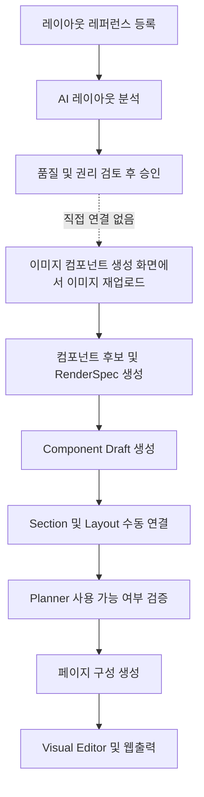
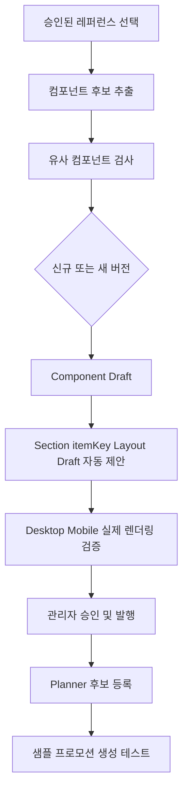
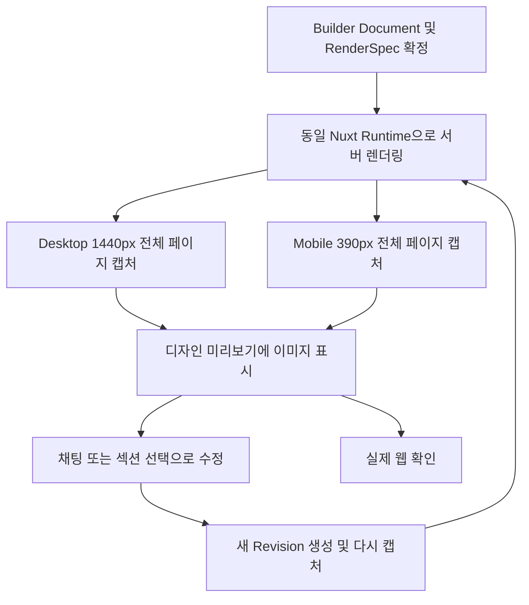

# 레퍼런스 컴포넌트 등록과 디자인 미리보기 및 웹출력 여백 검토 보고서

## 0. 문서 정보

- 작성일: 2026-11-09
- 대상 프로젝트: Promo Web Builder
- 대상 기능:
  - 레이아웃 레퍼런스 수집과 컴포넌트 등록
  - 페이지 구성 및 디자인 미리보기
  - Visual Editor와 웹출력 렌더링
- 검토 기준 문서: Builder Document Revision 1
- 검토 상태: 소스코드와 자동 테스트 기준 검토 완료, 운영 문서 데이터 직접 조회는 Builder 세션 인증으로 제한됨
- 소스코드 변경: 없음

## 1. 핵심 결론

현재 시스템에는 레퍼런스 수집, 이미지 기반 컴포넌트 생성, 컴포넌트 Registry 발행 기능이 각각 구현되어 있다. 그러나 `승인된 레퍼런스 → 컴포넌트 후보 추출 → Component Draft → Section 및 Layout 연결 → Planner 사용`이 하나의 작업 흐름으로 연결되어 있지 않다.

디자인 미리보기는 별도의 AI 디자인 이미지를 생성하는 방식보다, 동일한 Builder Document와 Nuxt Runtime을 서버에서 렌더링한 뒤 Desktop 및 Mobile 스크린샷으로 보여주는 방식을 권장한다. 실제 웹출력과 다른 이미지를 만들면 미리보기와 코드 결과가 다시 달라질 수 있기 때문이다.

웹출력에서 섹션, 특히 하단 여백이 과도하게 보이는 핵심 원인은 단순 CSS 한 줄이 아니다. 다음 값들이 합쳐져 섹션 높이를 크게 만든다.

1. 공통 `sectionStyles[sectionKey].minHeight`
2. 역할별 최소 높이와 Layout Recipe의 상하 패딩
3. AI 디자인 계획이 생성하는 최소 높이
4. Desktop과 Mobile 충돌 보정 결과 중 큰 값을 공통 섹션 높이에 적용하는 처리
5. 자동 복구 과정에서 섹션 높이를 늘리기만 하고 줄이지 않는 처리
6. 숨김 또는 빈 항목도 자동 높이 계산에 영향을 줄 수 있는 처리

현재 증상은 렌더러 CSS만 수정해서 해결하기보다, 높이 계산 정책과 반응형 데이터 구조를 함께 수정해야 재발을 막을 수 있다.

## 2. 현재 서비스 흐름



## 3. 레퍼런스 기반 컴포넌트 등록 검토

### 3.1 확인된 강점

- 레퍼런스는 출처 URL, 스크린샷, Layout Spec, 디자인 요약, 품질점수와 변경 이력을 저장한다.
- 승인 전 저작권 및 사용 범위 확인을 요구한다.
- 컴포넌트 분석 결과는 RenderSpec 검증을 통과해야 Draft로 생성할 수 있다.
- 레퍼런스 컴포넌트 발행 API는 Idempotency Key와 트랜잭션을 사용한다.
- 발행 전에 Section, itemKey, Desktop 및 Mobile Layout, Composition Shell과 레퍼런스 근거를 검증한다.

### 3.2 확인된 약점

#### 레퍼런스 이미지 재사용 경로 부재

레이아웃 레퍼런스 화면은 공개 `previewImageUrl`을 저장하지만 컴포넌트 생성 화면에서는 로컬 이미지를 다시 업로드해 별도의 `component_design_sources` 레코드를 만든다. 승인된 레퍼런스 화면에서 바로 컴포넌트 후보 추출을 시작하는 동작과 `layoutReferenceId` 전달이 없다.

영향:

- 동일 이미지가 중복 저장될 수 있다.
- 레퍼런스와 생성 컴포넌트의 출처 관계가 Draft 단계에서 남지 않는다.
- 관리자 작업 단계가 불필요하게 분리된다.

#### 레퍼런스 파생 메타데이터 누락

이미지 후보를 Component Draft로 적용할 때 필드, Placement Policy, `ai-generated` 키워드와 RenderSpec은 저장하지만 `capabilities.referenceDerived=true`와 원본 레퍼런스 ID는 설정하지 않는다.

컴포넌트 관리의 레퍼런스 발행 UI는 `ref-pattern-*` 시스템 코드 또는 `referenceDerived=true`인 컴포넌트에만 표시된다. 따라서 일반 이미지 분석으로 만든 Draft는 레퍼런스 발행 흐름에 진입하지 못할 수 있다.

#### Section 및 Layout 초안 자동 생성 부재

Planner 후보가 되려면 활성 Section, itemKey, Desktop 및 Mobile Layout과 Component Instance가 필요하다. 현재 생성 Apply API는 Component Draft와 RenderSpec까지만 생성하므로 이후 연결 작업은 관리자가 별도로 수행해야 한다.

#### 기존 컴포넌트 새 버전 경로 미완성

화면에서는 `기존 컴포넌트의 새 버전`을 선택할 수 있지만 일괄 적용 대상에서 제외되며 Apply API도 해당 방식을 거부한다. 현재 선택지는 존재하지만 완료 가능한 작업 흐름은 없다.

#### 운영 기능 플래그 확인 필요

`REFERENCE_COMPONENT_PUBLISHING_V1_ENABLED`의 소스 기본값은 `false`다. 운영 환경에서 명시적으로 활성화되지 않았다면 관련 발행 API가 차단된다.

### 3.3 권장 통합 흐름



필수 데이터 연결:

- `layoutReferenceId`
- 레퍼런스 캡처 버전 또는 이미지 URL
- Crop 영역
- Generation Run ID와 Proposal ID
- Component ID와 Component Version ID
- Section ID, itemKey, Layout Preset ID
- 관계 유형: `derived`, `inspired`, `validated`

## 4. 디자인 미리보기 표현 방식 검토

### 4.1 권장 결정

디자인 미리보기의 기본 표현은 스크린샷으로 전환하되, 스크린샷의 원천은 별도의 AI 이미지가 아니라 실제 웹 Runtime이어야 한다.



### 4.2 기대 효과

- 미리보기 컨테이너 CSS와 실제 프로모션 CSS의 충돌을 방지한다.
- Desktop과 Mobile을 고정된 조건으로 비교할 수 있다.
- 긴 페이지를 전체 이미지로 안정적으로 검토할 수 있다.
- Revision별 디자인 비교가 쉬워진다.
- 운영 결과와 같은 Runtime을 사용하므로 미리보기와 웹출력의 차이를 줄일 수 있다.

### 4.3 제한과 보완

스크린샷에서는 클릭, 입력, 애니메이션, 키보드 접근성 및 유동적인 반응형 동작을 검증할 수 없다. 따라서 다음 두 기능을 함께 제공해야 한다.

- 기본: Desktop 및 Mobile 스크린샷 미리보기
- 보조: 동일 Revision의 `실제 웹으로 확인`

AI가 디자인 이미지를 먼저 만들고 이를 다시 코드화하는 방식은 디자인 탐색 단계에는 활용할 수 있다. 그러나 최종 미리보기로 사용하면 이미지와 웹 코드 사이의 차이가 다시 발생할 가능성이 높다.

## 5. 웹출력 섹션 하단 여백 원인 분석

### 5.1 렌더링 높이의 최종 결정 위치

`PromoPageRenderer.vue`의 `resolvedSectionHeight()`가 자동 계산 높이와 `sectionStyles[sectionKey].minHeight` 중 큰 값을 선택한다. Flow가 아닌 섹션에는 이 값을 고정 `height`로 적용하고, Flow 섹션에도 `minHeight`로 적용한다.

관련 소스:

- `visual-editor/src/PromoPageRenderer.vue`
  - `defaultSectionHeight()`
  - `resolvedSectionHeight()`
  - `inlineSectionStyle()`
  - `inlineCanvasStyle()`
- `visual-editor/src/platform/layout-engine/geometry.mjs`
  - `minimumSectionContentHeight()`
  - `resolveSectionHeight()`

따라서 저장된 `minHeight`가 실제 콘텐츠보다 크면 남는 공간이 그대로 하단 여백으로 표시된다.

### 5.2 역할별 최소 높이와 상하 패딩

`api/_promo-layout-recipe.js`는 역할별 최소 높이를 설정한다.

| 섹션 역할 | 최소 높이 |
|---|---:|
| Header 및 Navigation | 96px |
| Hero 및 Key Visual | 560px |
| Terms, Legal 및 Footer | 220px |
| 기타 일반 섹션 | 320px |

같은 Recipe는 Flow Layout에 다음 기본 패딩을 적용한다.

| 조건 | Desktop 상하 패딩 | Mobile 상하 패딩 |
|---|---:|---:|
| Compact | 32px | 32px |
| 기본 | 48px | 32px |
| Spacious, Editorial, Cinematic, Luxury, Premium | 72px | 32px |
| Hero 및 Key Visual | 72px | 32px |

레퍼런스 분석 결과에 `spacious`, `cinematic`, `luxury`, `premium` 등의 표현이 포함되면 콘텐츠 양과 관계없이 큰 패딩이 선택될 수 있다.

### 5.3 AI 디자인 계획의 최소 높이

`api/_promo-section-design-contract.js`에는 두 종류의 높이 결정이 있다.

- 일반 디자인 결과는 AI가 반환한 `minHeight`를 240~900px 범위로 제한하고 기본값 420px을 사용한다.
- 구조 디자인 계획은 텍스트 하단 위치에 40px을 더하고 최소 520px을 보장한다.

콘텐츠가 적은 일반 섹션에도 구조 계획 경로가 적용되면 최소 520px이 남을 수 있다.

### 5.4 Mobile 높이가 Desktop 높이를 키우는 구조

`api/_promo-layout-text-collision.js`는 Desktop과 Mobile의 콘텐츠 하단 위치를 각각 계산한 후 다음과 같이 더 큰 값을 사용한다.

```text
contentBottom = max(desktop.bottom, mobile.bottom)
sectionStyles[sectionKey].minHeight = contentBottom + 40
```

모바일에서는 컴포넌트가 한 열로 쌓이므로 Desktop보다 높아지는 경우가 많다. 그러나 계산 결과를 공통 `sectionStyles.minHeight`에 기록하기 때문에 모바일에 필요한 높이가 Desktop에도 적용된다. 이 구조는 Desktop 섹션 하단에 큰 빈 공간을 만드는 직접적인 원인이 될 수 있다.

### 5.5 자동 복구가 높이를 줄이지 않음

`visual-editor/src/builder/CompositionPreviewCanvas.vue`의 자동 복구는 Desktop과 Mobile 충돌 결과를 순차 적용하면서 다음 방식으로 높이를 저장한다.

```text
minHeight = max(기존 minHeight, 보정 minHeight)
```

한 번 큰 높이가 저장되면 이후 콘텐츠가 줄거나 레이아웃이 Flow로 전환되어도 자동으로 낮아지지 않는다. 여러 번 수정하고 자동 복구를 실행할수록 과거의 큰 높이가 Revision에 남을 가능성이 있다.

### 5.6 숨김 또는 빈 항목의 높이 영향

`defaultSectionHeight()`는 `section.items` 전체를 기준으로 예상 높이를 합산한다. 렌더링 가시성에 따라 먼저 제외하지 않으므로 숨김 처리되었거나 내용이 비어 있는 항목도 기본 컴포넌트 높이 계산에 영향을 줄 수 있다.

기본 예상 높이는 다음과 같다.

- 일반 텍스트: 86px
- CTA: 64px
- 이미지: 250px
- 다중 필드 컴포넌트: 각 필드 기본 높이 합계와 추가 여백

### 5.7 CSS 자체의 영향

`visual-editor/src/promo-renderer.css`에서 Section Inner는 기본 `padding: 10px`을 가진다. Flow Layout은 별도로 `layoutPaddingBlockPx` 또는 `mobileLayoutPaddingBlockPx`를 적용한다.

CSS 기본 패딩도 여백에 기여하지만, 현재처럼 하단이 크게 비는 증상의 주요 원인은 CSS 10px보다 저장된 `minHeight`, 반응형 높이 통합과 누적 보정일 가능성이 높다.

## 6. 우선 개선안

### P0. 반응형 섹션 높이 분리

Desktop과 Mobile의 섹션 높이를 별도로 저장하고 계산한다.

권장 데이터 구조:

```json
{
  "sectionStyles": {
    "hero": {
      "minHeight": 560
    }
  },
  "responsiveLayouts": {
    "mobile": {
      "sectionStyles": {
        "hero": {
          "minHeight": 720
        }
      }
    }
  }
}
```

### P0. 충돌 보정 결과 분리

`max(desktop.bottom, mobile.bottom)`을 공통 높이에 기록하지 않는다.

- Desktop 결과는 Desktop Section Style에 저장
- Mobile 결과는 Mobile Section Style에 저장
- 한 Viewport의 보정 결과가 다른 Viewport를 키우지 않도록 제한

### P0. 섹션 높이 축소 재계산 추가

자동 복구 완료 후 실제 표시 항목의 하단 좌표와 상하 안전 여백으로 적정 높이를 다시 계산한다. `Math.max()` 누적만 사용하지 않고, 사용자가 높이를 명시적으로 잠근 경우에만 기존 높이를 유지한다.

### P1. 빈 항목과 숨김 항목 제외

자동 높이 계산에서 다음 항목을 제외한다.

- 출력 가시성이 `false`인 항목
- 값이 없고 필수도 아닌 항목
- 이미지 URL과 대체 콘텐츠가 모두 없는 선택 이미지

### P1. 최소 높이 정책 조정

- Hero는 560px 고정 최소값 대신 이미지 비율과 실제 콘텐츠 높이로 계산
- 일반 섹션 기본 최소 높이는 320px보다 콘텐츠 기반 자동값을 우선
- Terms 및 Footer도 실제 내용이 적으면 220px 이하로 축소 가능하게 구성
- `spacious` 같은 분석 키워드만으로 72px 패딩을 선택하지 않고 Layout Spec의 명시적 밀도 값을 사용

### P1. 디자인 미리보기 스크린샷 도입

동일 웹 Runtime을 고정 Viewport에서 렌더링하고 전체 페이지 스크린샷을 생성한다. 미리보기 컨테이너가 레이아웃에 영향을 주지 않도록 하며 실제 웹 열기 기능은 유지한다.

### P1. 품질 게이트 강화

발행 전 자동 검증 항목:

- 섹션 콘텐츠 하단과 섹션 하단 사이의 빈 공간 비율
- 빈 공간이 섹션 높이의 30%를 초과하는지 여부
- Desktop과 Mobile 높이 비율 이상치
- 빈 섹션과 숨김 항목만 있는 섹션
- 이미지 비율과 컨테이너 비율 불일치
- 페이지 마지막 섹션의 불필요한 최소 높이 및 하단 패딩

## 7. 권장 개발 순서

1. 운영 Builder Document의 Revision Snapshot을 인증된 세션에서 추출한다.
2. 섹션별 `minHeight`, Layout Mode, Desktop 및 Mobile item geometry를 표로 출력한다.
3. Desktop과 Mobile Section Style을 분리하는 계약을 추가한다.
4. Text Collision 보정이 Viewport별 높이를 저장하도록 변경한다.
5. Auto Repair에 높이 축소 재계산을 추가한다.
6. 숨김 및 빈 항목을 자동 높이 계산에서 제외한다.
7. 기존 문서 Revision을 대상으로 높이 정규화 마이그레이션 또는 일회성 Repair를 실행한다.
8. Desktop 1440px, Tablet 768px, Mobile 390px 스크린샷 회귀 테스트를 추가한다.
9. 동일 Runtime 기반 디자인 스크린샷 미리보기를 연결한다.
10. Preview에서 검증한 뒤 Production에 단계적으로 반영한다.

## 8. 테스트 및 검증 기준

### 자동 테스트

- 섹션 높이 계산 단위 테스트
- Desktop 및 Mobile 높이 분리 계약 테스트
- 숨김 및 빈 항목 제외 테스트
- Auto Repair 축소 가능성 테스트
- 긴 텍스트와 짧은 텍스트 회귀 테스트
- 마지막 섹션 하단 여백 테스트
- 미리보기 스크린샷과 실제 웹의 시각 차이 테스트

### 시각 검증 Viewport

| 구분 | 폭 |
|---|---:|
| Desktop | 1440px |
| Tablet | 768px |
| Mobile | 390px |

### 통과 기준

- 콘텐츠가 적은 일반 섹션의 불필요한 하단 공백이 섹션 높이의 30% 미만
- Desktop 높이가 Mobile Stack 높이에 의해 증가하지 않음
- 페이지 미리보기, 디자인 미리보기 및 웹출력이 같은 Section 순서와 같은 Layout Recipe를 사용함
- 스크린샷 미리보기와 실제 웹출력의 주요 시각 차이가 허용 기준 이내
- CTA, 이미지, 텍스트가 섹션 경계를 넘거나 잘리지 않음

## 9. 확인된 사실과 추가 확인 항목

### 확인된 사실

- 섹션 최종 높이는 자동 높이와 저장된 `minHeight` 중 큰 값으로 결정된다.
- Flow Layout에도 공통 `minHeight`와 상하 패딩이 적용된다.
- 충돌 보정은 Desktop과 Mobile 중 큰 콘텐츠 하단 값을 공통 높이에 반영한다.
- 자동 복구는 기존 높이와 보정 높이 중 큰 값만 저장한다.
- 레퍼런스 수집과 이미지 컴포넌트 생성은 직접 연결되지 않는다.
- 새 버전 생성 선택지는 현재 Apply 경로에서 완료할 수 없다.

### 가능성이 높은 원인

- Mobile Stack에서 계산된 큰 높이가 Desktop에도 적용되어 섹션 하단이 비는 현상
- 이전 자동 복구에서 커진 `minHeight`가 Revision에 계속 남는 현상
- 숨김 또는 빈 항목이 자동 높이에 포함되는 현상
- `spacious`, `cinematic` 계열 Recipe가 실제 콘텐츠보다 큰 패딩을 적용하는 현상

### 추가 확인이 필요한 항목

- 현재 운영 Revision 1의 섹션별 실제 `minHeight`
- 각 섹션의 Desktop 및 Mobile `yPx`, `heightPx`와 `positionMode`
- 마지막 섹션에 숨김 또는 빈 컴포넌트가 포함되어 있는지 여부
- 운영 환경의 `REFERENCE_COMPONENT_PUBLISHING_V1_ENABLED` 값
- 운영 DB에 migration 081이 적용됐는지 여부

운영 API는 유효한 Builder 세션을 요구하므로 비인증 요청으로 현재 Revision Snapshot을 읽을 수 없었다. 운영 화면의 인증된 세션에서 Snapshot을 내려받거나 관리자 진단 기능으로 위 값을 확인해야 현재 문서의 정확한 문제 섹션을 확정할 수 있다.

## 10. 주요 소스 위치

| 목적 | 파일 |
|---|---|
| 레퍼런스 등록 및 승인 UI | `admin-app/src/components/LayoutReferenceManager.vue` |
| 이미지 컴포넌트 생성 UI | `admin-app/src/components/ComponentGenerationWorkspace.vue` |
| 컴포넌트 Draft 적용 | `api/component-generation-proposals-apply.js` |
| 레퍼런스 컴포넌트 발행 준비 | `api/_reference-component-publishing.js` |
| 레퍼런스 컴포넌트 발행 | `api/reference-component-publish.js` |
| 기능 플래그 | `api/_promo-builder-flags.js` |
| Layout Recipe | `api/_promo-layout-recipe.js` |
| AI 섹션 디자인 계약 | `api/_promo-section-design-contract.js` |
| 텍스트 충돌 및 높이 보정 | `api/_promo-layout-text-collision.js` |
| Auto Repair | `visual-editor/src/builder/CompositionPreviewCanvas.vue` |
| 최종 페이지 렌더러 | `visual-editor/src/PromoPageRenderer.vue` |
| 렌더러 CSS | `visual-editor/src/promo-renderer.css` |
| 레이아웃 Geometry | `visual-editor/src/platform/layout-engine/geometry.mjs` |

## 11. 인수인계 결론

가장 먼저 해결해야 할 문제는 CSS 조정이 아니라 Desktop과 Mobile의 섹션 높이를 하나의 `minHeight`로 공유하는 계약이다. 이 구조를 유지한 채 패딩이나 기본 높이만 줄이면 긴 모바일 콘텐츠가 잘리거나 충돌이 다시 발생할 수 있다.

첫 구현 범위는 다음 네 가지가 적절하다.

1. Viewport별 Section Style 분리
2. 충돌 보정의 Viewport별 저장
3. Auto Repair의 높이 축소 재계산
4. 숨김 및 빈 항목의 높이 계산 제외

이후 동일 Runtime 기반 Desktop 및 Mobile 스크린샷 미리보기를 추가하면, 미리보기 안정성과 실제 웹출력 일치도를 함께 개선할 수 있다.
