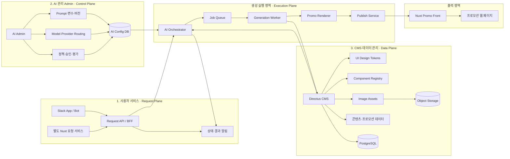
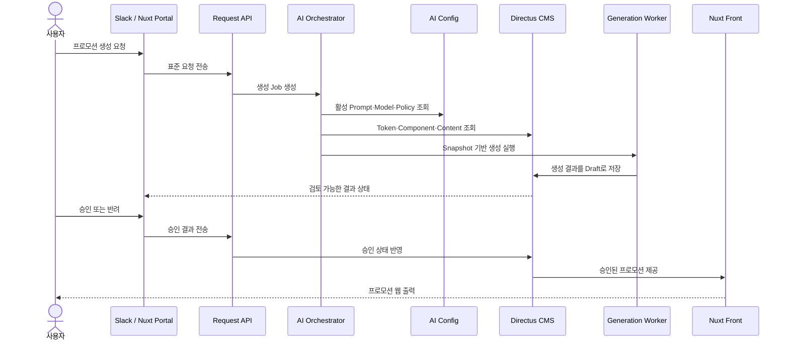
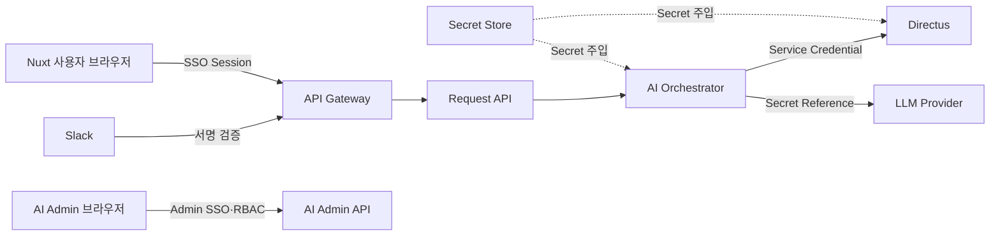

# Promo Web Builder 서비스·AI Admin·CMS 영역 분리 아키텍처

```yaml
status: Proposal
owner: Promo Web Builder 개발팀
reviewers: [Product, Frontend, Backend, AI, Directus, Infra, Security, QA]
baseline_date: 2026-11-01
target_environments: [development, preview, production]
execution_allowed: false
```

## 1. 목적

Promo Web Builder를 다음 세 가지 업무 영역으로 분리한다.

1. **사용자 서비스**: 프로모션 생성 요청과 결과 확인
2. **AI 관리 Admin**: AI 실행 설정과 운영 정책 관리
3. **CMS·데이터 관리**: 컴포넌트, 디자인 토큰, 이미지와 콘텐츠 관리

실제 프로모션 생성은 세 영역을 연결하는 별도의 **생성 실행 영역**이 담당한다.

이 문서는 목표 구조를 정의한 제안서다. Directus 전환, Schema 적용, Runtime Read·Write 전환을 승인하거나 실행하는 문서가 아니다.

## 2. 핵심 구조



## 3. 영역별 책임

### 3.1 사용자 서비스 — Request Plane

프로모션 생성을 요청하고 진행 상태와 결과를 확인하는 사용자 접점이다.

#### 채널 예시

- Slack App 또는 Slack Bot
- 별도 Nuxt 요청 포털
- 사내 업무 시스템
- 외부 시스템용 API

#### 주요 기능

- 프로모션 생성 요청
- 요청 내용 수정 및 취소
- 진행 상태 조회
- 생성 결과 미리보기
- 승인·반려 및 피드백
- 결과 링크와 완료 알림

Slack과 Nuxt 포털은 생성 로직을 각각 구현하지 않는다. 모든 채널은 동일한 `Request API`와 요청 계약을 사용한다.

#### 소유 데이터

- 사용자 요청 원문
- 요청 채널과 요청자 정보
- 생성 Job 연결 정보
- 사용자 피드백
- 사용자에게 노출할 상태와 결과 링크

### 3.2 AI 관리 Admin — Control Plane

AI가 어떤 기준과 정책으로 프로모션을 생성할지 관리하는 내부 운영 도구다. 일반 요청 사용자는 접근하지 않는다.

#### 관리 대상

- 프롬프트 템플릿과 변수
- 프롬프트 버전과 활성 상태
- LLM Provider와 모델
- 모델 Routing과 Fallback
- 생성 Workflow
- 콘텐츠 정책과 금칙어
- 승인 및 검토 정책
- 평가 기준과 품질 결과
- 실행 로그, 토큰 사용량과 비용

#### 소유 데이터

- AI Prompt 및 Prompt Version
- Model·Provider 설정
- Routing·Fallback 정책
- Workflow 정의
- AI 평가와 운영 정책
- 실행 시점에 고정할 AI Config Snapshot

AI Admin은 콘텐츠를 저장하는 CMS가 아니라 AI 실행 방식을 관리하는 **Control Plane**이다.

### 3.3 Directus CMS — Data Plane

프로모션 제작에 필요한 구조화 콘텐츠와 디자인 리소스를 저장·관리한다.

#### 관리 대상

| 도메인 | Directus 컬렉션 예시 | 역할 |
|---|---|---|
| 디자인 토큰 | `design_token_sets`, `design_token_versions`, `design_token_values` | 색상, 타이포그래피, 간격과 컴포넌트 스타일 |
| 컴포넌트 | `components`, `component_versions`, `component_fields` | 컴포넌트 정의, 버전과 필드 계약 |
| 이미지 | `image_assets`, `directus_files` | 이미지 메타데이터, 분류, 권한과 파일 연결 |
| 콘텐츠 | `content_resources`, `content_resource_versions` | 공통 문구, HTML과 다국어 콘텐츠 |
| 프로모션 | `promotions`, `promotion_versions` | 프로모션 기본 정보와 상태 |
| 섹션 | `promotion_sections`, `promotion_fields` | 섹션 구성, 순서와 입력 콘텐츠 |
| 생성 결과 | `generation_results` | AI 초안, 검토 결과와 적용 상태 |

#### 저장 원칙

- 구조화 데이터와 관계: Directus + PostgreSQL
- 이미지 Binary: S3 호환 Object Storage
- 이미지 메타데이터와 파일 참조: Directus
- Draft·Review·Approved·Published 상태: Directus Workflow
- 공개 Runtime은 승인된 버전만 조회

Directus는 콘텐츠·컴포넌트·디자인 데이터의 목표 **Source of Truth**다. 실제 전환은 기존 마이그레이션 Gate를 통과한 도메인부터 수행한다.

### 3.4 생성 실행 영역 — Execution Plane

사용자 요청, AI 설정과 CMS 데이터를 조합해 실제 프로모션을 생성한다.

#### 구성 요소

| 구성 요소 | 책임 |
|---|---|
| Request API / BFF | 채널별 요청을 공통 계약으로 변환하고 권한 검사 |
| AI Orchestrator | 요청, AI Config Snapshot과 콘텐츠 데이터를 조합 |
| Job Queue | 비동기 실행, 재시도와 부하 제어 |
| Generation Worker | 문구, 구조와 레이아웃 생성 |
| Promo Renderer | 생성 결과를 공통 Render Contract로 렌더링 |
| Publish Service | 승인 결과를 Nuxt Runtime에 공개 |

Execution Plane은 가능한 한 Stateless하게 구성하고, Job 상태와 실행 Snapshot은 영속 저장한다.

## 4. 전체 처리 흐름



### 권장 Job 상태

```text
requested
→ validating
→ queued
→ generating
→ review_required
→ approved | rejected
→ publishing
→ published | failed
```

## 5. 데이터 소유권

| 데이터 | 소유 시스템 | 비고 |
|---|---|---|
| 사용자 요청과 피드백 | 사용자 서비스 | Slack·포털 공통 계약 사용 |
| Job 상태와 재시도 | Execution Plane | 운영 데이터로 CMS 콘텐츠와 분리 |
| Prompt·Model·AI Policy | AI Admin | 실행 시 Snapshot 고정 |
| UI 디자인 토큰 | Directus | 승인된 버전만 Runtime 사용 |
| 컴포넌트와 필드 계약 | Directus | Version 단위 관리 |
| 이미지와 콘텐츠 | Directus | Binary는 Object Storage 사용 |
| 프로모션 Draft·승인 버전 | Directus | Publication 상태 포함 |
| 공개 웹 페이지 | Nuxt Runtime | 승인된 CMS 데이터만 렌더링 |

같은 데이터를 두 시스템에서 동시에 수정하지 않는다. 각 도메인은 하나의 Source of Truth를 갖는다.

## 6. 주요 API 계약 예시

### 6.1 사용자 요청 생성

```http
POST /v1/promo-requests
```

```json
{
  "channel": "slack",
  "requestedBy": "user-123",
  "brief": {
    "title": "신규 가입 이벤트",
    "purpose": "acquisition",
    "market": "KR",
    "locale": "ko-KR",
    "requestText": "신규 사용자를 위한 가입 보너스 프로모션을 만들어 주세요."
  }
}
```

```json
{
  "requestId": "promo-request-001",
  "jobId": "promo-job-001",
  "status": "requested"
}
```

### 6.2 상태 조회

```http
GET /v1/promo-requests/{requestId}
```

### 6.3 결과 검토

```http
POST /v1/promo-requests/{requestId}/review
```

```json
{
  "decision": "approved",
  "comment": "문구와 혜택 내용을 확인했습니다."
}
```

### 6.4 Directus 접근

브라우저가 Directus를 직접 호출하지 않는다. 내부 서비스가 Directus Adapter를 통해 공용 Domain Contract로 정규화한다.

```text
Request API / Worker
        ↓
Directus Adapter
        ↓
Directus REST 또는 GraphQL API
```

## 7. 네트워크와 보안 경계



### 보안 원칙

- 브라우저와 Slack에 Directus Token 또는 LLM API Key를 노출하지 않는다.
- Slack 요청은 Signing Secret으로 검증한다.
- 사용자 서비스와 AI Admin은 SSO와 역할 기반 권한을 분리한다.
- Directus는 Collection별 최소 권한 Service Account를 사용한다.
- Runtime Reader, Content Writer와 Schema Admin Credential을 분리한다.
- Secret 원문은 DB, Directus 콘텐츠, 로그와 문서에 저장하지 않는다.
- 요청, AI 설정, 콘텐츠 버전과 결과의 Audit Trail을 남긴다.

## 8. 권장 프로젝트 구조

```text
promo-platform/
├── apps/
│   ├── request-portal-nuxt/     # 사용자 요청 서비스
│   ├── ai-admin/                # AI 관리 Admin
│   └── promo-runtime-nuxt/      # 프로모션 Front
│
├── services/
│   ├── slack-adapter/           # Slack 요청·응답 변환
│   ├── request-api/             # 공통 사용자 요청 API
│   ├── ai-orchestrator/         # AI 실행 제어
│   ├── generation-worker/       # 비동기 생성 Worker
│   └── publish-service/         # 승인 결과 공개
│
├── directus/
│   ├── schema/                  # Collection·Field 계약
│   ├── extensions/              # Hook·Endpoint·Flow 확장
│   └── migrations/              # Schema·Data Migration
│
└── packages/
    ├── api-contracts/           # 요청·응답 공통 타입
    ├── component-contracts/     # 컴포넌트 계약
    ├── design-token-runtime/    # 디자인 토큰 변환
    └── promo-renderer/          # 공통 Renderer
```

한 저장소에서 시작할 경우에도 `apps`, `services`, `directus`, `packages`의 경계를 유지한다. 배포 단위 분리는 운영 요구가 확정된 후 진행할 수 있다.

## 9. MVP 적용 범위

### Phase 1 — 요청과 실행 계약

- Slack Adapter와 Request API
- 공통 Request·Status Contract
- AI Orchestrator와 단일 Worker
- 생성 결과 Draft 저장

### Phase 2 — AI Admin 분리

- Prompt·Model·Routing 관리
- 활성 버전과 실행 Snapshot
- 정책, Audit와 기본 평가

### Phase 3 — Directus CMS 적용

- Component와 Design Token부터 이관
- Shadow Read와 Reconciliation
- Content와 Image Asset 확대
- 승인된 도메인만 Runtime Read 전환

### Phase 4 — 사용자 채널 확대와 배포

- Nuxt Request Portal
- 승인 Workflow
- Publish Service와 Nuxt Runtime 연동
- 모니터링, 비용과 품질 지표

## 10. 현재 기준 주의사항

- 현재 운영 Source of Truth는 기존 PostgreSQL이다.
- Directus는 연결 설정과 마이그레이션 기반이 마련된 상태이며 전체 Runtime Source로 전환되지 않았다.
- Directus Runtime Write는 별도 승인 전까지 비활성으로 유지한다.
- 첫 Cutover 후보는 `components`, 이후 `designTokens` 순서로 검토한다.
- 본 문서의 AI Admin 분리는 최신 목표안이며, 기존의 “전체 Admin을 Directus Studio로 대체”하는 안과 최종 의사결정이 필요하다.

## 11. 결정이 필요한 항목

- AI Prompt를 AI Admin DB에만 둘지 Directus에 Mirror할지
- Directus에서 관리할 프로모션 Draft와 실행 Job의 경계
- Slack 승인과 Nuxt Portal 승인 간 권한 정책
- Request API, Orchestrator와 Worker의 배포 단위
- Directus Development·Preview·Production 프로젝트 구성
- Component·Design Token Source of Truth 전환 시점
- Object Storage, CDN과 이미지 변환 책임
- Cutover Gate, Fallback과 Rollback 승인자

## 12. 결론

Promo Web Builder는 다음 책임 분리를 기본으로 한다.

- **사용자 서비스**: 요청과 결과 확인
- **AI 관리 Admin**: AI 생성 방식과 운영 정책
- **Directus CMS**: 컴포넌트, 토큰, 이미지와 콘텐츠
- **Execution Plane**: 세 영역을 연결해 프로모션 생성
- **Nuxt Front**: 승인된 프로모션 렌더링과 서비스

사용자 채널은 Request API만 호출하고, Directus와 AI Provider는 내부 서비스에서만 접근한다. 이 경계를 유지하면 Slack, 별도 사용자 서비스, AI Admin과 Directus를 독립적으로 확장할 수 있다.

