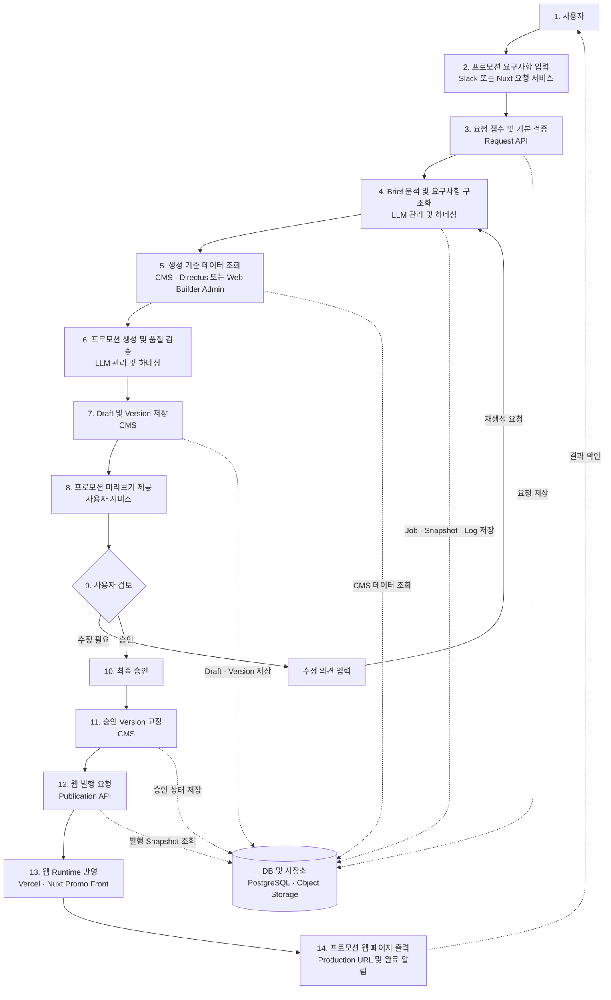
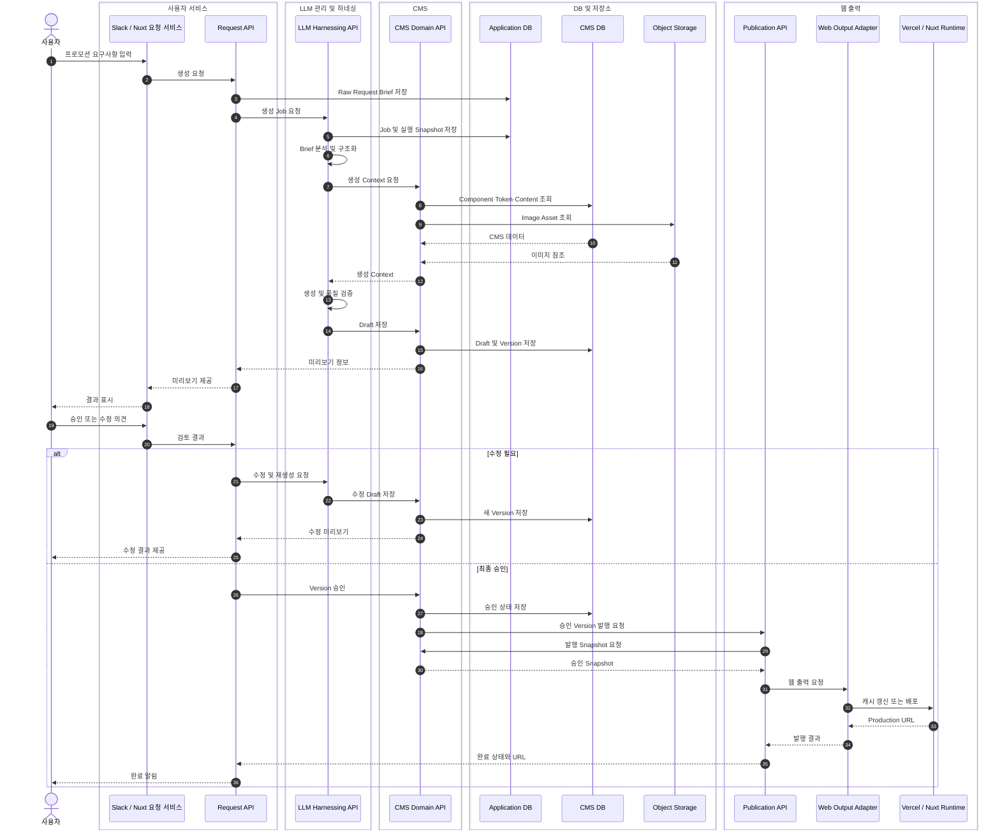
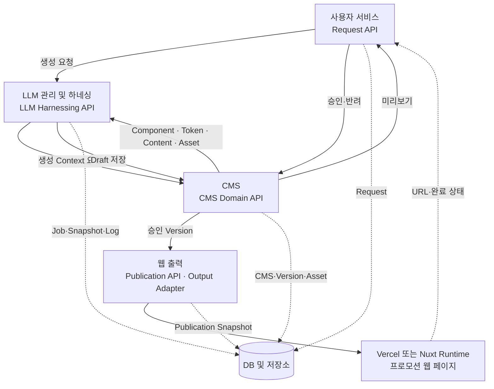

# Promo Web Builder 서비스 흐름 소스 검토 및 LLM 인수인계

```yaml
status: Review
baseline_date: 2026-11-03
source_commit: 5fe5731
source_branch: main
audience:
  - Product
  - Frontend
  - Backend
  - AI
  - CMS
  - Infra
  - QA
  - 후속 작업을 수행하는 LLM
```

## 1. 목적

이 문서는 Promo Web Builder의 현재 소스 코드와 지금까지 합의한 목표 서비스 구조를 함께 정리한다. 다른 LLM이나 개발자가 별도 대화 맥락 없이도 다음 내용을 이해하고 작업을 이어갈 수 있도록 작성했다.

- 사용자의 프로모션 요구사항 입력부터 웹 출력까지의 전체 흐름
- 사용자 서비스, LLM 관리 및 하네싱, CMS, DB 및 저장소, 웹 출력의 책임 경계
- 현재 소스 코드에서 구현된 기능과 아직 목표안에만 존재하는 기능
- 현재 API와 목표 API의 대응 관계
- Directus, PostgreSQL, Object Storage, Nuxt 및 Vercel의 역할
- 후속 구현 시 지켜야 할 데이터 소유권과 호출 원칙

핵심 결론은 다음과 같다.

1. 현재 저장소에는 AI Builder, Visual Editor, Web Builder Admin, 생성 Run, 품질 게이트, 발행 계약, Nuxt SSR Runtime이 이미 구현되어 있다.
2. 사용자 채널을 통합하는 독립 Request API와 하나의 LLM Harnessing API, CMS Domain API, Web Output Adapter는 목표 구조이며 동일한 이름의 통합 서비스로 완성되어 있지는 않다.
3. 현재 PostgreSQL이 운영 Source of Truth다. Directus는 연결 설정, Schema Manifest, Migration, Shadow Read 및 Cutover Gate 기반까지 구현되었으나 Runtime Source로 전환되지 않았다.
4. DB는 업무 흐름의 한 단계가 아니라 각 서비스가 소유 데이터를 저장하는 기반 계층이다. 사용자 화면이나 LLM Worker가 DB를 직접 호출하지 않도록 API 경계를 유지해야 한다.
5. 프로모션 발행은 승인된 문서 Revision을 고정한 PublishedPromotion 계약을 통해 Nuxt Runtime에 제공하는 구조가 구현되어 있다.

## 2. 검토 기준

### 2.1 저장소 규모

2026-11-03 기준 주요 소스 규모는 다음과 같다.

| 구분 | 수량 | 비고 |
|---|---:|---|
| `api/` 파일 | 222 | Vercel 스타일 API Handler와 내부 Helper 포함 |
| HTTP Method를 처리하는 API 파일 | 141 | `req.method` 기준 정적 검색 |
| DB Migration | 75 | `002`부터 `076`까지 존재 |
| 테스트 파일 | 186 | `scripts/test-*` 기준 |
| Vue 컴포넌트 | 54 | Admin, Visual Editor, Nuxt 포함 |

### 2.2 실제 검토한 핵심 영역

| 영역 | 검토한 주요 소스 |
|---|---|
| 프로젝트 구성 | `README.md`, `package.json`, `pnpm-workspace.yaml`, `vercel.json` |
| Admin | `admin-app/src/main.js`, Admin 서비스와 주요 관리 컴포넌트 |
| AI Builder | `visual-editor/src/builder/AiBuilderApp.vue`, `composition-client.mjs`, Builder Store |
| Visual Editor | `visual-editor/src/platform/visual-editor-entry.mjs`, Runtime Renderer와 Adapter |
| Builder 문서 | `api/promo-builder-documents.js`, `_promo-builder-document-store.js` |
| 자연어 구성 | `promo-overview-parse.js`, Composition Proposal, Process, Apply API |
| 생성 파이프라인 | `promo-generation-runs.js`, `promo-generation-prepare.js`, `_promo-generation-run-store.js`, Worker Trigger |
| 웹 페이지 생성 | `generate-promo-page.js`, Generation Proxy, Contract, Artifact Store |
| 발행 | `promo-publications.js`, `promo-publication.js`, Preview API, Publication Store |
| 공용 계약 | `packages/promo-contracts`, `contracts/published-promotion-v1.schema.json` |
| Nuxt Runtime | `apps/promo-runtime-nuxt`의 Config, Server API, 공개 및 Preview Page |
| Directus | Integration Config, Connection Test, Source Router, Cutover Readiness, Migration Package |
| DB | 주요 Migration `069`, `070`, `071`, `072`, `076`과 Store Query |
| 테스트 | 전체 `pnpm test` 실행 |

### 2.3 테스트 결과

전체 테스트를 실행한 결과 `186개 테스트 파일이 모두 통과`했다.

```text
All 186 test files passed
```

실행 환경은 저장소가 요구하는 Node.js 22가 아니라 번들 Node.js 24.22.1이었다. 테스트는 통과했지만 다음 경고가 확인되었다.

- `package.json`의 Engine은 Node.js `22.x`를 요구한다.
- `visual-editor/src/contracts.js`를 ESM으로 재해석하는 `MODULE_TYPELESS_PACKAGE_JSON` 경고가 발생한다.
- 후속 CI 검증은 Node.js 22 환경에서 다시 수행해야 한다.

## 3. 사용자 중심 서비스 흐름

다음 다이어그램은 사용자의 요구사항 입력부터 Vercel 또는 Nuxt 기반 웹 출력까지의 순차 흐름이다.



### 3.1 사용자 관점 핵심 단계

```text
사용자 요구사항 입력
→ 기본 검증
→ LLM Brief 분석
→ CMS 생성 기준 조회
→ 프로모션 생성 및 품질 검증
→ Draft 저장
→ 미리보기와 수정 반복
→ 최종 승인
→ 승인 Version 고정
→ Publication API 발행
→ Vercel 또는 Nuxt Runtime 출력
→ Production URL 제공
```

## 4. API 중심 서비스 흐름

다음 다이어그램은 하위 모듈 직접 호출을 숨기고 각 영역의 대표 API만 노출한 목표 흐름이다.



## 5. 서비스별 책임과 데이터 소유권

### 5.1 사용자 서비스

책임:

- Slack, Nuxt Portal 등 사용자 채널 제공
- Raw Request Brief 수집
- 인증, 권한, 필수 필드와 기본 형식 검증
- 생성 상태, 미리보기, 수정 의견, 승인 UI 제공
- 완료 URL과 오류 알림 제공

소유 데이터:

- 사용자 요청 원문
- 요청자와 요청 채널
- 사용자 피드백과 승인 행위
- 사용자에게 노출할 상태

사용자 서비스는 Brief의 의미 분석이나 프로모션 생성 로직을 직접 구현하지 않는다.

### 5.2 LLM 관리 및 하네싱

책임:

- Raw Brief의 의도 분석과 Structured Brief 변환
- Prompt, Model, Provider, Routing, Policy, Workflow 관리
- 실행 시점 Config Snapshot 고정
- 비동기 Generation Job, Retry, Timeout 관리
- CMS Context를 이용한 콘텐츠, 구조와 레이아웃 생성
- Quality Gate와 Rendering 수행

소유 데이터:

- Generation Job과 Attempt
- Prompt, Model, Policy 실행 Snapshot
- 실행 로그, 오류, 토큰 및 비용
- 품질 검증 결과
- CMS Draft와 Asset의 참조 ID

LLM 하네싱은 Component, Design Token, CMS Content, 최종 Promotion Version 원본을 소유하지 않는다.

### 5.3 CMS

구현 선택지는 Directus 또는 현재 Web Builder Admin이다. 외부 서비스는 구현 제품을 직접 인지하지 않고 CMS Domain API를 사용해야 한다.

책임:

- Component Registry
- UI Design Token과 Version
- 다국어 Content Resource
- Image Asset Metadata
- Promotion Draft, Version, Approval, Publication Status
- CMS Workflow와 운영 권한

Directus 사용 시 Directus는 DB 대체물이 아니라 DB 위에서 동작하는 Admin, API, 권한과 Workflow 계층이다.

### 5.4 DB 및 저장소

DB는 서비스 흐름의 다음 단계가 아니라 서비스 내부 저장 계층이다.

| 저장 영역 | 권장 데이터 |
|---|---|
| Application DB | 사용자 Request, Generation Job, Attempt, Snapshot, Log, Quality Result |
| CMS DB | Component, Token, Content, Promotion Draft, Version, Approval |
| Object Storage | 이미지, 생성 Asset, 대용량 Binary |

초기에는 동일 PostgreSQL Instance를 사용할 수 있지만 Schema와 데이터 소유권을 분리해야 한다.

### 5.5 웹 출력

책임:

- 승인된 Version을 PublishedPromotion Snapshot으로 고정
- Preview와 공개 Runtime 분리
- ETag와 Cache-Control 제공
- Nuxt SSR 또는 정적 출력
- Vercel Cache Revalidation 또는 다른 Hosting Adapter 호출
- Production URL 반환

Vercel 사용 시 프로모션마다 전체 애플리케이션을 재배포하기보다 Nuxt Runtime을 Vercel에 배포하고, 개별 발행에서는 승인 Snapshot 반영과 캐시 갱신을 수행하는 방식을 기본으로 한다.

## 6. 현재 구현 구조 AS IS

### 6.1 사용자 입력과 Builder

현재 독립 Slack App 또는 별도 Request Portal은 구현되어 있지 않다. 현재 사용자 입력 경로는 다음과 같다.

- Prototype Wizard와 Create Promo 화면
- Vue 기반 AI Builder
- Visual Editor
- Web Builder Admin

`AiBuilderApp.vue`의 실제 흐름은 자연어 입력 분석, Overview 검토, Composition Proposal 생성, Proposal Polling, Apply, Asset 생성 대기, Visual Editor 진입으로 구성된다.

주요 구현:

- `promo-builder-session.js`: Builder 세션 진입
- `promo-overview-parse.js`: 자연어 Overview 분석
- `promo-page-composition-proposals.js`: 구성 Proposal 생성과 조회
- `promo-page-composition-process.js`: Proposal 처리
- `promo-page-composition-apply.js`: 문서 Revision 적용
- `promo-builder-documents.js`: 문서 생성, 조회, Editor Snapshot Patch

### 6.2 Builder 문서와 Revision

Builder 문서는 PostgreSQL의 `promo_builder_documents`와 `promo_builder_document_versions`를 중심으로 관리된다.

확인된 동작:

- Idempotency Key 기반 문서 생성
- 문서 Revision 증가
- Snapshot Hash 저장
- Composition Proposal의 Base Revision 검증
- Proposal Lease, Retry, Backoff, Stage 관리
- Contract v2와 v3 지원
- Quality Gate 상태를 Revision에 포함
- Editor Snapshot의 Section과 Item Key 유일성 검증
- 활성 Design Token Version과 Semantic Role 검증

### 6.3 LLM 생성 파이프라인

현재 LLM 하네싱 기능은 하나의 통합 서비스가 아니라 여러 API와 n8n Worker 계약으로 분산되어 있다.

주요 구현:

- `promo_generation_runs`: Browser와 Worker 사이의 Durable Handoff Record
- `promo-generation-prepare.js`: 저장된 Snapshot으로 Worker Prompt Input 재구성
- Integrated Brief, LO-FI Draft, Final Design 단계
- V2 Pipeline은 기본 경로에서 LO-FI를 제거하고 Integrated Brief에서 Final Design으로 진행
- Worker Trigger는 n8n Webhook을 호출하고 실제 완료는 Callback API가 반영
- Run Key 재사용 시 중복 생성 대신 동일 Run을 재시작하는 Idempotent 동작
- Input Hash, Prompt Metadata, Model Metadata 기록
- Vercel Blob 기반 이미지 저장 경로 지원

현재 Queue는 독립 Queue 제품이라기보다 DB 상태, Lease/Polling 및 n8n Webhook을 조합한 형태다.

### 6.4 웹 페이지 생성과 Artifact

`generate-promo-page.js` 경로는 CMS Builder Snapshot 발행과 별개로, 검증된 HTML/CSS 웹 페이지 Artifact를 생성하는 기능이다.

확인된 보호 장치:

- 필수 Top-level 결과 구조 검증
- Required Copy와 Link 검증
- Safe HTML과 Responsive CSS 검증
- Prompt Version과 SHA-256 Hash 기록
- Artifact Size 제한
- TTL 5분에서 7일 사이 제한
- HMAC 기반 View Token
- 만료 Artifact 정리

이 Artifact 흐름과 Builder Publication 흐름은 목적과 데이터 계약이 다르므로 통합 시 명시적인 선택이 필요하다.

### 6.5 CMS와 Admin

현재 실질적인 CMS 역할은 Web Builder Admin과 PostgreSQL Store가 수행한다.

Admin에서 확인된 관리 기능:

- Template Layout
- Design Token
- Prompt Group과 Prompt Variable
- LLM Model Registry
- Section Layout Preset
- Component Generation과 RenderSpec
- Directus Integration Settings
- Locale Message
- Content Resource와 Component Registry 관련 API

Admin Entry는 Vue 기능을 전역 모듈로 노출한 후 기존 `prototype/app.js`를 불러온다. 따라서 Admin은 현대화된 Vue 모듈과 Legacy Prototype Shell이 공존하는 Hybrid 구조다.

### 6.6 Directus 연동

Directus 관련 기반은 다음까지 구현되어 있다.

- 환경별 Integration Config Draft, Validation, Activation, Suspension
- HTTPS, Host Allowlist, Secret Reference 검증
- Health와 Authentication Connection Test
- Reference Schema Manifest
- Migration Inventory, Plan, Reconciliation, Rollback
- Shadow Diff와 Cutover Readiness Gate
- Domain Source Router와 Internal Fallback
- Feature Flag 기반 Runtime Read/Write 차단

현재 지원 Migration Domain은 다음 두 개다.

- `components`
- `designTokens`

현재 기본 Feature Flag 상태:

| 기능 | 기본값 |
|---|---:|
| Directus Config Management | ON |
| Directus Integration | OFF |
| Directus Connection Tunnel | OFF |
| Directus Migration | OFF |
| Directus Shadow Read | OFF |
| Directus Runtime Read | OFF |
| Directus Runtime Write | OFF |

따라서 현재 Directus는 Runtime Source of Truth가 아니다. Source Router 기반은 있지만 실제 Directus Domain Adapter와 Runtime Cutover는 완료되지 않았다.

### 6.7 Publication과 Nuxt Runtime

발행 경로는 현재 코드에서 비교적 완성도가 높은 영역이다.

구현 내용:

- `promo_builder_publications` 테이블
- Document ID와 고정 Revision 외래키
- Locale과 Slug Unique Constraint
- Draft, Published, Unpublished, Archived 상태
- PublishedPromotion v1 계약
- Snapshot Contract v2와 v3 지원
- Renderer Identity 검증
- Quality Gate 통과 확인 후 Published 상태 허용
- ETag와 `s-maxage`, `stale-while-revalidate`
- HMAC Preview Token
- Preview `no-store`, `noindex`, `nofollow`
- Nuxt SSR Runtime과 Readonly Renderer
- `/promotions/:slug` 공개 경로
- `/preview/promotions/:slug` Preview 경로
- Revalidate Secret을 이용한 Nitro Route Cache 삭제

현재 Revalidation API는 특정 Slug만 정밀 삭제하기보다 Promotion Route Cache Group의 관련 Entry를 순회 제거한다. 트래픽 증가 전 Slug와 Locale 단위 무효화를 검토해야 한다.

### 6.8 Vercel 상태

현재 Root `vercel.json`은 주요 API Function의 Max Duration을 정의하고 `outputDirectory`를 저장소 Root로 설정한다. Nuxt Runtime Build Script는 존재하지만 Root Vercel Project가 `apps/promo-runtime-nuxt`를 별도 Runtime Project로 배포하는지, 하나의 Monorepo Project에서 처리하는지는 명확히 고정되어 있지 않다.

목표 구조에서는 다음 중 하나를 결정해야 한다.

1. Admin/API와 Nuxt Runtime을 별도 Vercel Project로 배포
2. 하나의 Monorepo Project에서 Service 경계를 유지
3. Nuxt Runtime은 Vercel, API/CMS는 별도 환경으로 분리

## 7. 목표 구조 TO BE

목표 구조는 각 그룹의 내부 모듈을 외부가 직접 호출하지 않고 하나의 대표 API를 통해 접근하는 형태다.



### 7.1 경계 원칙

- 사용자 채널은 LLM Provider, Directus, PostgreSQL을 직접 호출하지 않는다.
- LLM 하네싱은 Component Store나 Design Token Table을 직접 호출하지 않고 CMS Domain API를 사용한다.
- CMS Domain API는 Directus와 Web Builder Admin의 구현 차이를 숨긴다.
- Publication API는 승인된 Version만 받는다.
- Nuxt Runtime은 Builder의 편집 중 Snapshot을 공개하지 않는다.
- Object Storage Binary는 CMS 또는 Asset Service가 관리하고 DB에는 Metadata와 Reference만 저장한다.
- Secret 원문은 DB, CMS Content, Prompt, Log에 저장하지 않는다.

## 8. API 목차

이 절의 `/v1`과 `/internal/v1` API는 목표 계약이다. 현재 동일한 경로로 전부 구현되어 있지는 않다.

### 8.1 Request API 목표안

| Method | 목표 API | 기능 | 현재 대응 구현 |
|---|---|---|---|
| POST | `/v1/promo-requests` | 사용자 요청 접수 | `promo-builder-session`, `promo-builder-documents`, `promo-overview-parse`에 분산 |
| GET | `/v1/promo-requests/{id}` | 요청과 생성 상태 | Builder Document, Proposal, Generation Run 조회에 분산 |
| GET | `/v1/promo-requests/{id}/preview` | 현재 Draft Preview | Visual Editor Entry와 Publication Preview에 분산 |
| POST | `/v1/promo-requests/{id}/feedback` | 수정 의견 저장 | Composition Operation과 재생성 API에 분산 |
| POST | `/v1/promo-requests/{id}/review` | 승인 또는 반려 | Publication Manager와 Status Patch에 분산 |
| POST | `/v1/promo-requests/{id}/cancel` | 요청 취소 | Proposal Cancel은 존재, 통합 Request Cancel은 없음 |

### 8.2 LLM Harnessing API 목표안

| Method | 목표 API | 기능 | 현재 대응 구현 |
|---|---|---|---|
| POST | `/internal/v1/generation-jobs` | 생성 Job 시작 | `promo-generation-runs`, Composition Proposal API |
| GET | `/internal/v1/generation-jobs/{id}` | 상태와 결과 조회 | `promo-generation-runs`, Proposal GET |
| POST | `/internal/v1/generation-jobs/{id}/regenerate` | 피드백 반영 재생성 | Stage별 Generation API와 Composition Operation |
| POST | `/internal/v1/generation-jobs/{id}/cancel` | Job 취소 | Proposal DELETE는 존재, 전체 Pipeline 취소는 부분 구현 |
| GET | `/internal/v1/generation-jobs/{id}/quality` | 품질 결과 조회 | Quality Gate와 Artifact Attestation API에 분산 |

### 8.3 CMS Domain API 목표안

| Method | 목표 API | 기능 | 현재 대응 구현 |
|---|---|---|---|
| GET | `/internal/v1/generation-context` | 생성 기준 통합 조회 | 여러 Component, Token, Content, Template Store 호출에 분산 |
| GET | `/internal/v1/components` | Component Registry 조회 | `item-components` 계열 API |
| GET | `/internal/v1/design-tokens` | 활성 Token 조회 | `design-token-set*` 계열 API |
| GET | `/internal/v1/content-resources` | Content Resource 조회 | `promo-content-resources` |
| GET | `/internal/v1/assets/{id}` | Asset Metadata와 URL | `promo-design-assets`, Builder Asset API |
| POST | `/internal/v1/promotions/drafts` | Draft 저장 | Builder Document Revision API |
| GET | `/internal/v1/promotions/{id}/versions` | Version 목록 | Document Version Store에 존재, 통합 API는 제한적 |
| POST | `/internal/v1/promotions/{id}/approve` | Version 승인 | `promo-publications` 생성·상태 변경으로 대응 |
| POST | `/internal/v1/promotions/{id}/reject` | Draft 반려 | 통합 반려 계약 없음 |

### 8.4 Publication API 목표안

| Method | 목표 API | 기능 | 현재 대응 구현 |
|---|---|---|---|
| POST | `/internal/v1/publications` | 승인 Version 발행 | `POST /api/promo-publications` |
| GET | `/internal/v1/publications/{id}` | 발행 상태 | `GET /api/promo-publications` |
| PATCH | `/internal/v1/publications/{id}` | 상태 변경 | `PATCH /api/promo-publications` |
| POST | `/internal/v1/publications/{id}/revalidate` | Runtime Cache 갱신 | Nuxt `revalidate-promotion.post.ts`와 Cache Invalidation Helper |
| GET | `/v1/promotions/{slug}` | 공개 Snapshot 조회 | `GET /api/promo-publication`, Nuxt Server API |
| GET | `/v1/preview/promotions/{slug}` | 서명 Preview 조회 | `promo-publication-preview`, Nuxt Preview API |

## 9. 현재 코드의 강점

### 9.1 계약과 Version 안정성

- PublishedPromotion과 Renderer 계약이 공용 Package로 분리되어 있다.
- Snapshot Contract와 Renderer Version 호환성을 명시적으로 검사한다.
- Publication은 문서의 고정 Revision을 참조한다.
- Prompt와 Model Metadata, Input Hash, Snapshot을 저장한다.

### 9.2 품질과 안전 장치

- Quality Gate가 Builder와 Publication 경로에 연결되어 있다.
- Preview Token, ETag, Cache-Control, `no-store`, `noindex`가 적용되어 있다.
- Remote Worker와 Directus URL에 HTTPS와 Host Allowlist를 적용한다.
- Secret은 `env:DIRECTUS_SECRET_*` 참조 형태만 허용한다.
- HTML/CSS 생성 결과에 별도 안전성 검증과 크기 제한이 있다.

### 9.3 전환과 롤백 가능성

- Feature Flag가 AI Composition, Nuxt Runtime, Directus 전환을 제어한다.
- Directus Source Router에 Internal Fallback이 있다.
- Migration Tool이 Inventory, Reconciliation, Rollback Plan을 지원한다.
- Composition v3를 기본 경로로 사용하면서 명시적 Rollback Switch를 유지한다.

### 9.4 테스트 범위

Admin, Builder, Visual Editor, Component, Design Token, Directus, Security, Publication, Nuxt Runtime과 Browser Flow를 포함한 186개 테스트가 통과했다.

## 10. 주요 차이와 위험

### 10.1 목표 서비스와 현재 코드의 차이

| 항목 | 현재 상태 | 목표 상태 |
|---|---|---|
| 사용자 Request Service | Builder UI 중심 | Slack/Nuxt Portal 공통 Request API |
| LLM 하네싱 | API와 n8n Stage에 분산 | 단일 Harnessing Facade |
| Queue | DB 상태와 Webhook 조합 | 명시적 Job Queue 또는 Durable Execution |
| CMS | Web Builder Admin과 Store | CMS Domain API 뒤 Directus 또는 Admin |
| Directus | 전환 준비 | 승인 Domain Runtime Source |
| DB 소유권 | 하나의 PostgreSQL에 다수 Domain | Schema 또는 DB 단위 명시적 소유권 |
| Web Output Adapter | 없음 | Vercel과 기타 Hosting 추상화 |
| Vercel Runtime | 배포 경계 불명확 | Nuxt Runtime Project와 Revalidation 계약 확정 |

### 10.2 API 수와 결합도

`api/` 아래에 222개 파일이 있으며 Endpoint와 Helper가 혼재한다. 현재 기능은 풍부하지만 외부 서비스가 내부 API를 개별 호출하면 관계가 복잡해진다.

후속 구조에서는 다음 네 개의 Facade를 우선 정의해야 한다.

1. Request API
2. LLM Harnessing API
3. CMS Domain API
4. Publication API

### 10.3 Admin Hybrid 구조

Admin Vue Entry가 기존 Prototype App을 함께 불러온다. 신규 기능을 추가할 때 Vue Module과 Legacy Global API 중 어느 경로를 확장할지 명확히 선택하지 않으면 중복 구현 가능성이 있다.

### 10.4 생성 경로 중복

현재 다음 생성 경로가 병존한다.

- AI Builder Composition과 Visual Editor Snapshot
- Multi-stage Image Generation Pipeline
- Text-first HTML/CSS Page Generation Artifact
- Publication Snapshot과 Nuxt Readonly Renderer

각 경로의 최종 산출물과 발행 대상이 다르므로 통합 전에 Product Decision이 필요하다.

### 10.5 Directus 전환 위험

- Runtime Read와 Write는 기본 OFF다.
- 실제 Domain Adapter 구현이 남아 있다.
- 현재 Migration Domain은 Components와 Design Tokens뿐이다.
- Publication, Request, Job, Execution Log를 Directus로 옮길지는 결정되지 않았다.
- Directus 전환 전 Shadow Read, Reconciliation, Fallback, Cache 검증과 Approval Gate가 필요하다.

### 10.6 Vercel 배포 위험

- Root Vercel Config와 Nuxt Runtime Project 경계가 명시적으로 통합되어 있지 않다.
- Promotion 발행과 Application Deployment를 분리해야 한다.
- Preview Deployment를 Production으로 바로 승격하기보다 동일 Production Build를 Stage 후 검증하고 Promote하는 전략이 안전하다.
- 일반 프로모션 발행은 App 재배포보다 Data Publication과 Cache Revalidation으로 처리하는 편이 적절하다.

## 11. 권장 구현 순서

### 단계 1. 계약 고정

- Promo Request Contract 정의
- Structured Brief Contract 정의
- Generation Job Contract 정의
- CMS Generation Context Contract 정의
- Publication Event Contract 정의

### 단계 2. Request API Facade

- 기존 Builder Document와 Overview API를 감싸는 Request Facade 구현
- Request ID, Document ID, Generation Job ID 관계 저장
- 사용자 상태 모델 통합

### 단계 3. LLM Harnessing Facade

- 기존 Composition과 Generation Run을 하나의 Job 상태로 정규화
- Prompt, Model, Policy Snapshot을 고정
- n8n Worker Trigger와 Callback을 내부 구현으로 숨김
- Retry, Cancel, Timeout과 Quality Result 계약 통합

### 단계 4. CMS Domain API

- Component, Token, Content, Asset 조회를 하나의 Generation Context로 묶음
- 현재 Internal Store Adapter 구현
- Directus Adapter 추가
- Shadow Read와 Diff 수집

### 단계 5. Approval과 Publication 통합

- User Review와 Publication Status 연결
- 승인 Version만 발행 가능하도록 서버 정책 고정
- Slug와 Locale 단위 Revalidation 개선

### 단계 6. Vercel Runtime 경계 확정

- Nuxt Runtime의 Vercel Project와 Environment 분리
- Preview와 Production Domain 정의
- Deployment와 Promotion Publication 분리
- 배포 실패와 Cache Revalidation 실패의 Rollback 정책 정의

### 단계 7. Directus Cutover

- Components 전환
- Design Tokens 전환
- Shadow Read와 Reconciliation 통과
- Domain별 Runtime Read 활성화
- Runtime Write는 별도 승인 전까지 OFF 유지

## 12. 후속 LLM 작업 지침

다른 LLM은 이 저장소에서 작업할 때 다음 원칙을 따라야 한다.

### 12.1 사실과 목표안을 구분한다

- `/v1/promo-requests`, `/internal/v1/generation-jobs`, `/internal/v1/generation-context`는 목표 API다.
- 현재 실제 API는 대부분 `/api/*.js`의 Vercel Handler다.
- 문서의 목표 API가 이미 구현되었다고 가정하지 않는다.

### 12.2 기존 계약을 재사용한다

- PublishedPromotion 계약을 새로 중복 정의하지 않는다.
- Builder Document Revision과 Snapshot Contract를 우회하지 않는다.
- Renderer Identity와 Quality Gate를 제거하지 않는다.
- 기존 Feature Flag와 Rollback 경로를 유지한다.

### 12.3 DB 직접 접근을 확장하지 않는다

- 사용자 UI는 DB를 직접 호출하지 않는다.
- LLM Worker가 Component, Token, Content Table을 직접 조회하지 않도록 한다.
- 신규 외부 서비스는 CMS Domain API와 Publication API를 사용한다.
- Store Query는 각 Domain Service 내부에 둔다.

### 12.4 Directus를 성급하게 Source of Truth로 전환하지 않는다

- Directus Runtime Read/Write Flag를 임의로 켜지 않는다.
- Schema 적용과 Migration Write는 승인된 Runbook과 Gate를 거친다.
- Secret 원문을 코드, DB, 로그나 문서에 기록하지 않는다.

### 12.5 테스트와 검증

권장 환경:

```text
Node.js 22.x
pnpm
PostgreSQL 또는 Neon 호환 연결
```

기본 검증:

```bash
pnpm test
pnpm build
```

변경 영역별 최소 검증:

| 변경 영역 | 최소 테스트 |
|---|---|
| Publication | PublishedPromotion, Publication Policy, Preview Token, Cache, Nuxt Runtime |
| Directus | Connection, Migration, Reconciliation, Router, Cutover Readiness |
| Builder | AI Builder Browser, Composition Contract, Document Revision, Visual Editor |
| LLM Pipeline | Worker Contract, Prompt Contract, Generation Run, Quality Gate |
| Web Output | Page Generation Contract, Artifact, Browser Quality Gate, Nuxt SSR |

## 13. 후속 LLM용 시작 프롬프트

다음 프롬프트를 다른 LLM에 전달하면 이 문서를 기준으로 작업을 시작할 수 있다.

```text
Promo Web Builder 저장소를 작업한다.

먼저 다음 문서를 읽고 현재 구현과 목표 구조를 구분한다.
- docs/설계/promo-web-builder-service-flow-source-review-and-llm-handoff-2026-11-03.md
- docs/설계/promo-web-builder-domain-architecture-2026-11-01.md
- docs/directus-migration-handoff-2026-09-22/12-basic-system-architecture.md

중요 원칙:
1. 현재 PostgreSQL이 Source of Truth다.
2. Directus Runtime Read/Write는 승인 전까지 활성화하지 않는다.
3. 목표 API 경로를 현재 구현 API로 오인하지 않는다.
4. Builder Revision, PublishedPromotion, Renderer, Quality Gate 계약을 재사용한다.
5. 사용자 UI나 LLM Worker에서 DB를 직접 호출하는 경로를 새로 만들지 않는다.
6. 변경 전 관련 소스와 테스트를 확인하고, 변경 후 Node.js 22 환경에서 검증한다.

요청받은 작업에 대해 먼저 현재 구현 경로, 목표 경계, 변경 대상 파일, 호환성 위험을 정리한 뒤 구현한다.
```

## 14. 미결정 사항

- 사용자 서비스의 첫 채널을 Slack으로 할지 Nuxt Portal로 할지
- Request API와 기존 Builder Document API의 통합 수준
- LLM Harnessing의 실행 기반을 n8n으로 유지할지 Durable Queue로 전환할지
- AI Config DB를 Application DB Schema로 둘지 별도 DB로 분리할지
- Directus가 Promotion Draft와 Approval까지 소유할지
- Web Builder Admin과 Directus의 장기 역할 분담
- Text-first HTML Artifact와 Builder Snapshot Publication의 최종 제품 경로
- Nuxt Runtime의 Vercel Project 분리 여부
- Object Storage와 CDN의 최종 Provider
- Slug 단위 Cache Revalidation 구현 방식

## 15. 관련 문서와 소스

- [프로젝트 README](../../README.md)
- [서비스 도메인 아키텍처](promo-web-builder-domain-architecture-2026-11-01.md)
- [Directus 기본 구성도](../directus-migration-handoff-2026-09-22/12-basic-system-architecture.md)
- [Directus Migration Master Guide](../directus-migration-handoff-2026-09-22/00-directus-integration-migration-master-guide.md)
- [PublishedPromotion 계약](../../packages/promo-contracts/src/publication.mjs)
- [Publication DB Migration](../../db/migrations/069_promo_publication_runtime.sql)
- [Nuxt Runtime Config](../../apps/promo-runtime-nuxt/nuxt.config.ts)
- [AI Builder](../../visual-editor/src/builder/AiBuilderApp.vue)
- [Builder Document Store](../../api/_promo-builder-document-store.js)
- [Generation Run Store](../../api/_promo-generation-run-store.js)
- [Directus Source Router](../../api/_directus-domain-source-router.js)
- [Vercel Config](../../vercel.json)

