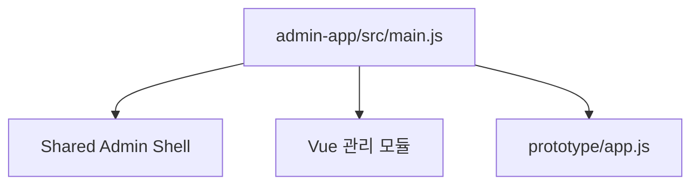
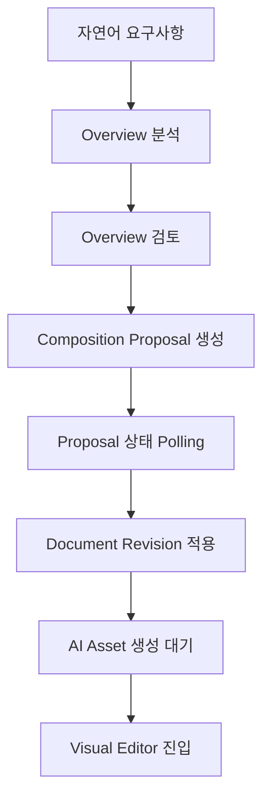
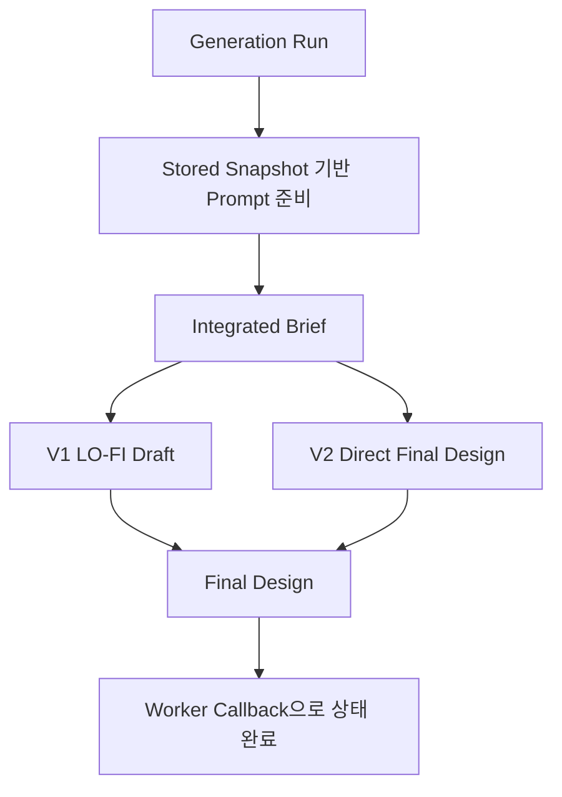
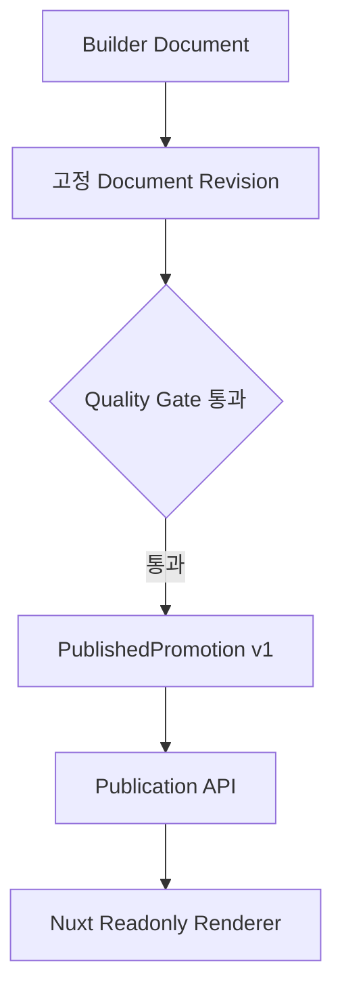
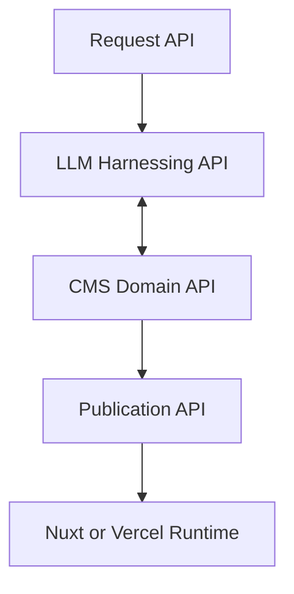

# Promo Web Builder 소스 코드 분석 보고서

```yaml
status: Review
baseline_date: 2026-11-03
source_commit: 5fe5731
source_branch: main
runtime: Node.js 22.x
frameworks:
  - Vue 3
  - Vite
  - Nuxt 4
  - Vercel Functions
  - PostgreSQL and Neon
```

## 1. 분석 요약

Promo Web Builder는 단순한 페이지 생성 Prototype을 넘어 다음 기능을 하나의 저장소에 포함한 통합 플랫폼으로 발전했다.

- 자연어 프로모션 요구사항 분석
- 템플릿과 Component Registry 기반 페이지 구성
- Design Token 및 Layout Preset 관리
- AI 이미지와 최종 디자인 생성
- Visual Editor 편집과 Revision 관리
- 품질 검증과 Browser Quality Gate
- 승인된 Revision 발행
- Nuxt SSR 기반 공개 프로모션 Runtime
- Directus 연동 및 단계적 Cutover 준비

코드는 기능적으로 풍부하고 계약 및 테스트 보호 수준이 높다. 반면 Prototype, Admin, Builder, Visual Editor, AI Pipeline, Publication Runtime이 같은 저장소에 누적되면서 API 표면과 실행 경로가 복잡해졌다.

가장 중요한 개선 방향은 기능 재작성보다 서비스 경계를 정리하는 것이다. 기존 Builder Document, Composition, Publication, Renderer 계약을 유지하면서 Request API, LLM Harnessing API, CMS Domain API, Publication API로 외부 호출 경계를 단순화하는 접근이 적절하다.

## 2. 저장소 규모

### 2.1 주요 파일 수

| 구분 | 수량 |
|---|---:|
| API 및 API Helper | 222개 |
| HTTP Method Handler | 141개 |
| DB Migration | 75개 |
| 테스트 파일 | 186개 |
| Vue 컴포넌트 | 54개 |

### 2.2 주요 소스 코드 규모

생성물과 `node_modules`, Nuxt Build Output은 제외했다.

| 경로 | 대략적인 코드 줄 수 | 역할 |
|---|---:|---|
| `api/` | 34,516 | API Handler, Store, Contract, Policy, Worker 연동 |
| `visual-editor/src/` | 12,739 | AI Builder, Visual Editor, Renderer |
| `admin-app/src/` | 4,284 | 운영 Admin Vue Module |
| `apps/promo-runtime-nuxt/` | 263 | 공개 및 Preview Nuxt Runtime |
| `db/migrations/` | 8,106 | 데이터 모델과 Runtime 기능 진화 |
| `scripts/` | 23,717 | 테스트, Migration, QA, 동기화, 생성 도구 |
| `packages/` | 302 | 공용 Publication, Renderer, Directus Migration 계약 |

### 2.3 API 파일 분포

파일 이름 패턴은 중복될 수 있으므로 전체 합계가 아니라 영역별 복잡도 지표로 해석해야 한다.

| API 영역 | 관련 파일 수 |
|---|---:|
| Wizard | 30 |
| Promotion Section | 22 |
| Prompt | 18 |
| Promotion Page | 17 |
| Design Token | 16 |
| Component | 15 |
| Promotion Generation | 14 |
| Promotion Builder | 12 |
| Locale | 11 |
| Item Component | 9 |
| Publication | 6 |
| Directus | 6 |

## 3. 상위 디렉터리 구조

```text
promo_web_builder/
├── admin-app/                  운영 Admin Vue 모듈
├── api/                        Vercel 스타일 API Handler와 Domain Helper
├── apps/promo-runtime-nuxt/    공개 프로모션 Nuxt SSR Runtime
├── contracts/                  JSON Schema 계약
├── db/migrations/              PostgreSQL Schema Migration
├── db/seeds/                   Design, Locale, Component Seed
├── directus/schema/            Directus Reference Schema Manifest
├── n8n/                        AI Generation Worker Workflow
├── packages/
│   ├── promo-contracts/        Publication과 Renderer 공용 계약
│   └── directus-migration/     Migration·Reconciliation·Rollback 도구
├── prototype/                  Legacy 및 Prototype UI
├── prompts/                    Prompt 원본
├── scripts/                    테스트·QA·Migration·동기화 도구
└── visual-editor/              AI Builder, Editor, Runtime Renderer
```

## 4. 애플리케이션 실행 구조

### 4.1 Admin

진입점은 `admin-app/src/main.js`다. Vue 기반 관리 기능을 전역 객체로 등록한 후 `prototype/app.js`를 불러온다.



등록되는 주요 Admin 기능:

- Template Layout Manager
- Design Token Manager
- Prompt Group과 Prompt Variable Manager
- LLM Model Registry
- Section Layout Preset Manager
- Component Generation Workspace
- RenderSpec Editor
- Directus Integration Settings

현재 Admin은 Vue Module과 Legacy Prototype이 함께 동작하는 Hybrid 구조다. 신규 기능을 어느 계층에 구현할지 명확히 정하지 않으면 동일 기능이 두 경로에 생길 수 있다.

### 4.2 AI Builder

`visual-editor/src/builder/AiBuilderApp.vue`가 자연어 기반 생성 흐름의 사용자 경험을 조율한다.



주요 특성:

- AI, Template, Wireframe Mode 분기
- Overview Fingerprint 검증
- Composition v3 Feature Flag 지원
- Proposal Polling과 Timeout
- Asset Readiness Polling과 실패 재시도
- Visual Editor URL Contract 사용
- 사용자 이벤트와 실행 표시 기록

### 4.3 Visual Editor

Visual Editor는 여러 Host Context를 같은 Editor Core로 연결한다.

- Section Preset 편집
- Admin Template Layout 편집
- AI Builder Document 편집
- Output 확인

`visual-editor-entry.mjs`가 Mode별 URL을 표준화하며, Adapter 계층이 Admin, Builder, Output의 데이터 차이를 흡수한다.

### 4.4 Nuxt Runtime

Nuxt Runtime은 편집 기능 없이 승인된 Snapshot을 Readonly Renderer로 출력한다.

| 경로 | 기능 |
|---|---|
| `/promotions/:slug` | 공개 프로모션 SSR 출력 |
| `/preview/promotions/:slug` | 서명 Token 기반 Preview |
| `/api/promotions/:slug` | Publication API Proxy와 Contract 검증 |
| `/api/preview-promotions/:slug` | Preview API Proxy |
| `/api/revalidate-promotion` | Runtime Cache 무효화 |

공개 경로는 SWR 300초를 사용하고 Preview는 `private, no-store`, `noindex`, `nofollow`를 적용한다.

## 5. 핵심 Domain 분석

### 5.1 Builder Document

Builder Document는 페이지 편집 상태의 중심 Aggregate다.

주요 데이터:

- Document ID와 Document Key
- 현재 Revision
- Revision별 Snapshot
- Snapshot Hash
- Contract Version
- Quality Gate
- Design Token Version
- Section과 Item 구조

주요 보호 장치:

- Idempotency Key 기반 생성
- Base Revision 충돌 검사
- Section Key와 Item Key 유일성 검증
- Section 100개, Section당 Item 200개 등 구조 제한
- 활성 Design Token Version 검증
- Contract v3 Semantic Token Role 검증

### 5.2 Composition Engine

Composition Engine은 사용자 Overview를 Component, Layout, Token으로 구성된 페이지 Snapshot으로 변환한다.

Contract v3의 핵심:

- Registry Candidate Resolver
- Composition Shell
- Required Section Policy
- Component Placement Policy
- Content Resource Fingerprint
- Policy Fingerprint
- Deterministic Operation
- Proposal Apply와 Rollback

Proposal은 DB Lease로 단일 Worker 처리를 보장하며 실패 시 지수 Backoff를 적용한다.

### 5.3 AI Generation Pipeline

이미지 중심 생성 Pipeline은 Browser와 n8n Worker 사이의 Durable Run을 사용한다.



V2는 기본 경로에서 LO-FI Artifact를 제거하지만 V1 Prompt와 Worker는 Rollback을 위해 유지된다.

### 5.4 Text First Page Generation

`generate-promo-page.js` 계열은 HTML과 CSS로 된 완성 웹 페이지 Artifact를 생성한다.

다음 검증을 수행한다.

- 응답 Top-level Field 검증
- Design Intent와 Layout Summary 검증
- Required Copy 포함 여부
- Link와 CTA 정책
- Safe HTML
- Responsive CSS
- Quality Check 목록
- Prompt Metadata와 Hash
- Artifact Size와 TTL
- HMAC View Token

이 기능은 Builder Snapshot을 Readonly Renderer로 출력하는 Publication 경로와 별도다. 두 경로 중 무엇을 최종 제품 출력으로 사용할지 명확한 Product Decision이 필요하다.

### 5.5 Publication

Publication은 편집 가능한 Document를 공개 가능한 고정 Snapshot으로 전환한다.



PublishedPromotion 계약은 다음을 포함한다.

- Publication Metadata
- SEO
- Renderer Key와 Version
- Snapshot
- Asset Manifest
- Cache ETag와 Revalidate Seconds

Snapshot Contract v2와 v3만 지원하며 Renderer Version도 명시적으로 검사한다.

### 5.6 Directus

Directus는 아직 Runtime Source가 아니다. 현재 PostgreSQL 내부 Store가 Source of Truth다.

구현된 기능:

- Integration Config Lifecycle
- HTTPS와 Host Allowlist
- Secret Reference Validation
- Connection Health와 Authentication Check
- Schema Manifest
- Migration Plan과 Inventory
- Reconciliation과 Rollback Plan
- Shadow Read Diff
- Cutover Readiness Gate
- Internal Fallback Source Router

지원 Domain:

- Components
- Design Tokens

기본 Feature Flag에서 Integration, Migration, Shadow Read, Runtime Read, Runtime Write가 모두 비활성화되어 있다.

## 6. 데이터베이스 분석

### 6.1 연결 방식

`api/_db.js`는 다음 우선순위로 Database URL을 선택한다.

1. Vercel Preview 환경의 `PREVIEW_DATABASE_URL`
2. `NEON_DATABASE_URL`
3. `DATABASE_URL`
4. `POSTGRES_URL`
5. `POSTGRES_URL_NON_POOLING`
6. 개별 PostgreSQL 환경 변수 조합

Neon Serverless Client를 사용하며 Hosted 환경에서는 SSL을 전제로 한다.

### 6.2 Migration 진화

Migration은 다음 단계로 기능이 확장된 흔적을 보여준다.

| 범위 | 주요 변화 |
|---|---|
| 002-009 | Design Concept, Style Classification, 이미지와 MD 데이터화 |
| 010-015 | Prompt Template, Generation Run, Worker 설정 |
| 016-024 | Wizard Section, Form Template, Layout, Audit Log |
| 025-033 | Section AI, Component Registry, Prompt Lifecycle |
| 034-043 | Design Token 관리, Full Theme, Template Recommendation |
| 044-053 | AI Builder Composition, Registry v3, Content Resource, Operation Contract |
| 054-065 | Registry 안정화, Prompt Governance, Typography, Section Library |
| 066-068 | Component RenderSpec와 Visual Analyzer |
| 069 | Publication Runtime |
| 070-071 | Directus Connection과 Migration Control Plane |
| 072-075 | Generation Pipeline v2, LLM Registry, Web Output Quality |
| 076 | Text-first Page Generation Artifact |

### 6.3 데이터 소유권 문제

현재 하나의 PostgreSQL 안에 다음 데이터가 함께 존재한다.

- Builder 편집 상태
- AI Generation Run
- Prompt와 Model 설정
- CMS 성격의 Component와 Token
- Publication
- Directus Integration Control Plane
- Generated Page Artifact

물리 DB를 바로 분리할 필요는 없지만 Schema와 Service Owner를 명시해야 한다.

권장 논리 구분:

```text
app_request       사용자 Request와 Feedback
llm_runtime       Job, Attempt, Snapshot, Log, Quality Result
cms_content       Component, Token, Content, Asset Metadata
promo_builder     Document, Revision, Composition Proposal
publication       Published Snapshot과 상태
integration       Directus Config, Migration, Diff, Cutover Evidence
```

## 7. API 구조 분석

### 7.1 현재 특성

- File-based Vercel Handler 방식이다.
- Endpoint Handler와 Domain Helper가 같은 `api/` 디렉터리에 있다.
- Domain별 Store는 존재하지만 공통 Service Facade는 제한적이다.
- Admin과 Builder가 다수의 세부 API를 직접 조합한다.
- 동일 사용자 행위가 여러 Endpoint 호출로 분산된다.

### 7.2 대표 현재 API

| 영역 | 대표 API |
|---|---|
| Builder | `promo-builder-session`, `promo-builder-documents`, `promo-builder-events` |
| Overview | `promo-overview-parse` |
| Composition | `promo-page-composition-proposals`, `process`, `apply`, `rollback`, `operations` |
| Generation | `promo-generation-runs`, `prepare`, Integrated Brief, LO-FI, Final Design |
| CMS | `item-components`, `design-token-sets`, `promo-content-resources`, Wizard Template APIs |
| Prompt | `prompt-templates`, `prompt-variables`, `prompts-render` |
| Publication | `promo-publications`, `promo-publication`, Preview Token과 Preview API |
| Directus | Integration Config, Connection Test, Cutover Readiness |

### 7.3 권장 Facade

외부 호출 경계는 다음 네 개로 단순화하는 것이 좋다.



Facade는 기존 세부 API를 즉시 제거하는 것이 아니라, 외부 소비자가 호출할 안정된 계약을 제공해야 한다.

## 8. 보안과 품질 검토

### 8.1 확인된 강점

- Admin과 Builder 인증 경계 테스트
- Preview HMAC Token과 Timing-safe 비교
- Remote Host Allowlist
- Hosted 환경 HTTPS 강제
- Secret Reference만 DB에 저장
- Prompt Hash와 Input Hash
- Publication ETag
- HTML/CSS Artifact Size 제한
- Quality Gate와 Browser Attestation
- Feature Flag 기반 위험 기능 차단

### 8.2 개선 항목

| 우선순위 | 항목 | 설명 |
|---|---|---|
| P1 | Service-to-Service 인증 표준화 | 내부 API별 인증 방식과 Credential Scope를 통합해야 한다. |
| P1 | API Schema 자동 검증 | 주요 Request와 Response에 공통 Schema Validator를 적용해야 한다. |
| P1 | Slug 단위 Cache 무효화 | 현재 Nuxt Revalidation은 Promotion Route Cache를 넓게 삭제한다. |
| P1 | Audit Correlation ID | Request, Job, Draft, Publication을 하나의 Trace ID로 연결해야 한다. |
| P2 | Rate Limit | 공개 Preview와 Generation Endpoint에 정책을 명시해야 한다. |
| P2 | Dependency Boundary | Prototype Global과 Vue Module 사이의 의존성을 줄여야 한다. |

## 9. 테스트 분석

전체 186개 테스트 파일이 통과했다.

주요 테스트 범위:

- Admin Browser Integration
- AI Builder Browser Flow
- Component와 RenderSpec
- Composition Contract v2와 v3
- Directus Connection, Migration, Reconciliation, Cutover
- Editor Command, History, Snapshot, Adapter
- Prompt Lifecycle과 Governance
- Section AI와 Image Policy
- Publication, Preview Token, Cache
- Nuxt SSR Readonly Renderer
- Security Boundary
- Web Output Quality Gate

실행 중 확인된 경고:

- 저장소 Engine은 Node.js 22지만 검증 Runtime은 Node.js 24.22.1이었다.
- Root `package.json`에 `type`이 없어 일부 ESM 파일이 재해석된다.

권장 조치:

1. CI에서 Node.js 22로 전체 테스트와 Build를 재검증한다.
2. Package Boundary별 `type: module` 적용 여부를 검토한다.
3. Browser Test가 사용하는 Port와 Fixture Server를 CI 환경에서 명시적으로 허용한다.

## 10. 주요 기술 부채

### 10.1 API 표면 과다

222개 API 파일과 다수의 세부 Handler는 기능 확장에는 유리했지만 소비자 관점의 안정된 경계를 약화시킨다.

### 10.2 Prototype 공존

Admin과 일부 화면이 Prototype Global에 의존한다. Vue 기반 구조로 전환 중이지만 완전히 분리되지 않았다.

### 10.3 생성 경로 중복

- Composition 기반 Builder Snapshot
- n8n Image Generation Pipeline
- Text-first HTML/CSS Generation
- Published Snapshot Runtime

이 경로는 목적이 다르지만 Product UI에서 경계가 불명확해질 수 있다.

### 10.4 배포 경계 미확정

Root Vercel API Project와 Nuxt Runtime Project의 관계가 소스 수준에서 완전히 고정되어 있지 않다.

### 10.5 CMS 전환 중간 상태

현재 Admin과 PostgreSQL이 CMS 역할을 수행하면서 Directus 전환 기반도 함께 존재한다. 전환 Domain과 Cutover 일정이 확정되지 않으면 이중 관리 비용이 증가한다.

## 11. 개선 우선순위

### P0 경계와 계약 확정

- Request, Job, Generation Context, Draft, Approval, Publication 계약 정의
- 현재 API와 목표 Facade Mapping 확정
- Trace ID와 상태 모델 통합

### P1 서비스 Facade 도입

- Request API
- LLM Harnessing API
- CMS Domain API
- Publication API

### P1 Runtime 안정화

- Vercel Nuxt Runtime Project 경계 확정
- Slug와 Locale 단위 Revalidation
- Publication Failure와 Rollback 정책

### P1 Directus Adapter 구현

- Components Internal Adapter와 Directus Adapter
- Design Tokens Internal Adapter와 Directus Adapter
- Shadow Read Evidence와 Diff Dashboard

### P2 Admin 현대화

- Prototype App 의존 축소
- Vue Route와 Module Boundary 명확화
- Legacy Global API 제거 계획

### P2 데이터 소유권 정리

- PostgreSQL Schema Owner 정의
- LLM Runtime과 CMS Content 분리
- Object Storage Asset Lifecycle과 Retention 정책

## 12. 후속 개발자가 먼저 읽을 파일

| 순서 | 파일 | 이유 |
|---:|---|---|
| 1 | `README.md` | 프로젝트 목적과 원칙 |
| 2 | `package.json` | Build와 Test Entry |
| 3 | `visual-editor/src/builder/AiBuilderApp.vue` | 사용자 생성 흐름 |
| 4 | `api/_promo-builder-document-store.js` | 핵심 Document와 Revision |
| 5 | `api/_promo-page-composition-service.js` | Composition 실행 |
| 6 | `api/_promo-generation-run-store.js` | 이미지 생성 Run |
| 7 | `packages/promo-contracts/src/publication.mjs` | 공개 계약 |
| 8 | `api/_promo-publication-store.js` | Publication Persistence |
| 9 | `apps/promo-runtime-nuxt/nuxt.config.ts` | 공개 Runtime 설정 |
| 10 | `api/_directus-domain-source-router.js` | Directus 전환 정책 |
| 11 | `api/_promo-builder-flags.js` | Rollout과 Rollback Switch |
| 12 | `scripts/run-tests.js` | 전체 검증 범위 |

## 13. 후속 LLM 작업 지침

다른 LLM은 다음 사항을 전제로 분석과 구현을 진행해야 한다.

```text
1. 현재 PostgreSQL이 Source of Truth다.
2. Directus Runtime Read와 Write는 기본 비활성 상태다.
3. Builder Document Revision과 PublishedPromotion 계약을 우회하지 않는다.
4. 목표 Facade API가 이미 구현되어 있다고 가정하지 않는다.
5. LLM Worker에서 CMS Table을 직접 조회하는 신규 경로를 만들지 않는다.
6. 신규 서비스는 CMS Domain API와 Publication API 경계를 사용한다.
7. Composition, Generation, Publication은 서로 다른 현재 실행 경로다.
8. 변경 후 Node.js 22 환경에서 관련 테스트와 전체 테스트를 실행한다.
```

## 14. 관련 문서

- [서비스 흐름 소스 검토 및 LLM 인수인계](promo-web-builder-service-flow-source-review-and-llm-handoff-2026-11-03.md)
- [서비스 도메인 아키텍처](promo-web-builder-domain-architecture-2026-11-01.md)
- [Directus 기본 구성도](../directus-migration-handoff-2026-09-22/12-basic-system-architecture.md)
- [프로젝트 README](../../README.md)
- [PublishedPromotion 계약](../../packages/promo-contracts/src/publication.mjs)
- [Nuxt Runtime](../../apps/promo-runtime-nuxt/nuxt.config.ts)
- [Vercel 설정](../../vercel.json)

