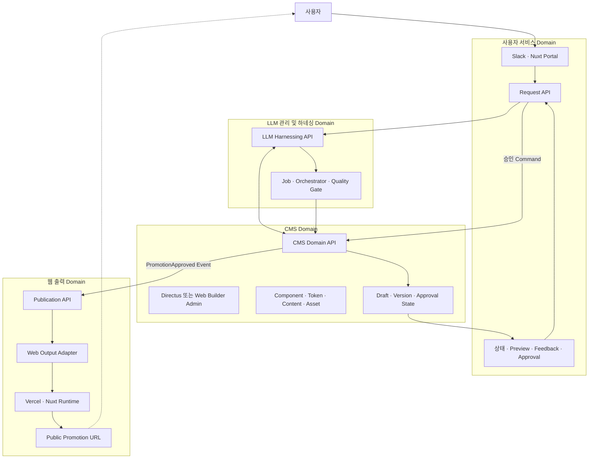
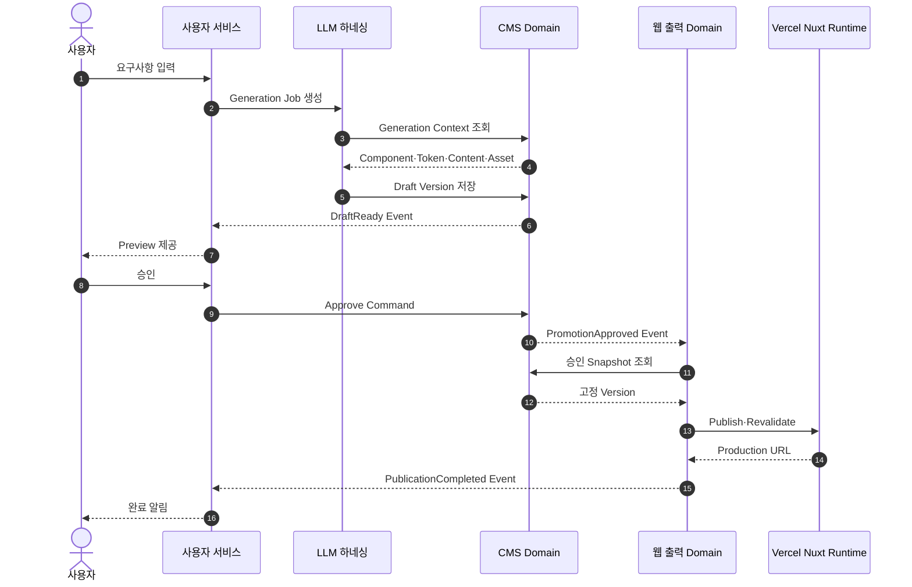

# Promo Web Builder 사용자 서비스 CMS 웹 출력 도메인 분리 검토

## 1. 검토 결론

사용자 서비스, CMS, 웹 출력을 별도 도메인으로 구분하는 방안은 적합하다. 세 영역은 변경 이유, 사용자, 데이터 수명주기, 보안 경계와 배포 요구가 다르기 때문이다.

다만 현재 저장소를 즉시 세 개의 독립 Microservice와 세 개의 물리 DB로 나누는 방식은 권장하지 않는다. 우선 하나의 저장소와 PostgreSQL을 유지하면서 코드, API, Schema와 데이터 소유권을 논리적으로 분리한 뒤 운영 필요가 확인된 도메인부터 배포 단위를 분리하는 접근이 안전하다.

권장 단계는 다음과 같다.

```text
1단계  논리 Domain 분리
→ 2단계  API와 Schema Owner 분리
→ 3단계  User Service와 Web Output 배포 분리
→ 4단계  필요 시 DB 물리 분리
```

## 2. 도메인 구성



## 3. 사용자 서비스 Domain

### 3.1 책임

- Slack, Nuxt Portal과 향후 사내 시스템 채널
- 사용자 인증과 권한
- 프로모션 요청 접수
- Raw Request Brief 관리
- 요청 상태 조회
- Draft Preview 연결
- 사용자 Feedback, 승인과 반려 입력
- 완료 알림과 결과 URL 제공

### 3.2 소유 데이터

```text
promo_requests
promo_request_channels
promo_request_feedback
promo_request_reviews
promo_request_notifications
```

사용자 서비스는 다음 데이터를 소유하지 않는다.

- Prompt와 Model 설정
- Component와 Design Token 원본
- Promotion Draft Snapshot 원본
- Published Runtime Snapshot
- 이미지 Binary

### 3.3 공개 API

| Method | API | 기능 |
|---|---|---|
| POST | `/v1/promo-requests` | 요청 생성 |
| GET | `/v1/promo-requests/{id}` | 사용자 중심 상태 조회 |
| GET | `/v1/promo-requests/{id}/preview` | Preview Link 조회 |
| POST | `/v1/promo-requests/{id}/feedback` | 수정 의견 저장 |
| POST | `/v1/promo-requests/{id}/review` | 승인 또는 반려 |
| POST | `/v1/promo-requests/{id}/cancel` | 요청 취소 |

### 3.4 도메인 경계

사용자 서비스는 LLM과 CMS 내부 상태를 그대로 노출하지 않는다. `proposal.processing`, `worker.trigger_failed`와 같은 내부 상태는 사용자 상태로 정규화한다.

```text
processing, worker_running → generating
proposal_ready, draft_ready → review_required
trigger_failed, quality_failed → failed
```

## 4. CMS Domain

### 4.1 책임

- Component Registry와 Component Version
- Design Token Definition, Set, Version
- Content Resource와 Locale Content
- Image Asset Metadata와 File Reference
- Promotion Draft와 Version
- Review 대상 Version 고정
- 승인 상태와 Workflow
- Directus 또는 Web Builder Admin 운영 화면

### 4.2 소유 데이터

```text
components
component_versions
design_token_sets
design_token_versions
content_resources
content_resource_versions
image_assets
promotions
promotion_versions
promotion_approvals
```

이미지 Binary는 Object Storage가 소유하고 CMS에는 Metadata와 Reference를 저장한다.

### 4.3 내부 API

| Method | API | 기능 |
|---|---|---|
| GET | `/internal/v1/generation-context` | 생성 기준 통합 조회 |
| GET | `/internal/v1/components` | Component Registry 조회 |
| GET | `/internal/v1/design-tokens` | 활성 Token 조회 |
| GET | `/internal/v1/content-resources` | Content 조회 |
| GET | `/internal/v1/assets/{id}` | Asset Metadata 조회 |
| POST | `/internal/v1/promotions/drafts` | Draft Version 저장 |
| GET | `/internal/v1/promotions/{id}/versions` | Version 조회 |
| POST | `/internal/v1/promotions/{id}/approve` | Version 승인 |
| POST | `/internal/v1/promotions/{id}/reject` | Version 반려 |

### 4.4 Directus와 Web Builder Admin 관계

`CMS Domain API`가 구현 제품을 추상화한다.

```text
CMS Domain API
├── Internal CMS Adapter
│   └── 현재 PostgreSQL Store
└── Directus CMS Adapter
    └── Directus REST 또는 GraphQL
```

LLM 하네싱과 사용자 서비스는 Directus를 직접 호출하지 않는다.

### 4.5 승인 데이터의 위치

사용자의 승인 행위는 사용자 서비스에서 발생하지만 승인된 Promotion Version의 상태는 CMS가 소유한다.

권장 흐름:

```text
사용자 승인 입력
→ Request API가 승인자와 권한 검증
→ CMS Approve Command
→ CMS가 Revision과 Quality Gate 검증
→ PromotionApproval 저장
→ PromotionApproved Event 발행
```

## 5. 웹 출력 Domain

### 5.1 책임

- 승인된 Promotion Version 수신
- PublishedPromotion Snapshot 생성
- Slug와 Locale 공개 상태 관리
- Preview Token
- ETag와 Cache Policy
- Vercel/Nuxt Runtime 전달
- Cache Revalidation
- Production URL 생성
- Publish, Unpublish, Rollback 상태 관리

### 5.2 소유 데이터

```text
publications
publication_snapshots
publication_deployments
publication_outbox
publication_cache_events
```

웹 출력 Domain은 CMS Draft를 직접 수정하지 않는다. 승인된 Version을 불변 Snapshot으로 복사하거나 참조한다.

### 5.3 API

| Method | API | 기능 |
|---|---|---|
| POST | `/internal/v1/publications` | 승인 Version 발행 |
| GET | `/internal/v1/publications/{id}` | 발행 상태 조회 |
| POST | `/internal/v1/publications/{id}/revalidate` | Cache 갱신 |
| POST | `/internal/v1/publications/{id}/unpublish` | 게시 중지 |
| GET | `/v1/promotions/{slug}` | 공개 Snapshot 조회 |
| GET | `/v1/preview/promotions/{slug}` | Preview Snapshot 조회 |

### 5.4 Vercel 역할

Vercel은 CMS가 아니라 웹 출력 Hosting과 Runtime 계층이다.

```text
Publication API
→ Web Output Adapter
→ Vercel에 배포된 Nuxt Runtime Cache 갱신
→ PublishedPromotion 조회
→ Production URL 제공
```

일반적인 Promotion Publish는 Nuxt Application 전체를 재배포하지 않는다.

## 6. LLM 관리 및 하네싱 Domain

사용자가 요청한 세 도메인을 연결하는 실행 Domain으로 유지한다.

### 6.1 책임

- Brief 분석과 구조화
- Prompt, Model, Policy Snapshot
- Generation Job과 Retry
- CMS Generation Context 조회
- 프로모션 콘텐츠와 구조 생성
- Quality Gate
- 생성 결과를 CMS Draft로 저장

### 6.2 데이터 소유권

```text
generation_jobs
generation_attempts
execution_snapshots
quality_results
usage_logs
```

LLM Domain은 CMS Content 원본과 Published Snapshot을 소유하지 않는다.

## 7. 도메인 간 통신

### 7.1 동기 API

즉시 결과가 필요한 Command와 Query에 사용한다.

| 호출 | 방식 | 이유 |
|---|---|---|
| 사용자 서비스 → LLM | 생성 Job Command | Job ID 즉시 반환 |
| LLM → CMS | Generation Context Query | 생성 입력 필요 |
| LLM → CMS | Draft Save Command | Version 저장 결과 필요 |
| 사용자 서비스 → CMS | Approve/Reject Command | 권한과 Version 검증 결과 필요 |
| 웹 출력 → CMS | 승인 Snapshot Query | 발행 Snapshot 구성 |

### 7.2 비동기 Event

장시간 처리와 도메인 간 결합을 줄이는 데 사용한다.

```text
PromoRequestCreated
GenerationStarted
GenerationProgressed
DraftReady
PromotionApproved
PromotionRejected
PublicationRequested
PublicationCompleted
PublicationFailed
```

이벤트는 Transaction Outbox를 사용해 DB Commit과 발행의 불일치를 방지한다.

### 7.3 서비스 흐름



## 8. DB 분리 방안

### 8.1 선택지 비교

| 방안 | 코드 | 배포 | DB | 장점 | 단점 |
|---|---|---|---|---|---|
| A. 논리 분리 | Monorepo | 단일 배포 가능 | 단일 DB, Schema 분리 | 가장 안전한 시작 | 장애 격리가 제한적 |
| B. 서비스 분리 | Monorepo | 도메인별 배포 | 단일 PostgreSQL, Schema 분리 | 독립 배포와 낮은 이전 비용 | DB 장애는 공유 |
| C. 완전 분리 | Repo 또는 Monorepo | 완전 독립 | Domain별 DB | 독립 확장과 장애 격리 | 분산 Transaction과 운영 비용 |

### 8.2 권장안

현재는 A에서 시작해 B로 전환하는 방식을 권장한다.

```text
Phase 1
한 저장소 + 한 PostgreSQL
도메인 Package + API + Schema Owner 분리

Phase 2
사용자 서비스와 Nuxt Runtime 별도 배포
CMS와 LLM은 기존 배포 유지 가능

Phase 3
운영 부하와 조직 Owner가 분리될 때 DB 물리 분리 검토
```

### 8.3 권장 Schema

```text
PostgreSQL
├── user_service
│   ├── promo_requests
│   ├── request_feedback
│   └── request_reviews
├── llm_runtime
│   ├── generation_jobs
│   ├── execution_snapshots
│   └── quality_results
├── cms
│   ├── components
│   ├── design_tokens
│   ├── content_resources
│   ├── promotions
│   └── promotion_versions
└── web_output
    ├── publications
    ├── publication_snapshots
    └── publication_outbox
```

기존 외래키와 Transaction을 보존하면서 Cross-schema Query를 단계적으로 API 호출로 교체한다.

## 9. 배포 분리 방안

### 9.1 권장 배포 단위

```text
Deployment A: User Service
- Nuxt Request Portal
- Request API
- Slack Adapter

Deployment B: Builder and LLM Control
- AI Builder
- Admin
- LLM Harnessing API
- Existing Workers

Deployment C: CMS
- CMS Domain API
- Directus 또는 Web Builder Admin

Deployment D: Web Output
- Publication API
- Nuxt Promo Runtime
- Vercel CDN and Cache
```

초기에는 B와 C를 같은 배포에 유지할 수 있다. 사용자 서비스와 웹 출력은 사용자와 보안 요구가 명확히 달라 우선 분리 효과가 크다.

## 10. 현재 코드 영향

### 10.1 사용자 서비스

신규 구현이 필요하다.

- Request Aggregate와 Persistence
- Builder Document, Proposal, Generation Run Mapping
- 사용자 상태 정규화
- Feedback와 Approval API

### 10.2 CMS

기존 Store와 Admin을 재사용할 수 있다.

- Item Component API
- Design Token API
- Content Resource API
- Builder Document Version
- Directus Source Router

신규 CMS Domain Facade가 기존 Store를 감싸야 한다.

### 10.3 웹 출력

기존 구현을 가장 많이 재사용할 수 있다.

- PublishedPromotion v1
- Publication Store
- Preview Token
- Cache Invalidation
- Nuxt SSR Runtime
- Readonly Renderer

추가할 부분은 Output Adapter, Publish 상태, Outbox와 Slug 단위 Revalidation이다.

## 11. 장점과 비용

### 11.1 장점

- 사용자 채널과 Builder 내부 구현 분리
- Directus와 Web Builder Admin 교체 가능
- 공개 Runtime의 장애와 보안 범위 축소
- LLM Pipeline 변경이 사용자 API에 미치는 영향 감소
- 데이터 Owner와 감사 책임 명확화
- 도메인별 독립 배포와 확장 가능

### 11.2 비용

- API와 Event Contract 추가
- 상태의 최종 일관성 처리
- Outbox와 Retry 운영
- Correlation ID와 관측성 필요
- 기존 Foreign Key와 Transaction 경계 재검토
- 테스트 환경과 Deployment 수 증가

## 12. 위험과 대응

| 위험 | 대응 |
|---|---|
| 서비스를 먼저 물리 분리해 개발 속도 저하 | 논리 Domain 분리부터 시작 |
| 동일 데이터 중복 소유 | Domain별 Source of Truth 표 작성 |
| 승인 Event 유실 | Transaction Outbox 적용 |
| CMS와 웹 출력 Snapshot 불일치 | 승인 Revision과 Content Hash 고정 |
| 사용자 상태와 Job 상태 불일치 | Request Projection과 Reconciliation Job |
| Directus 장애가 생성에 전파 | Internal Fallback과 Cache |
| Runtime이 CMS 장애에 의존 | Published Snapshot을 웹 출력 Domain에 보관 |

## 13. 권장 의사결정

1. 사용자 서비스, CMS, 웹 출력을 논리적으로 별도 Domain으로 승인한다.
2. LLM 관리 및 하네싱은 세 Domain을 연결하는 독립 Execution Domain으로 유지한다.
3. 첫 단계에서는 Monorepo와 단일 PostgreSQL을 유지한다.
4. 각 Domain의 API와 Schema Owner를 먼저 분리한다.
5. 사용자 서비스와 웹 출력부터 배포를 분리한다.
6. CMS는 Domain API 뒤에서 Internal Store와 Directus를 선택한다.
7. 웹 출력은 승인 Snapshot을 보관해 공개 요청 시 CMS 실시간 의존을 제거한다.
8. DB 물리 분리는 부하, 장애 격리 또는 조직 Owner가 분리될 때 진행한다.

## 14. 개발 계획 반영 항목

기존 API 서비스 경계 개발 계획에 다음을 추가해야 한다.

- PWB-00에서 Domain Owner와 Source of Truth 확정
- PWB-01에서 Domain Event Contract 추가
- PWB-02에서 사용자 서비스 Projection과 Notification 책임 추가
- PWB-04에서 CMS 승인 Workflow와 Domain Schema 추가
- PWB-06에서 웹 출력 Snapshot과 Publication Outbox 추가
- PWB-09에서 도메인 간 Correlation ID와 Event 관측성 추가
- 배포 계획에 User Service와 Web Output 우선 분리 추가

## 15. 관련 문서

- [API 서비스 경계 개편 개발 계획서](../계획/promo-web-builder-api-service-boundary-refactoring-development-plan-2026-11-03.md)
- [소스 코드 분석 보고서](promo-web-builder-source-code-analysis-2026-11-03.md)
- [서비스 흐름 소스 검토 및 LLM 인수인계](promo-web-builder-service-flow-source-review-and-llm-handoff-2026-11-03.md)
- [서비스 도메인 아키텍처](promo-web-builder-domain-architecture-2026-11-01.md)
